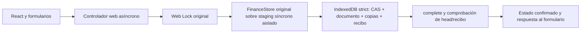

# 5H-WEB-001 — Durabilidad de escrituras web confirmadas

Corrección web independiente en [PR Draft33](https://github.com/dlopezteruel-rgb/Finanzas-pro/pull/33), rama `fix/5h-web-001-durable-confirmed-writes`. Base verificada: `ce1ec8398fed0eb6a39f0c362567b8a6613eaf81`, PR31 fusionada. Origin/main continúa en ese SHA. PR32 sigue abierta/Draft, sin modificar, en `ceb08c7fa3d05ea8c448855bf46fdec03e8af947`. Los diez worktrees actuales se conservan; no se utiliza5H como base.

El código de aplicación y las últimas mediciones locales corresponden a `6221e76da770418a3090663be707105672a8d89f`. La entrega añade documentación y evidencia sin modificar ese código financiero ni móvil. Este informe distingue las pasadas locales por SHA de la CI: **la aprobación del SHA exacto de entrega debe comprobarse en [los checks de PR33](https://github.com/dlopezteruel-rgb/Finanzas-pro/pull/33/checks)**, cuya ejecución y SHA se registran en la descripción de entrega. Un resultado parcial o cancelado no cuenta como aprobación.

## Problema y diagnóstico reproducible

La interfaz cerraba el formulario tras `localStorage.setItem`. El documento nuevo era visible, pero al terminar inmediatamente todos los procesos Chromium propios podía reaparecer el documento anterior íntegro. Es preexistente en main y5H; no procede de SQLCipher ni de un cálculo financiero incorrecto.

Antes de implementar se compila la base real y se copia **solo el arnés** `scripts/native/webCrashRecovery.ts` de PR32, sin almacenamiento móvil. SHA256 original `b03faa31180540b664250b816f60de31f154c737c81562d986166fbb77c8a224`. La [adaptación completa e instrumentación](web-001-evidence/reference-harness-complete-diff.json) conserva la igualdad de snapshot completo, sin espera artificial entre confirmación y SIGKILL. Se añaden backend explícito, tiempos, revisiones e identidades; la instrumentación de referencia está [archivada](web-001-evidence/reference-harness-instrumentation.patch.json).

| Escenario | Base real | Corrección,6221e76 |
| --- | --- | --- |
| Cierre normal después de confirmar | Aprobado | Aprobado |
| SIGKILL inmediato después de confirmar | **Fallido: reaparece el documento anterior** | **20/20 perfiles independientes aprobados** |
| SIGKILL antes del callback de escritura | Aprobado: documento anterior | Aprobado: documento anterior |
| Durante transacción financiera/restauración | No usado para atribuir la causa original | Estado anterior íntegro y copias previas preservadas |
| Después de commit, antes de respuesta | No usado para atribuir la causa original | Estado nuevo íntegro; un recibo, sin duplicación |
| Migración prepare/activate, durante/después | No aplicable a la base | Reanudación íntegra e idempotente |

[Base2/3](web-001-evidence/baseline-crash.json), [pasada completa00b4acf](web-001-evidence/checkpoint-00b4acf-web-durability.json), [20repeticiones6221e76 y controles](web-001-evidence/delivery-web-durability.json), [8controles de frontera](web-001-evidence/delivery-web-crash-controls.json). La base se reproduce también con la instrumentación y el mismo criterio del arnés adaptado; las evidencias históricas se conservan, sin ejecutarlas como un test esperado verde.

La detección real de confirmación precede a SIGKILL sin temporizador añadido. En las20repeticiones6221e76, detección→solicitud de kill: mediana4,80ms, rango3,69–8,66ms. Se comparan bytes/hash, revisión, carteras, IDs y relaciones completas; no basta encontrar el nombre. No hay reintentos que oculten fallos. Los grupos terminados y perfiles son exclusivamente los creados por la prueba, con datos ficticios y origen loopback.

## Investigación y decisión anterior a implementar

La [investigación aislada](web-001-evidence/engine-research.json) reproduce SIGKILL con tres perfiles por alternativa: localStorage0/3, IndexedDB strict3/3 y relaxed3/3. `persisted` y `persist()` resultan denegados en las nueve observaciones. Esa muestra no demuestra equivalencia entre relaxed y strict ni una ventaja estadística de strict: se elige por su contrato más fuerte y el comportamiento comprobado.

[Fuentes oficiales, URLs y hashes](web-001-evidence/research-sources.json): IndexedDB, HTML/Web Storage, Storage y compatibilidad MDN. La decisión y los datos se publican antes de implementar en60b1f47. No se atribuye sin una traza interna de Chromium a un syscall concreto: lo demostrado es que el retorno síncrono de localStorage no es una frontera suficiente de confirmación recuperable en el escenario reproducido.

| Alternativa | Evaluación |
| --- | --- |
| localStorage | Sin evento de commit duradero; releer no demuestra consolidación. Se descarta como fuente de nuevas confirmaciones financieras. |
| IndexedDB readwrite strict | Transacción atómica, complete/abort, revisión CAS y documento/copia/recibo conjuntos. Elegido, sin dependencia adicional. |
| IndexedDB default/relaxed | No aceptado silenciosamente aunque las tres muestras relaxed sobrevivan. |
| `navigator.storage.persist` | Reduce riesgo de expulsión por cuota; no confirma commits ni sustituye backup. No se solicita automáticamente. |
| OPFS/flush | Exige otro protocolo de atomicidad y workers. No se añade sin una necesidad demostrada. |
| Backend/nube | Fuera del alcance; no se incorpora. |

**Strict es una indicación de durabilidad al navegador**, no una garantía universal ante cortes eléctricos, hardware, sistema operativo, eliminación del origen o pérdida del perfil. El resultado probado es Chromium156.0.8078.79 en este Linux. No certifica Firefox, WebKit, Safari, móviles físicos ni otros fallos.

## Contratos anterior y nuevo

Antes: Web Lock → FinanceStore valida → setItem → cambia revisión/this.data → resuelve mutate → React → `{ok:true}` y cierre de formulario. La restauración creaba y releía una copia antes de otra escritura separada. La API no ofrecía una confirmación física adicional.

Ahora:



FinanceStore, backup, validadores, cálculos, parsers y redondeos permanecen intactos. El staging Map cumple `SyncFinanceStorage.setItem(): undefined`: no devuelve una Promise ni aparenta que la propuesta ya es duradera. Solo el controlador publica después de confirmación. `useFinanceData` y App adaptan explícitamente carga, guardado, copias y errores asíncronos. El prototipo móvil5G conserva su sesión desechable original.

DB `finanzas-pro-web-v1`, esquema de contenedor1, tablas `finance`, `metadata`, `operations`. La clave lógica sigue siendo `finanzas_pro_data_v1`, las copias `finanzas_pro_recovery_`. Se conserva el documento financiero completo y su revisión; no se normaliza el dominio ni se cambia JSON3.5 por cambiar de motor.

| Comportamiento | Antes | Después |
| --- | --- | --- |
| Confirmar guardado | Retorno de setItem | complete strict y comprobación de recibo |
| Documento y copia previa | Escrituras separadas | Una transacción con revisión y recibo |
| Respuesta incierta | Sin recibo transaccional | Reconciliación, bloqueo y recarga explícita |
| Navegador insuficiente | Dependencia de localStorage | Consulta/exportación segura; sin fallback de escritura |
| Datos antiguos | Fuente financiera localStorage | Archivo íntegro y activación controlada, sin borrar claves |
| Conflicto antiguo | Revisión localStorage | Web Lock, CAS y detección de divergencias entre fuentes |
| Recuperación forense | Claves locales | Ambas fuentes, con errores parciales identificados |

### Escritura, revisiones y respuesta incierta

1. Adquirir `finanzas-pro-data-write`, el Web Lock original, antes de validar la propuesta.
2. Verificar el origen antiguo y la revisión confirmada; preparar una propuesta aislada con el motor original.
3. Dentro de una transacción strict, comparar otra vez el snapshot/revisión esperado y escribir documento, head, copias requeridas y recibo atómicamente.
4. Esperar complete, comprobar head/recibo/hash y solo entonces publicar o cerrar el formulario. request.success no confirma.

UUID y fingerprint inmutables identifican cada petición. La respuesta perdida se reconcilia consultando el recibo; nunca se vuelve a ejecutar ciegamente la transformación. Una resolución sin recibo registra cancelación transaccional antes de permitir un nuevo intento explícito. Si no puede determinarse el resultado, se bloquean escrituras y se conserva el formulario. Un commit conocido adelantado por otro escritor exige recarga explícita, sin afirmar falsamente que no se guardó.

Los aborts/cuota conocidos no publican cambios ni copias parciales. Un error de lectura **después de complete de escritura** es incierto, no prueba de aborto: las regresiones reproducidas de ese límite están [antes](web-001-evidence/postcommit-response-before-fix.json) y [después](web-001-evidence/postcommit-response-fixed-engine.json). No hay timeout que simule el resultado de una transacción concedida. Los10s solo cancelan apertura/espera de Web Lock no adquirido. El orden lock→transacción evita adquisición inversa y interbloqueo.

## Migración, clientes antiguos y reversión

Se inventarían todos los bytes financieros `finanzas_pro_` —principal, revisión, claves de colecciones heredadas y copias— excluyendo únicamente metadatos reservados. Preferencias `finanzas.ui.*` permanecen independientes. Se validan datos con los parsers originales. Documento JSON2.5–3.5 válido, IDs, céntimos, nombres, relaciones y fotografías se conservan exactamente; las colecciones heredadas se consolidan mediante el lector original y se archivan además sus bytes fuente.

Bajo el mismo Web Lock: releer fuente → transacción strict de preparación/archivo/documento/copias → instalar señal de propiedad en DATA_KEY → transacción strict de activación → verificar. La fuente activa nueva solo se publica tras activación. No se llama removeItem/clear ni se eliminan claves/copias. El valor original de DATA_KEY queda preservado byte a byte en el archivo fuente; su sustitución documentada por una señal no financiera impide que el FinanceStore5G ya abierto escriba sobre la revisión antigua. El parser antiguo rechaza la señal, no la muestra como un documento financiero vigente.

Si hay interrupción, se reanuda la etapa preparada con el mismo UUID. Si reaparece exactamente la fuente archivada por perderse el cercado localStorage, la versión nueva puede reponer la señal bajo lock; nunca importa esa fuente sobre el último documento confirmado. Si difiere cualquier byte financiero, se preservan ambos lados y se bloquea, sin fusión ni selección automática. La preparación no constituye autoridad sobre un escritor antiguo: la consulta compara el hash inmutable archivado incluso si el cambio ocurrió antes de abrir la vista. Se etiqueta como copia previa (`WEB_LEGACY_VIEW`) y bloquea exportar una vista desactualizada detectada.

**Límite real:** no se puede enseñar retroactivamente IndexedDB a un binario anterior. Mientras existe la señal, los clientes5G probados rechazan las escrituras; si se pierde y se sirve código anterior antes de abrir la versión nueva, puede mostrar el snapshot viejo. No se garantiza downgrade transparente ni coexistencia universal. La versión nueva detecta divergencia y conserva su estado confirmado. Un rollback operativo requiere detener clientes, preservar/exportar ambas fuentes, revisar revisiones y restaurar explícitamente; nunca volver a servir un binario antiguo suponiendo que ve el último documento ni copiar automáticamente hacia localStorage.

Ambos almacenes y Web Locks comparten origen, no ruta. APP_BASE_PATH dentro del mismo origen conserva autoridad; las rutas existentes se prueban mediante su suite. No se migra automáticamente desde otro dominio, protocolo o puerto. Un origen inválido, apertura fallida o esquema desconocido no se borra ni recrea.

## Copias, restauración, exportación y recuperación

Las copias anteriores se archivan y permanecen accesibles. En consulta sin autoridad activa nueva se listan/descargan desde el origen antiguo legible; si solo está disponible una preparación, se conserva su copia archivada como recuperación. No se presenta un inventario vacío por haber creado una DB vacía. Las treinta combinaciones de idioma/ancho/tema descargan la copia antigua con igualdad exacta.

Importar conserva selección, validación, preview y confirmación explícita. La copia recuperable previa y la sustitución son parte de la misma transacción, con revisión CAS y verificación; cancelar o abortar conserva el documento anterior. No hay restauración automática ni eliminación de copias anteriores. Se exporta el documento confirmado completo, no las filas visibles.

La recuperación forense lee registros brutos de ambas fuentes, incluidos metadatos/recibos, sin upgrade ni reinicialización. Una conexión cerrada por versionchange puede leerse mediante una vía bruta independiente; los errores parciales se identifican. Permisos denegados no producen una descarga vacía ficticiamente correcta. Si localStorage está denegado pero hay un documento activo confirmado legible en IndexedDB, siguen disponibles consulta/exportación y recuperación parcial, con escrituras bloqueadas.

Los hashes detectan incoherencia e identifican bytes, no cifran ni autentican frente a código malicioso del origen. La web conserva su modelo de privacidad actual; no se añade backend, cuenta, nube, datos reales de prueba ni secretos.

## Concurrencia y pruebas financieras

Web Locks sigue siendo coordinación de origen, complementada por CAS **dentro de IndexedDB**. BroadcastChannel, storage y foco notifican, nunca sustituyen la exclusión. Dos pestañas reales demuestran un solo escritor confirmado y rechazo de revisión obsoleta. Dos conexiones que evitan deliberadamente el controlador prueban CAS del driver. Se comprueban foco, origen antiguo divergente, migración concurrente, operaciones vinculadas y restauración con copia atómica.

La propuesta reutiliza el mismo FinanceStore: se comparan documentos normalizados y referencias con la implementación web original. Once casos cubren JSON2.5,2.6,2.7,2.8,2.9,3.0,3.1,3.2,3.3,3.4 y3.5, conservando bytes/revisión sin migraciones económicas. Los [44archivos protegidos](web-001-evidence/protected-financial-source.json) se comparan directamente con main; proyectos nativos, configuraciones nativas y package-lock sin cambios. No se modifican redondeos, orden de sumas, IDs, transferencias, reintegros, préstamos, aprobaciones, fotografías, catálogo ni asistentes/API.

## Validación local, UI y accesibilidad

| Pasada | Fuente | Resultado real |
| --- | --- | --- |
| Instalación base/final con lockfile sin cambios | ce1ec839 / checkpoint previo00b4acf | npm ci correcto; una deprecación node-domexception; sin actualización de dependencias |
| Unitarias originales | ce1ec839 | 654/654 |
| Unitarias tras endurecimiento | 6221e76 | **684/684**, cero fallos/omisiones/cancelaciones |
| Infraestructura | 6221e76 | **44/44**, incluidos los22originales |
| Batería local completa congelada | 00b4acf | **955/955 en45suites**, incluidos885originales; no se atribuye al SHA final |
| Puerta reforzada después de corregir consulta | 6221e76 | **72/72**:34motor+36UI+2puertas reales |
| SIGKILL del casoP0 | 6221e76 | **20/20**, más2controles;20perfiles distintos |
| Fronteras prepare/activate/escritura/restore | 6221e76 | **8/8** cierres reales en señales request.success/complete |
| Lint/build/diff/bundles y mediciones finales | 6221e76 | Aprobados, sin avisos de build/lint |
| Batería de entrega | SHA exacto de PR33 | CI debe completar **957/957 en45suites**, incluidos885originales y72de la puerta, antes de recomendar integrar |

[Órdenes/estados/times locales](web-001-evidence/delivery-local-commands.json), [batería955](web-001-evidence/checkpoint-00b4acf-summary.json), [puerta72](web-001-evidence/delivery-gate-summary.json), [motor](web-001-evidence/delivery-web-storage-engine.json), [UI](web-001-evidence/delivery-web-storage-ui.json). No se suman pasadas parciales para fingir una batería final. Los avisos de actualización de npm son informativos, no pruebas adicionales.

Los fallos intermedios también se conservan: fixture de firma Web Locks, evidencia patch con espacios, corrupción dirigida al motor antiguo y predicados async Playwright resueltos prematuramente. Se adaptan lecturas/fallos a transacciones reales sin caché de snapshots ni rebajar aserciones/timeouts. El helper espera el booleano real dentro del límite existente; una regla CI detecta callbacks async inseguros incluso multilínea. La CIc151597 queda [registrada como fallida](web-001-evidence/ci-c151597-failure.json), no aprobación. Las dos regresiones nuevas de consulta tienen prueba [antes](web-001-evidence/readonly-copy-before-fix.json) y [antes de detectar origen divergente](web-001-evidence/readonly-prepared-source-before-fix.json), y casos correctos en la puerta final.

UI real con cinco idiomas,390/768/1280px y ambos temas: capacidad strict denegada, errores, formulario conservado, Tab/Shift+Tab/Escape/foco, exportación y copia íntegra; respuesta perdida/reconciliación/recarga en cinco idiomas. Las44suites originales conservan los recorridos financieros, landing, módulos, paginación, precarga y prototipo5G. No se modifican prompts, parser natural ni traducciones de datos del usuario.

Axe no cambia reglas. La pasada local completa registra **28informes,1611superficies, cero violaciones,944grupos incompletos en52conjuntos equivalentes y5552ocurrencias de nodos**: [agrupación con procedencia](web-001-evidence/checkpoint-00b4acf-axe-review.json). La nueva matriz aporta40superficies, cero violaciones y36grupos incompletos. Los **947grupos/53conjuntos de referencia5G** siguen pendientes contextuales; las diferencias entre pasadas no resuelven esos pendientes ni equivalen a pruebas manuales. No se usan lectores de pantalla ni dispositivos físicos.

Capturas reales del build endurecido, con datos ficticios: [390px](web-001-evidence/delivery-readonly-390.png), [768px](web-001-evidence/delivery-readonly-768.png), [1280px](web-001-evidence/delivery-readonly-1280.png). Documentan el estado de consulta segura, no un rediseño.

## Rendimiento y coste observado

Producción antesce1ec839 / después6221e76, Chromium156.0.8078.79, Node24.22.1, Linux. Móvil emulado390×900, CPU4×, red1,6Mbit/s y80ms; **tres muestras por escenario**, mismo host sin otra batería/perfilador local simultáneo. Cuota real del contenedor2vCPU y8GiB; los192procesadores que informa os.cpus pertenecen al host. No es teléfono físico, INP de campo ni una certificación de memoria. [Procedencia](web-001-evidence/delivery-measurement-provenance.json), [medianas/rangos](web-001-evidence/delivery-performance-summary.json); se conservan todas las muestras y mediciones anteriores.

| Métrica (ms) | Antes mediana [mín–máx] | Después mediana [mín–máx] |
| --- | --- | --- |
| Landing fría | 1569 [1532–1571] | 1665 [1549–1697] |
| Aplicación100 fría | 2750 [2737–2753] | 3031 [2838–3147] |
| Aplicación100 recarga caliente | 750 [743–788] | 931 [880–1218] |
| Carga inicial/migración1000 | 2773 [2741–2816] | 3123 [3070–3131] |
| Lectura confirmada1000, incluido puente de prueba | 22 [20–23] | 63 [61–65] |
| Guardar cuenta1000 | 347 [339–373] | 797 [626–905] |
| Guardar movimiento1000 | 421 [399–561] | 783 [742–793] |
| Transferencia1000 | 437 [333–476] | 743 [742–778] |
| Restauración verificada100 | 215 [205–234] | 400 [390–454] |
| Abrir1000 completos,50filas | 590 [586–735] | 603 [594–745] |
| Abrir5000 completos,50filas | 1142 [1041–1215] | 1020 [953–1227] |
| Filtrar5000 completos | 641 [491–668] | 689 [543–767] |
| Cambio de periodo | 217 [203–223] | 216 [214–222] |
| Cambio de idioma frío | 701 [652–806] | 711 [654–750] |

Hay un coste real observado: cuenta+451ms, movimiento+362ms, transferencia+306ms y restauración+185ms en estas medianas; aplicación fría+281ms y recarga caliente+181ms. No se presentan como rendimiento idéntico. Las diferencias pequeñas/rangos solapados de listados, filtros, periodo e idioma no demuestran una mejora estadística. La variación entre las pasadas anteriores se conserva, sin atribuir reducciones al endurecimiento de consulta que no cambia el camino de guardado normal.

Separación de etapas, medianasms:

| Guardado | Preparación/dispatch antes→después | Barrera API/commit antes→después | Posbarrera/UI antes→después |
| --- | --- | --- | --- |
| Cuenta |196→536|3→14|123→188|
| Movimiento |194→441|3→52|202→227|
| Transferencia |248→480|10→15|146→218|

La barrera antigua es retorno de API, **no commit duradero**. Las etapas incluyen transporte Playwright; sus medianas no se suman como si fueran una única muestra. El staging y los hashes/revisiones añaden trabajo real, preservando el motor original. Las trazas distinguen preparación, complete y respuesta/render; las interacciones visuales requieren cero escrituras financieras.

JavaScript inicial gzip138072→**139970bytes** (+1898;1,37%). El recorrido español completo medido pasa249065→262986bytes (+13921;5,59%). El driver se carga al entrar en App, no por visitar landing. No se incorpora librería de DB, SQLite ni módulo nativo al bundle web. Se mantienen diccionarios/módulos diferidos, precarga y paginación accesible50filas; los1000/5000datos y totales siguen completos. [Bundles](web-001-evidence/delivery-bundles-after.json), [muestras generales](web-001-evidence/delivery-performance-after.json), [guardados](web-001-evidence/delivery-writes-after.json), [recorridos/restauración](web-001-evidence/delivery-journeys-after.json). Perfiles CPU1000/5000 se conservan en delivery-performance-after-*.cpuprofile.gz para DevTools tras descomprimir.

## Navegadores, errores y limitaciones

| Entorno | Estado verificable |
| --- | --- |
| Chromium156.0.8078.79 Linux | SIGKILL, strict/CAS, migración, UI y pruebas locales ejecutados |
| Chromium instalado por Playwright1.64.1 en GitHub | Versión/resultado exactos en los logs y artefactos de la ejecución del SHA entregado |
| Firefox / WebKit / Safari | No ejecutados; no se extrapola aprobación |
| Sin Web Locks o sin strict efectivo | Escrituras bloqueadas, lectura/exportación cuando la fuente validada sea segura |
| Sin acceso a ninguna fuente | Error/recuperación explícitos; sin borrado, reinicialización ni copia vacía |
| Fallo eléctrico/hardware/OS/evicción | No certificado por esta prueba; backup independiente sigue siendo necesario |

Se comprueba `tx.durability==='strict'`: default/relaxed/ausencia no tienen fallback financiero a localStorage. Los casos incompatibles están inyectados sobre la API real Chromium, no se presentan como ejecución en un navegador no disponible. La cuota está inyectada; no se llena el disco de un usuario. Los recibos/copias no se purgan automáticamente: el crecimiento de almacenamiento puede requerir gestión explícita futura, nunca eliminación silenciosa.

## CI obligatoria y evidencia de entrega

Se conservan los tres checks: **Unitarias**, **Lint, build y diff**, **Chromium y axe**, con workflow y50min sin cambios. `npm run test:ui` utiliza el manifiesto único de45suites. Solo12matrices aisladas pueden ejecutarse de dos en dos; recompilaciones que sustituyen dist, landing/catálogo integral, volumen, prototipo y SIGKILL quedan en serie. Logs por proceso se escriben durante la ejecución; resultados se publican completos en orden del manifiesto. Seis pruebas comprueban conservación de44suites, máximo de trabajadores, orden de informes y rechazo de fallo/señal. FINANZAS_UI_WORKERS=1 permite ejecución en serie con recursos limitados.

La puerta45 exige reportes frescos con SHA correcto, al menos20perfiles críticos independientes,22observaciones íntegras y8controles de frontera;34resultados del motor/36UI y40superficies sin violaciones. Un reporte ausente, viejo, duplicado, fallido, incompleto o con snapshot perdido falla el check. No hay continue-on-error, reintento automático ni baselinefallida esperada verde. CI instala npm ci/Chromium de la dependencia fijada, mantiene secretos vacíos y compara el diff real con main.

La [CI00b4acf44088142789](https://github.com/dlopezteruel-rgb/Finanzas-pro/actions/runs/44088142789) termina **cancelada por50min**, con41suites/784resultados completados y las otras4no completadas; unitarias/código sí pasan. [Registro exacto](web-001-evidence/ci-00b4acf-budget.json). Esto motivó la programación acotada, no ampliar límites. Las ejecuciones canceladas por publicar nuevos checkpoints y los fallos anteriores permanecen en GitHub y en el [historial](web-001-evidence/checkpoint-history.md); no son éxitos.

Cada CI genera `browser/summary.json`, logs por suite, versión de navegador, reportes engine/UI, `web-durability.json` y `web-crash-controls.json`. La [PR33 y sus checks](https://github.com/dlopezteruel-rgb/Finanzas-pro/pull/33/checks) identifican **el SHA final, URL real, duración y estado de cada uno de los tres trabajos**. La entrega solo se recomienda cuando todos sean verdes para ese mismo SHA; la descripción de PR recoge los resultados posteriores a este documento sin atribuir al HEAD una pasada de otro commit.

## Integración futura con PR32 y pendientes

No se incorpora ni modifica SQLCipher, Keystore, Keychain, proyectos/IDs nativos, backend móvil, firma o distribución. PR32 no se actualiza ni rebasa en este trabajo. Ambas fronteras mantienen el motor común y el concepto de datos confirmados, mutate/restore asíncronos reales, copias y reconciliación; su integración autorizada posterior deberá armonizar el contrato de binding, resolver conflictos explícitamente y revalidar web/nativo. El prototipo móvil no se habilita para datos reales porque la CI web sea verde.

Pendientes: runtime Firefox/WebKit/Safari, pruebas físicas/pérdida de energía, revisión contextual de axe, política operativa de rollback con clientes antiguos y optimización medida del coste de staging/lectura caliente. `persist()` informado y gestión explícita de crecimiento de copias quedan separados de la confirmación transaccional. No se afirma recuperación absoluta ni se distribuye una beta.

## Reproducción segura

Node24.22.1, npm ci y Chromium de playwright-core1.64.1. Usar datos ficticios y perfiles propios; no tocar un perfil personal ni ejecutar limpiezas globales.

```bash
npm ci
npm test
node --test scripts/ci/*.test.mjs
npm run lint
npm run build
CHROMIUM_PATH=/usr/bin/chromium npm run test:durability
CHROMIUM_PATH=/usr/bin/chromium npm run test:ui
git diff origin/main...HEAD --check
git diff --check
```

`test:durability` usa dist existente e incluye motor,UI,20perfilesP0 y8controles. `test:ui` recompila y mantiene las44suites originales más esa puerta. Para informes CI completos usar `CI_ARTIFACT_DIR=/ruta/aislada CHROMIUM_PATH=/ruta/chromium node scripts/ci/run-check.mjs browser`; prepara los directorios antes de escribir los informes axe. En GitHub no se presupone /usr/bin/chromium: se resuelve su ejecutable real.

Reproducción histórica fallida: compilar ce1ec839 en otro worktree limpio y pasar su dist al mismo arnés. El retorno1 es la evidenciaP0, no un resultado correcto:

```bash
DURABILITY_BACKEND=legacy DURABILITY_REPETITIONS=1 \
  DURABILITY_SOURCE_SHA=ce1ec8398fed0eb6a39f0c362567b8a6613eaf81 \
  CHROMIUM_PATH=/usr/bin/chromium \
  node --import tsx scripts/native/webCrashRecovery.ts /ruta/base/dist /ruta/baseline.json
```

Mediciones comparables, build de producción previo; `PERF_BACKEND=legacy` se utiliza solo con la base:

```bash
PERF_BACKEND=indexeddb PERF_PROFILE=mobile PERF_SAMPLES=3 npm run measure:performance
PERF_BACKEND=indexeddb PERF_PROFILE=mobile PERF_SAMPLES=3 npm run measure:journeys
PERF_BACKEND=indexeddb PERF_PROFILE=mobile PERF_SAMPLES=3 \
  node --import tsx scripts/performance/webWriteJourneys.ts
npm run audit:bundles
```

**Sin fusión, despliegue, Google AI Studio, tiendas, cambios de main/protecciones ni activación de datos móviles reales.**

Archivos principales: `src/platform/web/{protocol,indexedDb,legacy,controller,openFinance,forensic}.ts`, `src/platform/financeBinding.ts`, `src/utils/useFinanceData.ts`, `src/App.tsx`, mensajes i18n de almacenamiento, fixtures asíncronas de las suites existentes y las nuevas puertas de durabilidad/CI. El [inventario completo de cambios](web-001-evidence/delivery-changed-files.json) permite revisar código, pruebas, documentación y evidencia por ruta.
