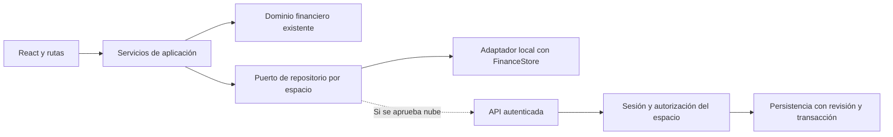

# Auditoría de producto, UX y preparación de lanzamiento — FinanZas

Fecha: **11 de noviembre de 2026**. Repositorio: `dlopezteruel-rgb/Finanzas-pro`.
Base comprobada: **`main` remoto en `66a045e17e310527c790a15ff2fe5dceaaba48a3`**.
Rama de análisis: `audit/product-ux-launch-2026-11-11`.

**Dictamen:** existe una base financiera apta para continuar una beta local controlada, con buenas protecciones de guardado y recuperación. **No está preparado el lanzamiento con la nueva identidad visual, las seis mejoras solicitadas y cuentas de usuario.** Pasar los tests actuales no certifica esas funciones pendientes ni la seguridad del despliegue comercial.

Esta entrega contiene análisis y evidencias, sin cambios de producto, esquema, almacenamiento ni configuración de producción. No modifica `main`, no incorpora otras ramas y no utiliza información financiera real. El [backlog por fases](backlog-product-ux-launch-2026-11-11.md) desarrolla alcance, módulos, riesgos, dependencias y pruebas.

## 0. Alcance y certeza

- La dirección visual aprobada que se aplica es **la descripción del usuario**: granate elegante, marino, marfil/neutros, diseño limpio, iconos contenidos, splash móvil y landing web. Los valores hexadecimales de este informe son una **propuesta técnica**, no valores previamente aprobados.
- No se ha aportado una maqueta de esa propuesta ni un archivo maestro del logo; no puede verificarse coincidencia visual exacta. El repositorio contiene capturas de fases anteriores y un monograma `FP` construido en `Header.tsx`.
- Se revisaron modelos, mutaciones, componentes, estilos, importación/recuperación, servidor, documentación y pruebas. La PR #16 sigue abierta en Draft, sin fusionar: su automatización de vídeo **no forma parte de la base `main` auditada**. Su workflow está limitado a esa PR; no equivale a CI general de producto.
- La revisión visual ejecutó el React real en un servidor estático `127.0.0.1`, con contextos Chromium nuevos, fixtures propias creadas con funciones de dominio, reloj de navegador fijo y peticiones externas/API bloqueadas. Las pruebas existentes se ejecutaron con Gemini desactivado y datos ficticios.
- No se inspeccionaron producción, cuentas reales, Google AI Studio, perfiles personales, secretos ni backups del propietario. No se probó ningún proveedor OAuth real.

### Evidencia actual

| Comprobación repetida en esta auditoría                                   | Resultado                                                                                                                                                                            |
| ------------------------------------------------------------------------- | ------------------------------------------------------------------------------------------------------------------------------------------------------------------------------------ |
| `npm test`                                                                | **255 superadas**, 0 fallos                                                                                                                                                          |
| `npm run lint`                                                            | Correcto; es comprobación TypeScript, no un análisis de seguridad                                                                                                                    |
| `npm run build`                                                           | Correcto; principal **624,31 kB / 174,73 kB gzip**, más CSS y chunk de gráficos; avisos de bundle y futura configuración nativa de Vite                                              |
| `CHROMIUM_PATH=/usr/bin/chromium npm run test:ui`, claves externas vacías | **180 resultados superados**, 0 fallos: 171 casos y 9 contenedores de `node:test`                                                                                                    |
| Inspección adicional                                                      | **42 vistas**: siete módulos × 390/768/1440 px × claro/oscuro; sin overflow horizontal global, errores JS/consola ni solicitudes externas/API; navegación sin cambios en el snapshot |
| `npm audit --json`                                                        | **0 avisos conocidos** en la resolución consultada; no sustituye revisión de código ni pentest                                                                                       |

Entorno: Node 24.22.1, Chromium 156.0.8078.79. Los recuentos de UI por archivo son 57, 12, 23, 13, 11, 8, 15, 16 y 25. No se presentan resultados antiguos como nuevas ejecuciones.

Las [evidencias resumidas](evidence-2026-11-11.json) contienen mediciones y reproducciones. Las muestras de contraste se calculan sobre estilos CSS compuestos, excluyendo gradientes y opacidades; incluyen algunos elementos decorativos. **No son una certificación WCAG completa.**

## 1. UX y diseño

### Qué existe y qué debe cambiar

| Hallazgo                       | Estado y evidencia                                                                                                                                                               | Decisión propuesta                                                                                                                                                                                                              |
| ------------------------------ | -------------------------------------------------------------------------------------------------------------------------------------------------------------------------------- | ------------------------------------------------------------------------------------------------------------------------------------------------------------------------------------------------------------------------------- |
| UX-01 · Identidad              | Predominan sky/índigo, fondos casi negros y overrides claros; múltiples colores y clases literales. No corresponde todavía a la dirección granate/marino.                        | Sistema de tokens semánticos y componentes compartidos; migración por módulo, conservando temas y preferencias.                                                                                                                 |
| UX-02 · Marca móvil            | A ≤600 px se oculta el primer bloque del header, incluido `FP`/FinanZas (`responsive.css:195`). No hay splash.                                                                   | Logo aprobado durante bootstrap móvil; cabecera compacta con identidad reconocible sin competir con el periodo.                                                                                                                 |
| UX-03 · Navegación             | Siete destinos en 390 px; etiquetas de aproximadamente **8,97 px**, aunque no hay overflow global.                                                                               | Probar cinco destinos: Inicio, Movimientos, Presupuestos, Cuentas y Más; Más contiene Contactos, Deudas y Asistente. Mantener accesos rápidos y enlaces directos a los siete módulos. Validar esta propuesta con tareas de uso. |
| UX-04 · Contraste              | En claro, «Nuevo Contacto» arroja aproximadamente **2,71:1** con texto de 12 px; filtros de Movimientos ~4,34:1. Hay otras muestras, incluidas iniciales decorativas de cuentas. | Corregir pares foreground/background y comprobar estados completos; no interpretar las iniciales decorativas como fallos funcionales automáticamente.                                                                           |
| UX-05 · Accesibilidad          | Ya hay skip link, foco visible, gestor de overlays, guardia de borrador y reducción de movimiento. Algunos controles de cabecera miden 32×44 px.                                 | Conservar lo existente; recomendar 44×44 px como objetivo táctil. Ese objetivo no significa que todo control menor incumpla automáticamente el mínimo AA de WCAG 2.2.                                                           |
| UX-06 · Comprensión financiera | «Patrimonio Total en Cuentas» muestra saldo líquido, excluye inversión y no descuenta todas las obligaciones.                                                                    | Rotular «Saldo líquido actual» y explicar alcance; separar patrimonio, disponible presupuestario, previsión y deuda. Cambiar el texto no debe cambiar el cálculo.                                                               |
| UX-07 · Entrada al producto    | `App` monta directamente la aplicación; sin router público, landing, onboarding ni separación explícita de demo.                                                                 | Landing breve y acceso a aplicación; demo inequívocamente identificada y separada del espacio personal.                                                                                                                         |
| UX-08 · Idioma del documento   | `index.html` declara `lang="en"` y la interfaz es española.                                                                                                                      | Corregir desde la futura capa de idioma y mantenerlo sincronizado con el idioma activo.                                                                                                                                         |

### Especificación visual para la fase de ejecución

| Token propuesto    | Valor     | Uso / contraste contra blanco                                                         |
| ------------------ | --------- | ------------------------------------------------------------------------------------- |
| Marca principal    | `#A63D4D` | Granate moderado: CTA primario, selección y detalles; blanco sobre granate **6,18:1** |
| Texto y navegación | `#172B4D` | Marino: texto principal, títulos y foco; **14,10:1**                                  |
| Fondo              | `#F7F4EF` | Marfil suave; no usar su diferencia con blanco como único límite de un control        |
| Superficie         | `#FFFFFF` | Formularios, tarjetas y tablas                                                        |
| Texto secundario   | `#5A6472` | Ayuda y metadatos; **6,00:1**                                                         |
| Borde de control   | `#7C8795` | Campos que necesitan un límite perceptible; **3,65:1**                                |
| Línea decorativa   | `#D7DCE2` | Separación de superficies; no sustituye al borde accesible de un campo                |

Los colores de éxito, aviso y error tienen tokens distintos, icono/etiqueta y contraste verificado. El granate de marca no debe convertir cada tarjeta en una alerta. Mantener un tema oscuro coherente como variante, sin forzar un cambio de preferencia existente.

- Tipografía de sistema, cuerpo **16 px**, interlineado ~1,5; etiquetas de formulario **14 px** y navegación **12 px o más**. No depender de textos esenciales de 8–10 px. Inputs de 16 px en móvil; comprobar zoom de Safari. Importes con cifras tabulares; evitar mayúsculas y negrita extrema en todos los textos.
- Espaciado 4/8/12/16/24/32 px; tarjetas con radio de 12–16 px, bordes suaves y sombras puntuales. Una jerarquía tipográfica estable y una acción principal por sección. Sin degradados decorativos ni paneles añadidos para rellenar espacio.
- Iconos Lucide coherentes con texto accesible. Emoticonos opcionales en sugerencias concretas; no en navegación, errores contables o importes críticos. No imitar bancos ni añadir imágenes generadas de una interfaz diferente.
- En móvil: resumen breve, filtros plegables con estado visible y detalle progresivo; tablas anchas solo con scroll interno. Conservar revisión, cancelación, foco, errores, espera y bloqueo de doble envío.
- Probar estados vacío, demo, carga, guardado, éxito, error de cuota, conflicto, recuperación y sin conexión. Un rediseño que solo resuelve el estado lleno no está terminado.

### Landing y apertura móvil

**Web:** `/` público con logo, propuesta de valor, tres beneficios demostrables, captura ficticia real, CTA «Abrir FinanZas» y demo, explicación de dónde se guardan los datos y enlaces de privacidad/soporte. Sin prometer sincronización, cifrado, integración bancaria ni IA externa no disponible. `/app` permite regresar directamente; no interponer la landing en cada cambio de módulo. Resolver SEO/HTML público sin obligar a descargar el bundle financiero completo para leer la propuesta comercial.

**Móvil:** bootstrap con logo antes de mostrar datos, mientras se resuelven preferencias, almacenamiento y, en su momento, sesión. Sin espera artificial de varios segundos. Si falla la carga, pasar a recuperación con explicación; nunca sustituir datos por una demo para salir del splash. Respetar movimiento reducido y lectores de pantalla.

Para una PWA se necesitarán manifest, iconos 192/512 y maskable, `start_url`, colores, `apple-touch-icon` y una política de actualización segura. El splash web no equivale al splash nativo de iOS ni garantiza el comportamiento de una PWA instalada en Safari. Decidir PWA frente a aplicación nativa antes de prometer distribución en tiendas. **El logo maestro y sus derechos de uso siguen pendientes de comprobar.**

## 2. Funcionalidad

### Inventario frente a los requisitos

| Requisito              | Existe ahora                                                                               | Falta / alcance exacto                                                                                                                                               |
| ---------------------- | ------------------------------------------------------------------------------------------ | -------------------------------------------------------------------------------------------------------------------------------------------------------------------- |
| Subítems opcionales    | `BudgetGroup` contiene `BudgetPartida`; `BudgetPlan` tiene un importe por mes/tipo/código. | Modelo de ítem y desglose mensual; total derivado; transición revisada desde planificación directa.                                                                  |
| Movimiento a subítem   | Solo código de partida y nombres de categoría/subcategoría.                                | Referencia opcional a ítem, selector contextual, filtros/agregación y validación de pertenencia histórica.                                                           |
| CRUD de estructura     | Reordenar partidas, duplicar y trasladar entre paquetes; editar previsión mensual.         | Alta/edición/baja completas de familias y partidas; CRUD de ítems; nombres y orden separados de importes. Editar una previsión no es editar la entidad del catálogo. |
| Raíces protegidas      | `MovementType` limita valores a `INGRESO`/`GASTO`; no hay editor de raíces.                | Garantía explícita de dominio/API de que no se renombran, eliminan ni cambian de identidad.                                                                          |
| Cartera predeterminada | Varias altas usan `wallets[0]`; filtros y gráficos suelen arrancar en «Todas».             | Preferencia por ID y política única por contexto; la primera posición no es una preferencia guardada.                                                                |
| Cinco idiomas          | Textos españoles, moneda europea manual, calendario Madrid y parser español.               | Diccionarios, selección, formatos, entradas numéricas, errores y estrategia del asistente para es/en/it/fr/pt.                                                       |
| Autenticación          | Sin usuarios, sesiones, proveedores ni partición por propietario.                          | Correo/contraseña y Google mediante proveedor de identidad; aislamiento y recuperación; adaptación Apple/iOS preparada.                                              |

### Dos reproducciones que deben entrar en el backlog

**FUN-01 · Duplicación sin efecto, P1.** Con catálogo original, pulsar «Duplicar partida» para `F.001.001` deja **77 partidas antes y después**, aunque cambia la revisión almacenada. Su contenedor es `F_EXP`, pero `partida.groupCode` vale `F.001`; `handleDuplicatePartida` busca igualdad entre ambos. No hay que derivar el padre real recortando códigos. Resolver el contenedor por pertenencia/ID y comprobar unicidad global. Se reprodujo en Chromium aislado; no se corrigió en esta auditoría.

**FUN-02 · Traslado entre sentidos, decisión P0 antes de ampliar el CRUD.** `changePartidaGroup` cambia también tipo de planes y movimientos históricos. Mover una compra ficticia de **135,35 €** de GASTO a INGRESO hace pasar la cuenta de **2.964,65 a 3.235,35 €**: diferencia **270,70 €**. La reproducción fue una llamada pura en memoria, sin persistir ese traslado. El comportamiento está previsto por las pruebas existentes; **es un riesgo de producto y de interpretación, no una regresión nueva**. El modal advierte del cambio de tipo, pero no presenta ese impacto bancario completo.

Recomendación: en el CRUD ordinario, mover/reordenar solo dentro del mismo sentido. Un cambio Ingreso↔Gasto debe bloquearse o tratarse como reclasificación financiera separada, con alcance, antes/después, copia y confirmación. El usuario debe aprobar esta política antes de implementarla.

**FUN-03 · Catálogo dinámico frente a clasificación estática, P0 para integrar el nuevo editor.** `parser.ts` clasifica con `ALL_PARTIDAS`; el endpoint de clasificación también parte de constantes. `proposeChatMovement` recibe el catálogo activo, pero puede caer en la primera partida del mismo tipo cuando no encuentra el código propuesto. Esto no permite reconocer correctamente categorías/subítems nuevos por el mero hecho de crearlos. Incorporar el catálogo y las palabras clave activos al clasificador, con resolución de ambigüedades y selección explícita cuando no haya confianza; mantener siempre la revisión previa. No se ha invocado ningún clasificador externo en esta auditoría.

### Reglas propuestas para estructura y subítems

Jerarquía visible: **Ingreso/Gasto → Familia → Partida → Ítem opcional**. «Ítem» y «subítem» designan la misma entidad en esta propuesta. Ejemplo: `Gasto → Vida diaria → Ocio → Cine / Cultura / Otros`. Normalizar la terminología actual «paquete/grupo/familia»; el `groupCode` histórico no es necesariamente el código del contenedor.

1. Las raíces son valores de sistema inmutables. Familias, partidas e ítems tienen identidad estable, nombre editable y orden; un traslado no cambia identidad ni reescribe códigos históricos.
2. En cada partida/mes hay **una fuente editable**: importe directo **o** líneas por ítem. Con desglose, la cabecera es de solo lectura y suma las líneas en céntimos. Ejemplo: Cine 40 + Cultura 30 + Otros 20 = Ocio 90; sin ítems, Ocio 90 se edita como ahora. No guardar otro total editable contradictorio.
3. Crear el primer ítem sobre una previsión existente exige revisar desde qué mes aplica y repartir el importe. No repartirlo automáticamente ni inventar ítems al cargar. Conservar el modelo directo de los periodos anteriores y todas sus aprobaciones. Eliminar el último ítem usado requiere resolver el desglose mediante un flujo explícito; nunca perder sus importes.
4. El movimiento puede seguir sin ítem aunque la partida tenga desglose. Mostrar «Sin subítem» como agrupación **derivada**, no como un ítem creado por el sistema. Total ejecutado de partida = ejecutado de sus ítems + movimientos sin ítem, aplicando las reglas económicas actuales. No sumar padre e hijos otra vez.
5. Seleccionar otra partida limpia un ítem incompatible dentro del borrador y exige revisión; no modifica registros guardados. Un ítem archivado sigue visible en históricos, pero no se ofrece para nuevas altas.
6. Los traslados entre partidas/familias afectan por defecto a la organización futura. Conservar la clasificación de movimientos y planes históricos mediante pertenencias versionadas y fotografías. No unir el histórico al padre actual del ítem sin considerar la versión de catálogo. Precisar el mes de efecto en la vista previa.
7. Eliminar físicamente solo entidades sin referencias. Si hay movimientos, planes, reglas, préstamos, arrastres o fotografías: explicar bloqueo y ofrecer archivado para uso futuro. El borrado de una familia no elimina movimientos ni reasigna descendientes silenciosamente. El borrado real y la política de archivado requieren aprobación de alcance.
8. Copia de meses, recurrencias de planificación, arrastres, reglas de movimientos, aprobaciones, gráficos y asistente deben utilizar el mismo lector de importes/clasificaciones. La liquidación de principal, el reintegro y el traspaso siguen fuera del ingreso/gasto económico correspondiente.

### Cartera predeterminada: política explícita

`defaultWalletId` apunta a un `Wallet.id` válido del espacio. Con una sola cartera, se resuelve como predeterminada **sin escribir durante la consulta**. Con varias y sin preferencia, pedir selección inicial; no elegir silenciosamente por orden del array. Sin carteras, guiar al alta.

| Contexto                                                         | Comportamiento propuesto                                                                                                                      |
| ---------------------------------------------------------------- | --------------------------------------------------------------------------------------------------------------------------------------------- |
| Nuevo movimiento manual / nueva regla                            | Preseleccionar; permitir cambiar. Una cartera explícita en una propuesta tiene prioridad.                                                     |
| Editar movimiento/regla                                          | Conservar la cartera original. Cambiar la preferencia no reescribe históricos.                                                                |
| Traspaso                                                         | Ofrecerla como origen; destino distinto y elegido explícitamente.                                                                             |
| Liquidación/operación vinculada                                  | Respetar su vínculo y restricciones; nunca sustituirlo por la preferencia.                                                                    |
| Listado / gráfico de una cartera                                 | Inicializar el filtro con la predeterminada cuando proceda, indicando alcance y ofreciendo «Todas». Respetar cambios posteriores del usuario. |
| Inicio, patrimonio/cuentas, presupuesto global, tesorería global | Mantener agregados completos y su ámbito explícito. La preferencia no convierte el saldo de una cuenta en el total del usuario.               |
| Deudas/Tesorería → registro enlazado                             | Hacer visible el destino aunque pertenezca a otra cartera; preservar el foco, resaltado y guardia de borrador de Fase 5.                      |
| Eliminar predeterminada                                          | Resolver sustitución o bloqueo en la misma operación; si queda una sola, se resuelve automáticamente. No conservar un ID huérfano.            |

## 3. Arquitectura y compatibilidad

### Situación actual

`App.tsx` centraliza navegación, modales y mutaciones. `FinanceStore` valida transiciones, utiliza Web Locks/revisión y confirma almacenamiento antes de actualizar React. Un snapshot en `finanzas_pro_data_v1` y copias `finanzas_pro_recovery_*` contienen las finanzas del navegador, sin propietario. No hay base de datos ni sincronización.

El dominio ya separa muchas funciones puras en `src/utils`; hay validación estricta de JSON **2.5–3.1**, referencias protegidas, migración con copia previa, recuperación de errores y consultas sin escrituras. Son activos que hay que conservar, no sustituir por escrituras desde cada formulario.

### Modelo y migración recomendados

- Identidades nuevas de catálogo por ID estable; `code`, `type` y referencias antiguas se conservan como correspondencia de importación. Resolver padres por contenedor real, no por prefijo. Detectar colisiones y referencias fuera de catálogo; no adivinar su destino ni borrar históricos huérfanos.
- Separar catálogo de previsiones. Modelo objetivo conceptual: `MonthlyAllocation(partidaId, month, direct(amountCents) | items([{itemId, amountCents}]))`. El total del padre y el adaptador para lectores existentes son derivados. **No mantener dos fuentes mutables** para la misma partida/mes.
- Introducir pertenencias versionadas de catálogo para trasladar ítems/partidas sin cambiar la atribución del pasado. Las nuevas aprobaciones pueden guardar detalle e identidad; las antiguas conservan sus líneas e importes, indicando «sin desglose histórico» cuando corresponda. No inventar fotografías ni alterar su estado por consultar.
- `locale` es preferencia de presentación, separada de la contabilidad. `defaultWalletId` es configuración del espacio con referencia validada y exportable. Si se incluye en `FinanceData`, necesita ampliar explícitamente su esquema; no añadirlo informalmente a JSON 3.1.
- La próxima versión de backup podría ser **3.2**, por decidir en ADR antes del código. Mantener doble lectura 2.5–3.1 y del formato nuevo. La carga no migra ni escribe. Primera escritura nueva: vista previa, backup completo verificado, validación, Web Locks/revisión y una sola confirmación activa. Un fallo conserva datos y borrador.
- Probar un prototipo de migración con fixtures doradas antes de habilitar el editor. Aprobaciones, reglas y ocurrencias deben mantener sus identidades, límites e idempotencia. Nombres de carteras heredados y vínculos por ID conviven actualmente; usar un resolver único, conservador y probado, sin fabricar cuentas a partir de nombres.

### Cinco idiomas

Propuesta: `i18next`/`react-i18next`, diccionarios es/en/it/fr/pt, carga por idioma, claves estables, plurales y errores estructurados. Variantes iniciales propuestas: es-ES, en-GB, it-IT, fr-FR y pt-PT; **confirmar región inglesa/portuguesa** antes de completar contenidos.

- Usar `Intl` para presentación de moneda, fechas y porcentajes. Mantener EUR salvo decisión independiente de multimoneda; cambiar idioma no cambia divisa, importes, fechas contables ni zona financiera Madrid.
- El parser monetario actual no admite todos los formatos ingleses/franceses. Definir entradas numéricas por locale con validación inequívoca y céntimos canónicos. No volver a parsear automáticamente una cadena ya formateada ni redondear entradas ambiguas.
- No traducir claves de JSON, enums `INGRESO/GASTO`, IDs ni nombres/conceptos escritos por el usuario. Etiquetas iniciales de catálogo pueden tener claves traducibles; un nombre personalizado se respeta.
- Extraer strings de componentes, validadores, calendario, gráficos y servidor. El asistente/parser actual es español: preparar respuestas estructuradas y formatos por idioma. Los comandos y negaciones deben probarse en cada lengua antes de anunciar soporte; mientras no esté validado un idioma, ofrecer formulario manual y explicar el límite. Una consulta nunca debe convertirse en registro por cambiar idioma.
- Cambiar idioma no debe escribir datos financieros, perder el borrador, recalcular aprobaciones ni cambiar el mes. Resolver también `html.lang`, etiquetas accesibles y contenido de landing.

### Autenticación y datos de usuario

**Decisión necesaria antes de implementar:** ¿cuenta para identidad/licencia con finanzas locales, o cuenta con datos en servidor/sincronización? Autenticar no añade automáticamente sincronización ni cifrado al almacenamiento local. Esta auditoría **no da por autorizado desarrollar nube, pagos o una app nativa**.

Recomendación para un servicio comercial con cuentas y varios dispositivos: proveedor de identidad gestionado y backend con aislamiento por espacio personal. Si se elige producto local, declarar expresamente que la cuenta no sincroniza las finanzas y diseñar igualmente la separación de perfiles y del estado de sesión. No presentar un formulario de login como protección suficiente de un único `localStorage` compartido.

Proponer primero un puerto pequeño `load / commitCommand(expectedRevision, operationId) / export`. Para un primer backend puede mantenerse un agregado financiero JSON versionado por espacio, con compare-and-swap y validación de dominio en servidor, sin precipitar la normalización de toda la contabilidad. La autorización y los índices de propietario están fuera del JSON importable. La elección de base de datos/proveedor queda pendiente; no está comprobada hoy.

- Proveedor recomendado por criterios, no seleccionado: correo/contraseña, verificación y recuperación, Google OIDC, soporte futuro Apple, exportación de identidad, región/coste y contrato de tratamiento. No desarrollar un sistema propio de contraseñas ni incluir contraseñas, tokens o cookies en backups financieros.
- Sesión de servidor con cookie `HttpOnly`, `Secure`, `SameSite` adecuado; CSRF/origen, rotación, cierre y callbacks permitidos. Google/Apple requieren state/nonce/PKCE y validaciones del proveedor. Vincular cuentas requiere reautenticación; no fusionar por coincidencia de email sin verificación.
- El servidor comprueba la propiedad en **cada** lectura, mutación, exportación y recuperación; nunca confía en el `userId/workspaceId` enviado por el cliente. Si hay base de datos, políticas de aislamiento además de autorización en API. Web Locks no resuelve conflictos entre dispositivos.
- Sesión y repositorio se resuelven antes de montar datos del perfil. Al cambiar usuario, no mostrar el snapshot previo; particionar también cachés, recuperaciones y escrituras pendientes. Migrar un espacio local a una cuenta exige copia, vista previa y consentimiento; **no subir datos al iniciar sesión ni confundir la demo con datos personales**.
- Si se aprueba nube: comandos idempotentes, revisión de servidor, transacciones para operaciones vinculadas y resolución de conflictos visible. Recomendar primera versión autenticada online, conservando el modo local separado; posponer edición offline sincronizada hasta tener un protocolo probado.
- Apple/iOS: interfaz de proveedor preparada, subject estable y tratamiento de correo relay; no suponer que email/nombre siempre vuelven a entregarse. Verificar requisitos vigentes y excepciones de App Store antes de enviar una app con Google. Decidir callbacks web/nativos y navegador de sistema; no mostrar Apple como operativo mientras no exista configuración y prueba real.

### Riesgos de compatibilidad que condicionan el orden

| Riesgo                                        | Control obligatorio propuesto                                                                                                                                     |
| --------------------------------------------- | ----------------------------------------------------------------------------------------------------------------------------------------------------------------- |
| Añadir campos a JSON 3.1 estricto             | Nueva versión y lectura de originales; fixtures por versión; nunca quitar etiquetas para forzar un downgrade                                                      |
| Padre + hijos duplican presupuesto            | Una fuente por partida/mes, suma en céntimos y lectores compartidos en todas las pantallas                                                                        |
| Trasladar catálogo altera históricos          | Pertenencia versionada, tipo raíz inmutable en CRUD y reclasificación separada                                                                                    |
| Borrar ítem/familia deja vínculos             | Informe de impacto de todas las fechas, archivado o bloqueo y revalidación al confirmar                                                                           |
| Aprobaciones/arrastres/reglas pierden sentido | Preservar fotos e IDs; migrar explícitamente los lectores y operaciones, no solo la pantalla                                                                      |
| Nueva cartera por defecto oculta registros    | Filtros con alcance, «Todas» y prioridad de enlaces directos; no cambiar saldos globales                                                                          |
| Idioma modifica interpretación monetaria      | Locale de entrada explícito, EUR separado, zona contable estable y rechazo de ambigüedad                                                                          |
| Login mezcla dos personas                     | Partición por propietario y espacio, aislamiento de recuperación/caché y prueba A/B                                                                               |
| Cambio de dominio/origen                      | `localStorage` no se traslada de dominio: exportación/importación revisada y comunicación del cambio; `/`→`/app` en el mismo origen no requiere esa transferencia |
| Pestañas/app antigua o PWA desactualizada     | Guardas de versión, actualización controlada y salida recuperable; no rollback ciego a un lector antiguo                                                          |
| Cuota y tamaño                                | Probar límite de backup de 10 MB y cuota real, incluyendo copias previas; no purgar datos o respaldos silenciosamente                                             |

## 4. Lanzamiento

### Bloqueos y requisitos de salida

| Prioridad                            | Bloque                     | Requisito para autorizar lanzamiento                                                                                                                                                                                                                                                                 |
| ------------------------------------ | -------------------------- | ---------------------------------------------------------------------------------------------------------------------------------------------------------------------------------------------------------------------------------------------------------------------------------------------------- |
| P0                                   | Integridad                 | Resolver política de reclasificación y migración; CRUD, subítems y recuperación probados; no cambios numéricos al navegar, traducir o reorganizar presentación                                                                                                                                       |
| P0                                   | Identidad y titularidad    | Decisión local/nube, sesiones reales y separación A/B; sin adopción ni subida silenciosa de datos locales                                                                                                                                                                                            |
| P0 condicionado a activar IA externa | API pública                | `server.ts` tiene dos endpoints sin autenticación/rate limiting de aplicación. No se verificaron protecciones del hosting. Antes de exponer una clave: autorización, límites de uso/coste, validación de payload, timeout y tratamiento de errores; hoy no se probó ningún ataque ni despliegue real |
| P0                                   | Transparencia y privacidad | Explicar datos locales/remotos, proveedor IA opcional y envío real; política y términos adecuados al modelo elegido, responsable y contacto de soporte, exportación y cierre de cuenta. Revisión legal pendiente, no declaración de cumplimiento                                                     |
| P0                                   | QA de lanzamiento          | Staging HTTPS con fixtures, Safari/iOS y Android físicos, Firefox, teclado/lector de pantalla, idiomas anunciados, tamaños/zoom nativo y pruebas de restauración/actualización                                                                                                                       |
| P0                                   | CI de producto             | Workflow general de checks por PR, sin depender de la PR #16; controles de migración, pruebas de dominio, UI y aislamiento                                                                                                                                                                           |
| P1                                   | Adquisición y operación    | Landing, marca, onboarding, ayuda, mensajes veraces, rendimiento y seguimiento de errores sin datos financieros                                                                                                                                                                                      |

Antes de vender, definir público objetivo, modo local/nube y oferta/precio. Si se decide cobrar por suscripción, facturación y cobro requieren otro alcance y validación; no están implementados ni se añaden por inferencia a esta auditoría. El acceso/exportación de datos no debe depender de conservar una suscripción para resolver una incidencia.

### Preparación operativa concreta

- Publicar desde artefactos versionados a staging y producción con configuración separada; no copiar secretos al frontend. Revisar HTTPS, CSP/cabeceras, cookies, origen, cache de respuestas privadas, cuotas y alertas. Estas medidas del hosting **no pueden acreditarse solo leyendo este repo**.
- Consolidar README y manual de backups: su introducción sigue describiendo instalación legacy/formato 2.5, mientras documentos posteriores describen 3.1 y lockfile. Evitar instrucciones contradictorias para usuarios y soporte.
- Reducir carga inicial mediante rutas/módulos/diccionarios diferidos; los gráficos ya tienen lazy loading parcial. Medir LCP/INP/CLS en condiciones reales: el tamaño del build no es una medición de Core Web Vitals. No hay resultados de producción en esta auditoría.
- Inventariar licencias del código, dependencias, logo, fuentes y capturas. Existe aviso de licencia en `App.tsx` y licencias de gráficos, pero no se ha acreditado una licencia global ni derechos del logo maestro. Un repo público no sustituye esa comprobación.
- Definir soporte, recuperación sin acceso remoto a finanzas, logs sin prompts/PII, retención y borrado. Si se incorpora analítica, limitarla a eventos de uso y gestionar el consentimiento aplicable; no enviar importes ni conceptos como telemetría por defecto.
- Hacer una beta de tareas guiadas y medir registro correcto, comprensión de saldo/previsión, recuperación y uso de subítems. No hay estudio de usuarios ni tasa de éxito comercial verificados hoy.
- Salida gradual con checklist firmado por responsable de producto. Reversión debe considerar la **versión de datos**, no solo el despliegue del bundle. Con escrituras posteriores, restaurar una copia antigua puede perder cambios legítimos: preferir solución compatible, modo lectura y exportación antes que un downgrade automático.

### No comprobado y decisiones para aprobar la ejecución

1. Archivo maestro de logo y maqueta aprobada; confirmar tokens, cinco destinos móviles y terminología.
2. Semántica temporal del desglose y traslados; eliminación frente a archivado; tratamiento de planes futuros y aprobaciones anteriores.
3. Cuenta local frente a nube/sincronización; proveedor, región, recuperación, enlace de cuentas y alcance de Apple/PWA/nativo.
4. Variantes en/pt, calidad de las cinco traducciones y alcance del asistente por idioma.
5. Hosting real, identidad/SMTP/OAuth/Apple, credenciales, reglas del servicio, App Store, términos legales, licencias, precios y soporte.
6. Dispositivos físicos, Safari/Firefox, lectores de pantalla, zoom nativo, métricas reales, auditoría de seguridad especializada y experiencia de usuarios.

**Orden recomendado:** decisiones/contratos → visual e i18n base → estructura y migración presupuestaria → cartera predeterminada/cuentas/autenticación → QA y lanzamiento. El diseño de identidad y propiedad se decide al principio aunque su implementación llegue después. La preferencia de cartera puede adelantarse tras cerrar su contrato de datos; no necesita esperar a un proveedor OAuth. Cada fase se propone y valida por separado antes de comenzar la siguiente.

### Capturas actuales, exclusivamente ficticias

- [Inicio móvil claro](assets/2026-11-11/mobile-light-home.jpg).
- [Contactos móvil claro](assets/2026-11-11/mobile-light-contacts.jpg).
- [Planificación móvil oscuro](assets/2026-11-11/mobile-dark-planning.jpg).
- [Planificación escritorio claro](assets/2026-11-11/desktop-light-planning.jpg).

Son evidencias del estado actual, no maquetas ni implementaciones de la nueva identidad.
