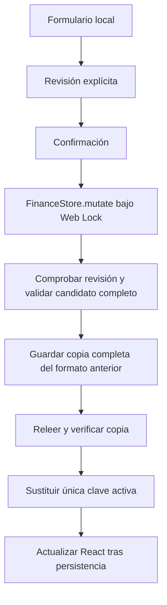
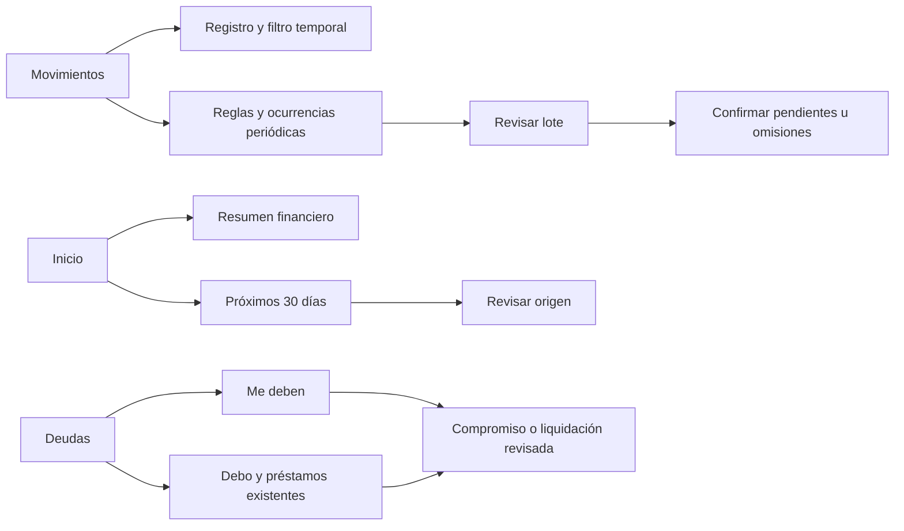

# Fase 5 — Gestión financiera inteligente

## Alcance y auditoría

Entrega integrada para [Issue #14](https://github.com/dlopezteruel-rgb/Finanzas-pro/issues/14). Se leyeron íntegramente el Issue y sus tres comentarios el 10/11/2026. Clon nuevo por instrucción expresa del usuario: no se intentó recuperar ni inspeccionar el entorno anterior. `main` y `feature/phase-5-intelligent-finance` estaban en `cb27fa9ff7f360e49185795d49b3314fa8f46af1`, sin diferencias ni implementación remota. Se publicaron checkpoints temáticos durante el trabajo. No se modifica `main`, no se fusiona la PR ni se utiliza Google AI Studio.

Se implementan calendario universal, movimientos periódicos, deudas/cobros personales, tesorería y asistente contextual. Los datos de pruebas y capturas son **ficticios** y se ejecutan en contextos nuevos de Chromium. No se usan perfiles, copias ni datos financieros del usuario.

## Arquitectura y separación contable

| Capa | Responsabilidad |
| --- | --- |
| `financialCalendar.ts` | Fecha de Madrid, meses 0001–9999, bisiestos y límites sin deriva por DST |
| `recurringMovements.ts` | Reglas de ingreso/gasto, propuestas, colisiones y confirmación idempotente |
| `personalObligations.ts` | Principal, reservas, liquidaciones y adaptadores de los saldos existentes |
| `treasury.ts` | Modelo de lectura de flujos bancarios futuros, precedencia y saldo proyectado |
| `financialAssistant.ts` | Contexto calculado, respuestas numéricas locales y payload mínimo del servicio existente |
| `intelligentValidation.ts` | Validación estricta 3.1 e invariantes de transición |
| `FinanceStore` | Lock, revisión, validación, copia previa y persistencia atómica |
| Componentes React | Formularios locales, vista previa, confirmación, errores y reintento |

Los nuevos cálculos no dependen de componentes ni crean escrituras. Usan `FinanceData` como contrato de entrada, reutilizan `calculateWalletBalances`, `calculateLoanStatus`, `remainingDebt`, `economicTransactions` y la planificación existente. Las fotografías aprobadas y la automatización presupuestaria siguen siendo fuentes independientes.

Se distinguen cinco magnitudes: saldo bancario, ingreso/gasto económico propio, principal pendiente de cobrar/pagar, presupuesto y proyección. Crear una regla o un compromiso no crea dinero ni un movimiento económico. Una devolución de principal puede afectar al banco **solo** mediante su movimiento explícito vinculado; se excluye de ingresos/gastos económicos, igual que los reintegros estructurados existentes.

## Modelo 3.1, migración y recuperación

`FinanceData.intelligentFinance` es opcional y contiene:

- `recurringRules`: ID estable, concepto, tipo, importe en céntimos, partida con nombres históricos, cartera por ID, frecuencia, día, inicio/fin, actividad y baja lógica.
- `occurrences`: ID `ruleId@AAAA-MM-DD`, fecha original, estado registrado/omitido y movimiento vinculado cuando corresponde.
- `obligations`: dirección `receivable/payable`, contraparte agnóstica con contacto opcional, principal en céntimos, fecha, vencimiento opcional, cancelación e historial de liquidaciones.
- Cada liquidación incluye ID de operación, céntimos, fecha, modalidad, nota y estado. La modalidad bancaria enlaza una única transacción mediante `obligationSettlement`; un ajuste no tiene cartera ni movimiento.

`Transaction.recurrence` conserva regla, ocurrencia, fecha original y cartera por ID. Editar el importe, fecha, partida o cartera de una ocurrencia no modifica la regla ni las demás ocurrencias. El listado muestra los valores realmente registrados y distingue una fecha editada de su vencimiento original.

No se migra al abrir, navegar, preguntar o calcular. Los JSON **2.5, 2.6, 2.7, 2.8, 2.9 y 3.0** siguen sujetos a su validación anterior y mantienen sus datos. Solo la presencia explícita del nuevo registro produce JSON 3.1; no se guardan metadatos nuevos bajo etiquetas antiguas. Una instalación que ya ha usado 3.1 conserva el registro vacío después de un borrado completo autorizado, sin degradar silenciosamente el formato.

Primera escritura que sube a 3.1:

Se conserva `finanzas_pro_data_v1` como única clave activa. La sustitución de `localStorage.setItem` mantiene la atomicidad del almacenamiento; no hay escrituras independientes por colección. Si falla cuota, lock, validación, revisión o verificación de la copia, no se aplica el candidato a la UI. Una copia previa válida puede quedar conservada si posteriormente falla la escritura activa. La propuesta y los formularios permanecen disponibles para reintentar. Otra pestaña exige recargar antes de sobrescribir y una vista previa obsoleta exige revisión nueva.

**Rollback:** menú → Copias de recuperación → descargar copia → Importar JSON → revisar versión, colecciones y avisos → confirmar sustitución completa. Antes de restaurar también se guarda una copia del estado actual. Restaurar un formato anterior retira las funciones/metadatos nuevos presentes únicamente en el estado reemplazado; no es una fusión ni una conversión automática hacia atrás. No se borran cookies ni almacenamiento para migrar. La exportación y recuperación siguen disponibles sin licencias.

Límites: archivo 10 MB; 1.000 reglas, 20.000 identidades, 5.000 compromisos y 1.000 liquidaciones por compromiso. Las cantidades nuevas son enteros seguros de céntimos y deben poder representarse exactamente en el importe de transacción existente. Se validan fechas reales, campos desconocidos, duplicados y referencias. Los valores monetarios históricos se conservan: las nuevas vistas redondean únicamente sus cálculos derivados a céntimos.

## Calendario y flujo de usuario

El periodo inicial se obtiene de **Europe/Madrid**, incluso si la zona del navegador es otra. Flechas, Hoy, acceso a meses con actividad y formulario independiente de mes/año permiten consultar meses vacíos. El formulario no depende de `input type=month`. Los extremos 0001-01 y 9999-12 deshabilitan el avance inválido. No se guarda una preferencia al navegar.

Planificación conserva su guardia: seguir editando, descartar o **guardar y continuar**. La navegación espera al guardado; si falla conserva borrador, periodo y error. Los presupuestos y resúmenes siguen el periodo global. Contactos, deudas y cuentas representan saldos globales. El registro de movimientos conserva su vista histórica de todas las fechas y añade un filtro explícito para el periodo seleccionado; ese filtro, la cartera y la búsqueda se conservan al cambiar el mes.

## Movimientos periódicos

Frecuencias mensual, trimestral y anual, ancladas al mes de inicio. El día inexistente se ajusta al **último día válido del mes**, sin trasladar el anclaje siguiente: 31 de enero → 29/28 de febrero → 31 de marzo. Inicio y fin son inclusivos. Una fecha anterior al inicio no se propone. No hay scheduler, relleno histórico oculto ni registro al arrancar.

La vista consulta hasta 12 meses y confirma lotes de 1–500 propuestas. Crear/editar/pausar/reactivar/eliminar reglas pasa por revisión. La baja lógica conserva las referencias y las transacciones. Registrar un lote guarda transacciones **pendientes** y sus identidades en la misma mutación. Repetir con el registro actual no duplica ni escribe. Una vista previa obsoleta se rechaza. Omitir persiste la identidad sin crear transacciones. Dado que todas las frecuencias soportadas tienen como máximo una ocurrencia por mes, el registro también reserva `regla + mes`: editar el día o la frecuencia no reabre un mes ya registrado u omitido. La identidad original no se renombra; una corrección individual se hace en el movimiento existente. Las ocurrencias registradas siguen visibles tras pausar o dar de baja la regla.

La colisión con un movimiento manual se detecta para advertir (fecha, sentido, importe y cuenta), **no para inferir identidad**. El usuario puede cancelar y omitir la propuesta o autorizar explícitamente otro movimiento. No se fusionan ni borran registros. Las reglas no se asocian automáticamente a préstamos, repartos o traspasos ni crean reglas de planificación. Los movimientos periódicos nuevos no pueden nacer tramitados y una ocurrencia futura no se puede tramitar anticipadamente.

## Me deben / Debo y liquidaciones

Los repartos reutilizan `remainingDebt` y sus liquidaciones de Contactos; no hay un segundo saldo almacenado. Los préstamos existentes mantienen `Loan`, cuotas, históricos y `calculateLoanStatus`. Las cantidades vencidas nuevas consideran la fecha de referencia; las estimaciones de cuotas se identifican como tales.

Los compromisos personales permiten contraparte independiente o contacto, dirección, principal, vencimiento, búsqueda y filtros pendiente/vencido/saldado. Inicio muestra por separado los créditos y obligaciones pendientes; no los añade al banco ni al patrimonio líquido.

Un cobro/pago parcial ofrece dos rutas explícitas:

1. **Ajuste sin banco/compensación:** reduce el compromiso sin nueva transacción; exige revisión y confirmación. Nunca compensa automáticamente deudas opuestas.
2. **Movimiento de devolución de principal:** genera una transacción vinculada, pendiente por defecto. Solo al tramitar se aplica al banco y al saldo liquidado; la reserva pendiente ya impide prometer o liquidar otra vez el mismo principal. Puede marcarse ya tramitado explícitamente en una fecha válida y confirmar ese efecto.

La suma de liquidaciones, incluidas las reservas pendientes, no puede superar el principal. El ID de operación hace idempotente un reintento, incluso cuando posteriormente cambia su estado de tramitación. Rechazar un importe no cierra el formulario. Una liquidación bancaria cambia de estado junto con su movimiento, en una sola mutación.

Con historial se protegen principal, dirección, contraparte, fecha e identidades. No se borran liquidaciones ni se desvinculan movimientos desde formularios ordinarios. Los compromisos sin historial pueden editarse o cancelarse tras revisión; se conserva la cancelación. No se ofrece eliminación física de historiales: una corrección debe ser explícita y trazable o usar restauración completa previamente revisada. Esta decisión prioriza conservar evidencia frente a una edición destructiva.

## Tesorería y matriz de doble contabilización

Horizontes de 30 y 90 días, fecha inicial, acceso al próximo mes, tabla por vencimiento y agrupación por meses. El punto de partida es el saldo actual de carteras líquidas; **INVESTMENT queda fuera**. No reconstruye un saldo histórico ficticio cuando se elige otra fecha. Los vencidos conocidos se aplican al inicio del escenario y se señalan. No se inventa una fecha para repartos o compromisos sin vencimiento.

| Coincidencia / fuente | Tratamiento |
| --- | --- |
| Regla + ocurrencia registrada pendiente | Solo el movimiento pendiente; la identidad suprime la propuesta |
| Ocurrencia ya tramitada | Su efecto está en el saldo inicial; no vuelve a sumarse |
| Ocurrencia omitida | No se proyecta ni registra |
| Regla + presupuesto de alquiler | El presupuesto no genera un flujo adicional |
| Compromiso + liquidación bancaria pendiente | Movimiento pendiente + principal no reservado; nunca se suma otra vez la reserva |
| Cuota ya registrada en el mes | Se conserva el movimiento; no se añade otra cuota estimada mensual |
| Cuotas vencidas de préstamos | Estimación agregada por cuotas teóricas/tramitadas, restando pendientes vencidos ya representados; limitada al principal restante |
| Gasto compartido | Banco por importe completo; gasto económico por parte propia; créditos fuera del efectivo hasta cobrar |
| Reintegro compartido pendiente | Un flujo bancario; no ingreso económico nuevo |
| Traspaso entre dos carteras líquidas | Dos extremos bancarios cuyo neto líquido es cero |
| Traspaso hacia inversión | Sale del saldo líquido; no se clasifica como gasto económico |
| Movimiento manual parecido sin enlace | Se advierte la incertidumbre; nunca se deduplica por una heurística |

Cada fila indica fecha, fuente, certeza, importe y saldo resultante, con acción para revisar el origen. Un saldo negativo genera alerta. Las carteras ausentes y los históricos ambiguos generan avisos y no se reparan. La secuencia intradía es ilustrativa (fecha e ID); el orden bancario real puede variar.

Las cuotas siguen la aproximación previa de préstamos, que resta pagos al principal y reconoce también ciertos históricos por nombre. No se introduce un cuadro de amortización bancario nuevo ni se alteran intereses. Las cuotas ya registradas sustituyen la estimación mensual, no se reconcilian por importe. Si una regla genérica corresponde a una cuota/manual sin enlace inequívoco, el usuario debe revisarla y omitir la propuesta equivalente; el sistema no afirma conocer esa identidad. La proyección no suma presupuestos genéricos ni gastos no fechados y **no garantiza disponibilidad real**.

## Asistente, consentimiento y privacidad

El contexto estructurado se calcula desde el mes guardado: ingresos/gastos previstos, ahorro, base/arrastre/efectivo, aprobación y cambios posteriores, gasto propio tramitado/pendiente, desviaciones, compromisos, recurrencias y próximos vencimientos. Se indica el mes y la fecha de tesorería, que puede ser distinta.

Las consultas numéricas soportadas se responden **localmente**, sin llamadas a IA: disponibilidad, pagos/cobros, alertas, arrastres, reparto e hipótesis de ahorro. Las sugerencias de recorte se limitan a presupuesto no ejecutado ni comprometido pendiente; no deciden qué gasto es prescindible. Un objetivo adicional solicita reducción adicional; un objetivo absoluto se compara con el balance previsto. Sin ingresos o datos suficientes se dice expresamente. Los importes ambiguos se rechazan en vez de adivinar.

El servicio `/api/assistant-chat` existente se conserva para otras consultas. Recibe pregunta, resumen y contexto agregado limitado (máximo 100 partidas y 60 flujos): no contactos, cuentas, IDs de movimientos, conceptos de liquidaciones ni respaldos completos. Los nombres de partidas pueden formar parte de ese contexto, como ya ocurría en el asistente. Se eliminan identificadores de avisos transmitidos y no se registran prompts/datos en los mensajes de error. No se añade proveedor, endpoint ni autorización externa nueva. Las pruebas desactivan credenciales y bloquean tráfico externo. Una caída de red/servicio devuelve el resumen local; el servidor deja de inventar importes de ejemplo.

Preguntas, negaciones y simulaciones no llegan al callback de registro. Las instrucciones de movimiento conservan la propuesta editable y la confirmación existente. El consejo no cambia presupuestos, reglas, compromisos ni cuentas. Cancelar implica cero escrituras.

## Extensibilidad Personal / Empresa

- Compromisos y reglas son dominio independiente de React. La contraparte no presume que sea amigo, empleado, cliente o proveedor; el contacto local es una referencia opcional.
- Un futuro repositorio/sincronización podrá suministrar el mismo modelo de lectura a tesorería y asistente. La identidad de ocurrencia y la idempotencia sobreviven a la exportación/importación.
- Introducir `workspaceId`, propietario y permisos requerirá autenticación y migración real de partición de datos. **No hay campos organizationId ficticios ni simulación multiusuario.**
- Facturación, clientes/proveedores, cuentas a cobrar/pagar empresariales, centros de coste, proyectos, impuestos, conciliación y aprobaciones por rol precisan sus propios modelos y análisis. Los compromisos de esta fase no se presentan como facturas.
- Premium, suscripciones, inversiones/cotizaciones y proveedores de mercado quedan fuera. La recuperación de datos no se condiciona a Premium.

## QA y resultados reales

Resultados verificados el 10/11/2026, con fixtures ficticias:

| Comando | Resultado |
| --- | --- |
| `npm test` | 255 pruebas, 255 pasan, 0 fallos |
| `npm run lint` | Pasa (`tsc --noEmit`) |
| `npm run build` | Pasa; avisos de tamaño de bundle y futura configuración nativa de Vite |
| `CHROMIUM_PATH=/usr/bin/chromium npm run test:ui` | 175 contabilizadas, 175 pasan, 0 fallos (166 casos + 9 contenedores de node:test) |
| `git diff --check` | Pasa |

El repositorio no incluía lockfile: el primer `npm ci` falló por ese motivo. Al resolver dependencias apareció el conflicto entre esbuild 0.25 y Vite 8.3. Se alineó esbuild con 0.28 y se añadió `package-lock.json`; los comandos de validación posteriores usan esa resolución. El bundle principal final mide aproximadamente 622 kB (174 kB gzip); la división adicional de módulos queda como mejora de rendimiento, sin ocultar el aviso del build.

Recuento de Chromium por archivo: fase 1 **57**, UX compartidos **12**, eliminaciones **23**, planificación **13**, UX presupuestos **11**, gráficos **8**, automatización **15**, responsive Fase 4 **16** y Fase 5 **20**. Tras los últimos ajustes de textos y abreviación del selector se repiten las 20 de Fase 5, lint, unitarios y build.

La batería nueva verifica calendario y Madrid desde un navegador en otra zona, extremos, guardia de borrador y fallos al guardar, reglas/omisiones/colisiones, lock real y doble clic, reintentos por cuota, copia previa, pestañas concurrentes, cobros parciales con y sin banco, restauración JSON anterior/3.1, tesorería, consultas sin escritura y fallback. Se mantienen las regresiones de fases 1, 2A, 2B, 3A, 3B y 4. Las suites históricas fijan su fecha ficticia de octubre; no fuerzan ese mes en la aplicación.

Unitarios: bisiestos y siglos, reglas inclusivas, meses remotos, vínculos, idempotencia tras recarga/exportación, fallos de copia/verificación/escritura, reservas, principal, cuotas, transferencias/repartos/reintegros, aprobación histórica, restauración 2.5–3.0 y validación estricta 3.1. La consulta amplia cubre **500 reglas, 5.000 movimientos y 6.000 propuestas** sin mutación; las coincidencias usan índices por clave y las guardas nuevas usan mapas por ID. Generación, confirmación, colecciones y tamaño están acotados.

Responsive: 390, 768, 1280, 1440 y 1920 px, temas claro/oscuro, foco/Tab/Escape en modal, emulación táctil y zoom CSS 125/150/200 %. No se afirma haber probado Firefox, Safari, zoom nativo del navegador ni dispositivos físicos. Capturas ficticias en `docs/assets/phase-5/` (Inicio, periódicos, deudas, tesorería y asistente).

Problemas encontrados y corregidos durante QA: multiplicación flotante en vencidos históricos; fixtures antiguas que asumían el mes inicial fijo; nombre accesible de modalidad de liquidación; navegación con badges móviles; reintento idempotente de una liquidación bancaria; duplicación de propuesta al editar el día de una regla en un mes ocupado; presentación de valores editados de ocurrencias y protección de tramitación futura. Los fallos iniciales no se cuentan como comprobaciones aprobadas: los resultados finales corresponden a las ejecuciones posteriores indicadas.

## Guion manual con datos ficticios y límites

1. En un perfil de pruebas, importar una fixture ficticia. Exportar y comprobar su versión antes de añadir entidades. Elegir febrero 2029, extremos y Hoy; sin escrituras. Editar planificación y comprobar las tres salidas de la guardia.
2. Crear alquiler de 950 € al día 31 desde enero 2028. Consultar enero–marzo, cancelar, confirmar pendientes y recargar. Febrero usa 29. Repetir no duplica. Pausar/editar/baja conservan los movimientos; una coincidencia manual exige elección.
3. Crear préstamo personal concedido de 200 €. Cobrar 50 sin banco y comprobar 150 pendientes. Reservar otro cobro bancario, tramitarlo y comprobar un único flujo de principal. Rechazar un cobro excesivo y revisar historial y Contactos sin nuevos saldos duplicados.
4. Con 1.000 € líquidos, nómina propuesta de 1.500 € y alquiler pendiente de 950 €, comprobar 1.550 € proyectados. Añadir presupuesto de alquiler sin alterar esa cifra. Revisar origen, horizonte y avisos.
5. Preguntar por disponibilidad, excesos, ahorro, arrastres y pagos; comparar cada importe con Planificación/Tesorería. Desconectar el servicio y repetir. Cancelar una propuesta de movimiento no escribe.
6. En dos pestañas de pruebas, cambiar una y confirmar desde la otra: debe rechazar el estado obsoleto. Simular cuota sin borrar almacenamiento. Descargar copia previa, revisar y restaurar explícitamente.

Límites deliberados: sin scheduler ni integración bancaria; sin fusión heurística de movimientos manuales; sin borrado destructivo de historiales; préstamos con la aproximación histórica existente; ausencia de vencimiento implica exclusión del horizonte; proyección por escenarios con saldo líquido actual y sin promesa de cobro. Las reglas usadas conservan su ID/cartera aunque se den de baja, por lo que eliminar una cartera dependiente queda bloqueado. No hay nuevas funciones empresariales, suscripciones ni inversiones. La PR se entrega **Draft**, sin fusión, para revisión funcional y técnica.
