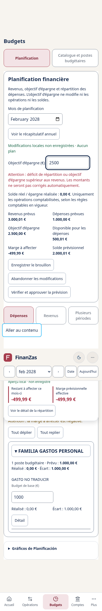
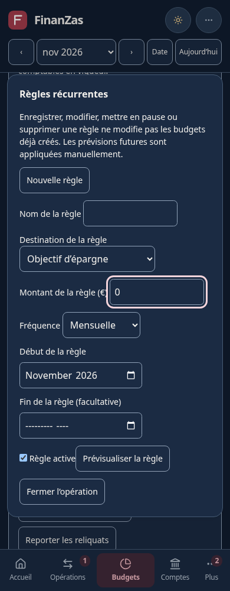
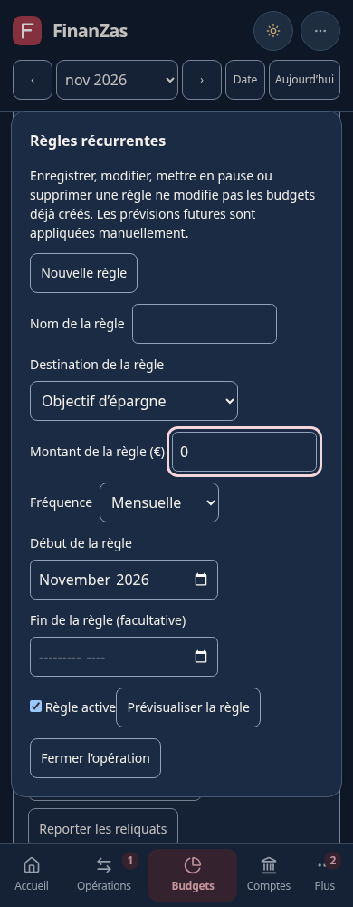
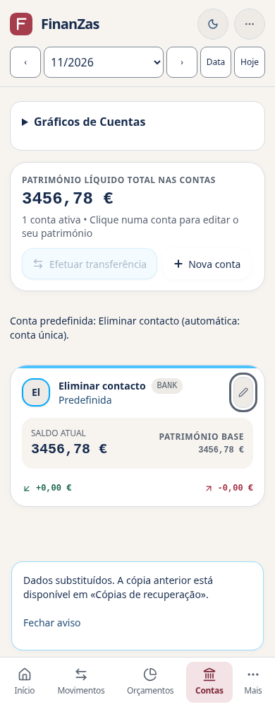

# Fase 5B — Traducción integral (en curso)

Base limpia: `95d08a2dd7c2d9752b8865fc8aa4a32263b5eb96`, merge PR #25. Rama `feature/phase-5b-full-translations`. No se modifica main ni se fusiona/despliega/sincroniza Google AI Studio. Se mantienen dependencias, workflow y protecciones.

## Checkpoints y estado real

1. Inventario y extracción de P1 bancario/común: validado en español, traducciones pendientes. Reutiliza I18nProvider/useI18n, es.ts, messages.ts y preference.ts; añade mensajes canónicos en es.p1.ts y parámetros React al mismo sistema.
2. P1: inicio, histórico, planificación, catálogo, automatizaciones, préstamos, obligaciones y reglas extraídos; errores globales de almacenamiento/restauración y algunos bordes de presentación pendientes.
3. P2/P3, diccionarios completos en-GB, it-IT, fr-FR, pt-PT y adaptadores de presentación: pendiente.
4. Matriz completa multidioma, accesibilidad, activación por idioma validado y entrega: pendiente.

**Ningún idioma nuevo está habilitado.** No se declara una traducción completa mientras haya superficies o pruebas pendientes.

| Idioma | Locale | Estado del selector | Cobertura actual | Flujos integrales traducidos |
| --- | --- | --- | --- | --- |
| Español | es-ES | Disponible | Referencia canónica, UI previa en español | Regresión española inicial correcta |
| English | en-GB | Próximamente, deshabilitado | 1879/1879 claves registradas; UI incompleta | No verificados |
| Italiano | it-IT | Próximamente, deshabilitado | 1879/1879 claves registradas; UI incompleta | No verificados |
| Français | fr-FR | Próximamente, deshabilitado | 1879/1879 claves registradas; UI incompleta | No verificados |
| Português | pt-PT | Próximamente, deshabilitado | 1879/1879 claves registradas; UI incompleta | No verificados |

## Diccionarios y guarda de disponibilidad

Los archivos independientes en.ts, it.ts, fr.ts y pt.ts contienen 1879 claves cada uno: controles y mensajes canónicos P1, contadores plurales y metadatos. Esto es cobertura completa del **catálogo registrado actual**, no de toda la interfaz. Las superficies sin extraer siguen pendientes; por eso los cuatro idiomas siguen inactivos.

`isLanguageAvailable` exige status ready, diccionario completo/compatible y las dos condiciones de languageReadiness: uiComplete y flowsVerified. Un diccionario completo por sí solo no permite activarlo ni persistirlo. Provider, validación de preferencias y selector comparten esa guarda. No hay detección automática del navegador ni un segundo sistema de idiomas.

Los plurales usan las reglas Intl existentes, claves one/other y familias tipadas; hay casos de cero, uno, varios y cantidades grandes en los cinco locales. Las cantidades se formatean solo para mostrar; no vuelven a ningún parser. La primera aplicación es el contador «y N más» en eliminación, sin cambiar su significado.

Las coincidencias de ortografía nativa (por ejemplo «Guardar» en pt-PT o «disponible» en fr-FR) no se contabilizan como texto español residual. El listado revisado de claves coincidentes está en phase-5b-lexical-exceptions.json, restringido a las claves actuales, sin eximir superficies pendientes. IBAN y nombres propios de ejemplos siguen intactos. Se conservan TIN/TAE como siglas del modelo existente, sin reinterpretarlas como otros indicadores regulatorios.

## Inventario reproducible

`scripts/i18n/inventory.mjs` usa el parser AST que ya incluye Rolldown/Vite; no se añade ninguna dependencia. Ejecutar `node scripts/i18n/inventory.mjs /tmp/finanzas-i18n.json` desde el repositorio. Registra archivo, línea, posición, tipo, atributo/propiedad, texto, expresiones dinámicas y clasificación. Incluye los literales no JSX que requieren revisión; no presupone que todo string de código sea texto traducible.

Inventario inicial: 790 fragmentos JSX y 300 atributos visibles, además de 3.618 literales para revisión semántica. Otros 768 son de importación/tipo y 2.057 son atributos internos. Esas categorías automáticas son candidatos, no una certificación de cobertura. Las claves ya localizadas se distinguen de textos pendientes; el informe resumido permite reproducir el análisis por archivo.

Superficies: Root/carga/error y landing; navegación, cabecera, opciones, PeriodSelector y Overlay; DashboardView/TreasuryView; TransactionsView y registro rápido; WalletsView, transferencias, préstamos y liquidaciones; BudgetWorkspace/PlanningView/BudgetsView, catálogo/subítems y automatizaciones; ContactsView y gastos compartidos; AssistantChatView y propuestas; ChartSlot/FinancialCharts/InteractiveChart; validaciones y mensajes producidos por utilidades.

### Política de excepciones

- Nombres, notas, conceptos, carteras, contactos, familias y partidas son datos, incluidos los ficticios del catálogo y los históricos: se conservan literalmente. No se traducen valores por coincidencia de texto.
- Identificadores, enumeraciones, claves de almacenamiento, códigos, versiones JSON, rutas de validación, clases CSS y atributos técnicos permanecen invariantes.
- Parser, prompts, intención y API del asistente quedan intactos. Los ejemplos que se envían al parser deben conservar su payload español y anunciarse como ejemplos en español; localizar sus etiquetas no debe cambiar las consultas enviadas.
- Los errores de dominio se mantienen dentro de las utilidades financieras; su presentación requiere un adaptador explícito, sin traducir por defecto textos desconocidos ni campos del usuario.
- FinanZas, EUR, IBAN y nombres propios de ejemplos son invariantes deliberados. Un literal pendiente de revisar no se considera una excepción justificada ni cobertura completa.

## Arquitectura y seguridad de datos

Las claves siguen derivando del español y son tipadas. Las frases con formato usan `I18nText`, conectado al mismo useI18n y diccionario: los slots tienen nombre y conservan React nodes, sin HTML crudo, sin evaluación de parámetros ni concatenaciones traducidas por partes. Los datos del usuario se insertan como valores escapados. Las traducciones siguen siendo objetos por clave; no tablas de índices.

No cambian FinanceStore, sus revisiones/Web Locks, lógica financiera, cálculos, parsers, migraciones, modelos, API o JSON 2.5–3.4. La preferencia continúa independiente en `finanzas.ui.language`. EUR y Europe/Madrid se mantienen para presentación Intl; ninguna cadena localizada vuelve a un parser.

## Glosario de revisión

| Concepto | en-GB | it-IT | fr-FR | pt-PT |
| --- | --- | --- | --- | --- |
| Movimiento | Transaction | Movimento | Opération | Movimento |
| Cartera/cuenta | Account | Conto | Compte | Conta |
| Familia presupuestaria | Budget family | Famiglia di budget | Famille budgétaire | Família orçamental |
| Partida | Budget item | Voce di budget | Poste budgétaire | Rubrica orçamental |
| Traspaso | Transfer | Trasferimento | Virement | Transferência |
| Tramitado/pendiente | Processed/Pending | Contabilizzato/In sospeso | Comptabilisé/En attente | Processado/Pendente |
| Reintegro compartido | Reimbursement | Rimborso | Remboursement | Reembolso |

## Validación registrada

Base recién ejecutada: 440 unitarias; lint/build y 301 resultados Chromium de las 22 suites anteriores correctos. No se usan referencias históricas como sustituto de pruebas.

Primera extracción: 443 unitarias correctas (incluye tres pruebas nuevas de slots, escape de datos y claves de módulos); lint y build correctos. Chromium focalizado: carteras 14/14 y eliminación segura 23/23; batería financiera ampliada 57/57. Total focalizado: 94 resultados, cero fallos, omisiones o cancelaciones. La batería anterior se conserva íntegra.

Los 136 grupos incompletos axe de referencia se mantienen como **pendientes de revisión manual**, separados de violaciones y de resultados verificados. Sus cifras se volverán a medir. No se afirma uso de lector de pantalla ni dispositivos físicos.

### Checkpoint de diccionarios validado localmente

La [primera ejecución de Actions](https://github.com/dlopezteruel-rgb/Finanzas-pro/actions/runs/43409428078), SHA 4109a04f273117fc3c53f28e2b19d2e96107cde0, terminó con los tres checks verdes. Los 136 grupos incompletos axe siguen siendo revisión manual pendiente, no violaciones ni accesibilidad certificada.

Durante el desarrollo una prueba nueva construyó mal su resultado esperado usando String.replace con `$&`; se corrigió el oráculo para comparar literalmente. La interpolación de producción ya preservaba esos caracteres y no cambió para ocultar un fallo.

Checkpoint de diccionarios: **454 unitarias**, lint/build y **10 resultados Chromium** del selector/preferencias correctos, sin omisiones ni cancelaciones. Son pruebas de las claves, variantes, plurales, slots, seguridad y bloqueo de idiomas no verificados. **No son pruebas de la interfaz completa en los otros cuatro idiomas**. Sus flujos siguen pendientes y bloqueados.

Los tres checks de cada checkpoint se conservan como evidencia de regresión del código publicado; un check verde no certifica por sí solo cobertura lingüística integral.

### Checkpoint de inicio, histórico, cuentas, recuperación y periodos

Se extraen 149 mensajes adicionales de App, DashboardView, TransactionsView, WalletsView, ConfirmClearModal y PeriodSelector; se añaden diez variantes plurales y dos metadatos. Total registrado: 425 claves por diccionario, todavía sin cobertura integral de UI. Las cabeceras y marcadores CSV permanecen como formato de intercambio fijo; el idioma no reescribe sus datos.

El título del documento y las descripciones HTML/Open Graph se actualizan mediante el proveedor existente, junto con lang. El HTML inicial sigue en español como idioma predeterminado; la preferencia local se aplica en el cliente.

Incidencia **5B-001 — Overlay**: el cambio de idioma cross-tab con un borrador de cuenta abierto conservaba el valor pero reinicializaba el foco porque title formaba parte del efecto de apertura. Reproducida en los cinco idiomas en un build de prueba: cinco casos fallidos, sin pérdida de datos. Se separa la actualización aria-label del ciclo de apertura; pasan los cinco casos, la devolución del foco y el guardado posterior con importe 1234.56. No se cambia el guardado ni los validadores.

Pruebas nuevas: scripts/translatedBanking.browser.ts, añadido al final de test:ui, conserva las 22 suites anteriores. Para verificar idiomas previstos sin habilitarlos se compila una **vista previa exclusivamente de prueba** en un directorio temporal: mismo proveedor, diccionarios y aplicación, con guardas de disponibilidad sustituidas solo en memoria por un plugin de test. No se reescriben registros ni archivos de disponibilidad de producción. Cuando todos los idiomas estén activos se utilizará directamente el build de producción. Estos resultados focalizados **no autorizan a marcar completos los flujos ni a activar idiomas**.

Verificado localmente: 457 unitarias, lint/build; 92 resultados Chromium de regresión española (sharedUx 12, deletion 23, phase1 57) y seis resultados de la nueva suite en los cinco idiomas, 1280 px/tema oscuro. Diez superficies axe del formulario de cuenta sin violaciones y sin grupos incompletos nuevos en esa prueba. El informe distingue esos datos de los **136 grupos incompletos de referencia** de la auditoría general, que siguen pendientes de revisión manual. La regresión completa y el check de GitHub de este checkpoint se registrarán al cerrar la ejecución.

Pendiente: resto de planificación/catálogo/automatizaciones, contactos/compartidos/asistente/gráficos y utilidades que producen UI; fechas/importes de todos los módulos mediante Intl preservando exactamente céntimos; matriz completa 390/768/1280 claro/oscuro, ausencia de residuales, restauración por idioma e imágenes de landing. Por eso uiComplete y flowsVerified siguen en false para en/it/fr/pt.

El inventario v2 incorpora fronteras server/config y distingue errores dentro de callbacks de atributos puramente técnicos. El análisis completo detectó y corrigió un error del propio recorrido: Array.flatMap pasaba su índice como segundo argumento del analizador. Dos pruebas nuevas cubren la clasificación de callbacks y el recorrido completo; no se ha traducido código interno para resolverlo. El informe señala también metadatos HTML, estilos e imágenes, y localiza llamadas de presentación por archivo. Todavía quedan candidatos visibles pendientes; no se deduce una cobertura integral de los recuentos automáticos.

### Checkpoint de planificación y aprobación

Se registran 114 mensajes adicionales de PlanningView, PlanningSection, PlanningLiveSummary y BudgetWorkspace y cuatro variantes plurales de errores visibles/ocultos. Total: **543 claves** completas por diccionario. Las pestañas conservan sus identificadores internos; solo sus etiquetas y los estados presentados se localizan. Los avisos locales guardan claves de presentación para actualizar su idioma sin reescribir datos. El estado devuelto por planificación se adapta al presentar, sin modificar utilidades, snapshots ni cálculos. Los textos de aprobación mantienen la confirmación explícita de déficit.

Resultado local: **459 unitarias**, lint/build y diff-check correctos; **13 resultados Chromium** de la regresión española de planificación; **31 resultados** de la nueva suite, que comprueba 30 combinaciones (cinco idiomas × tres anchos × dos temas) y su contenedor. Verifica entradas canónicas, borrador sin escrituras, aceptación explícita de déficit, Escape, devolución de foco, Tab/Shift+Tab dentro del diálogo, aprobación única y persistencia exacta de 300001, 100000 y 250000 céntimos. Conserva nombres ficticios personales y todos los movimientos/cuentas originales.

La suite añade 60 observaciones axe: cero violaciones, **86 grupos incompletos pendientes de revisión manual en esas observaciones**. Son mediciones de esta matriz parcial, separadas de los 136 grupos de referencia; no son nuevos defectos únicos ni certificación de lector de pantalla. Genera diez capturas ficticias de vista previa (390 claro / 1280 oscuro por idioma) como artefactos; contienen otras superficies aún pendientes de traducir. No se presentan como capturas de idiomas habilitados.

El primer intento de la nueva prueba seleccionaba Ingresos solo en móvil y fallaba en escritorio por intentar editar un panel oculto. Se corrigió el recorrido para seleccionar la pestaña en todos los anchos. No se cambió la aplicación ni se ampliaron tiempos para ocultarlo. Una interrupción de esa ejecución dejó logs superpuestos; la ejecución de evidencia se repitió con archivo independiente. Quedan pendientes los errores provenientes de utilidades, nombres históricos generados, Intl general, subítems, automatizaciones y Catálogo, además del resto de P2/P3. Por tanto, los cuatro idiomas siguen bloqueados.

Regresión completa publicada del checkpoint anterior: [Actions 43423672139](https://github.com/dlopezteruel-rgb/Finanzas-pro/actions/runs/43423672139), SHA `541deb8fec51041aba024892343d7f7e3094724e`: Unitarias, Lint/build/diff y Chromium/axe en verde; artefacto del navegador verificado, **307 resultados / 23 suites**, cero fallos, omisiones o cancelaciones. No sustituye la validación final de la fase.

Incidencia **5B-002 — Etiqueta de ahorro en móvil**: la revisión de la captura francesa a 390 px confirmó separación de 0 px entre texto y campo, por lo que el contorno de foco ocultaba el final de la etiqueta. Se añade flex-wrap con espacio de 8 px solo a esa etiqueta. La nueva suite exige separación geométrica suficiente en las 30 combinaciones, sin cambiar valores, restricciones ni parsers. Capturas ficticias de la vista previa (otros módulos siguen pendientes):

| Antes | Después |
| --- | --- |
|  |  |

Tras el ajuste visual pasan también los **16 resultados Chromium** de la batería responsive española: siete módulos, 390–1920 px, ambos temas, zoom 125 %/200 %, foco y redimensionado. La matriz multidioma se repite con la comprobación geométrica y pasa 31/31, sin omisiones ni cancelaciones.

### Checkpoint de Catálogo, detalle, subítems y arrastre

Se añaden **206 mensajes canónicos y dos variantes plurales**, 751 claves completas por diccionario. Se localizan la gestión de familias y partidas, confirmación de archivo con reglas activas, traslado, detalle, selectores, desglose mensual y anuncios de arrastre. El mensaje conserva explícitamente que las reglas seguirán activas y no se borran, desactivan ni reasignan; que no se ejecutan automáticamente; y que históricos/importes/desgloses quedan en lectura. Los nombres personales se conservan incluso si coinciden con términos de interfaz.

Las diez etiquetas propias de catalogDependencies se adaptan exclusivamente al presentar mediante claves explícitas en i18n/presenters.ts. Las utilidades permanecen intactas. Un resultado desconocido se conserva y se señala como pendiente de cobertura; no se interpreta como clave ni se aplica este adaptador a nombres o campos del usuario. La fila sintética «Sin subítem» se distingue por la ausencia de ID; un subítem personal con ese nombre conserva su texto literal.

Los anuncios de arrastre guardan claves y referencias de presentación, no frases ya traducidas. El hook construye las descripciones a partir de kind y del nombre literal. Los callbacks conservan los mismos tipos/códigos/IDs/scope y las utilidades de ordenación no cambian. Así, cambiar de idioma con un arrastre por teclado activo actualiza los anuncios y conserva la sesión y el foco.

Verificado localmente: **461 unitarias**, lint/build y diff-check; **40 resultados Chromium españoles** de catalogArchive (11), catalogReorder (10) y budgetSubitems (19). Nuevas suites: translatedCatalog (31 resultados, 30 combinaciones de idiomas/anchos/temas + contenedor) y translatedCatalogDrag (11 resultados, cinco idiomas × ratón/tacto emulado + contenedor). En todos los casos, cero fallos, omisiones o cancelaciones en las ejecuciones de evidencia. El tacto se emula mediante CDP, no se afirma haber probado dispositivos físicos.

La matriz comprueba eliminación bloqueada, archivo explícito, cambio cross-tab en el diálogo, Escape/Tab/Shift+Tab/foco, reactivación, lectura de subítems y recarga; conserva reglas, previsiones, movimientos e históricos. La prueba de arrastre comprueba anuncios nativos durante un cambio cross-tab, cancelación sin escrituras, ordenación confirmada con teclado y con puntero, nombres/identidades y cantidades intactos. Los 60 controles axe del diálogo de archivo dan cero violaciones y **60 grupos incompletos pendientes de revisión manual**, separados de las observaciones de Planificación y de los 136 grupos de referencia.

Se corrigieron dos errores de recorrido en la prueba nueva: el foco inicial pertenece al propio diálogo, y los nombres de subítems debían buscarse en el desglose visible, no en su gestor plegado. También se devuelve expresamente el primer plano a la pestaña revisada tras escribir la preferencia desde la segunda, como haría el usuario. Las ejecuciones de evidencia completan la matriz de Catálogo en 104,53 s y la de arrastre en 25,77 s; los límites finales siguen siendo 300 s y 180 s, sin ampliar los tiempos por control ni relajar aserciones.

Aviso nuevo de build: algunos chunks superan 500 kB minificados al incorporar los diccionarios. No se oculta el aviso ni se cambian dependencias, configuración o workflow para suprimirlo. Se documenta como coste pendiente de revisar antes de la habilitación global.

CI publicado del checkpoint de Planificación: [Actions 43426545828](https://github.com/dlopezteruel-rgb/Finanzas-pro/actions/runs/43426545828), SHA `e8ac869677a0bace1ca7c579f8dc0654cd257f25`, tres trabajos verdes. Artefacto verificado: **338 resultados / 24 suites**, cero fallos, omisiones o cancelaciones; auditoría general 128 superficies, cero violaciones, **136 grupos incompletos**. La matriz adicional de Planificación registra 88 grupos incompletos en CI frente a 86 locales; son observaciones que requieren revisión manual, no violaciones ni resultados verificados.

Las capturas PNG de las suites se generan en ci-artifacts/browser localmente. El workflow existente conserva logs/JSON siempre y capturas solo si falla; no se modifica esa política. Las dos imágenes comparativas francesas de esta documentación sí están versionadas y son íntegramente ficticias. Continúan pendientes automatizaciones, otros módulos P1/P2/P3, errores de dominio, presentación Intl global y validación integral sin residuales. Los cuatro idiomas siguen deshabilitados.

### Checkpoint de automatizaciones y errores de planificación

Se añaden **204 claves**, total **955 claves completas por diccionario**. PlanningAutomationPanel localiza copias, reglas, recurrencias, arrastres, revisión, eliminación e historial, incluidos sus controles, ayudas, confirmaciones y diferencias antes/después. Las etiquetas de operaciones y los estados presentados son claves; los valores internos y las solicitudes originales no cambian. A/B siguen siendo marcadores invariantes de comparación.

planningMessages.ts adapta al presentar 80 entradas estáticas propias de planificación y del aviso de traslado, además de sus motivos parametrizados. Incluye errores de importes/rangos y variantes completas de motivos de copia con o sin desglose. Los motivos de reglas utilizan su nombre literal y una frecuencia separada de presentación; los de arrastre leen céntimos con la función de dominio existente, sin interpretar cadenas monetarias. Los mensajes, filas, ámbitos y solicitudes originales se conservan para la revalidación de FinanceStore. Los campos técnicos de mensajes «falta/campo no reconocido» permanecen literales. Los diagnósticos desconocidos conservan su texto, lo que sigue siendo cobertura pendiente.

Los errores se traducen al mostrarlos; no se modifica el parser, ni el texto que recibe, ni sus reglas. Los campos editables y las sumas de subítems mantienen entradas canónicas. La advertencia textual de un total inválido se localiza únicamente en el campo de solo lectura; el centinela interno y el borrador original permanecen intactos. No se cambian planningPreview, FinanceStore ni ninguna utilidad financiera.

Pruebas nuevas: **464 unitarias** correctas. Tres casos comprueban que 3.000, -1 y 1.001 siguen rechazándose; 15,50/15.50 siguen siendo 1550 céntimos; MAX_SAFE_INTEGER conserva el último céntimo; el texto no se interpreta como HTML o como parámetros nuevos; y adaptar motivos no cambia la propuesta ni su aplicación posterior. Lint/build y diff-check correctos. Se mantiene visible el aviso de chunks superiores a 500 kB.

Chromium de este checkpoint: **49 resultados españoles** (automation 15, budgetSubitems 19, budgetUx 15), **31 resultados** de Planificación en los cinco idiomas con errores de entrada, y **41 resultados** de automatizaciones. Estos últimos son 30 combinaciones de copia (cinco idiomas × tres anchos × dos temas), cinco recorridos de subítems/cross-tab y cinco de reglas/recurrencias/arrastre/historial, más su contenedor. Cero fallos, omisiones o cancelaciones en las ejecuciones de evidencia. Todos los datos son ficticios.

La batería comprueba confirmación única ante doble envío; cancelación sin escrituras; conflicto omitido por defecto; guardado, pausa y retirada de reglas sin borrar las previsiones generadas; arrastre separado sin movimientos bancarios; revisión y retirada conservando las fotografías; y conservación de 6001/4000 céntimos al corregir un subítem. El cambio cross-tab mantiene el mismo campo y su valor 3.000 mientras cambia el idioma del error. La primera prueba conservaba el nombre anterior de la región en su localizador: fallaron cinco casos y su contenedor, sin fallo de datos; se corrige el recorrido y pasan los 41 resultados completos.

Axe adicional: **85 observaciones de automatización, cero violaciones y 95 grupos incompletos** pendientes de revisión manual. La matriz repetida de Planificación tiene 60 observaciones, cero violaciones y 86 grupos incompletos locales. Se mantienen separados de los **136 grupos de referencia**, sin sumarlos como defectos únicos ni declararlos verificados.

Incidencia **5B-003 — Contorno de foco en reglas**: la etiqueta francesa de importe tenía 0 px de separación en 390 px. Se reutiliza el ajuste flex-wrap/8 px de ahorro en las etiquetas de los campos de regla, sin cambiar controles, validación o cantidades. La nueva prueba exige separación geométrica suficiente en los cinco idiomas. Capturas ficticias comparables:

| Antes | Después |
| --- | --- |
|  |  |

CI publicado del checkpoint de Catálogo: [Actions 43443220414](https://github.com/dlopezteruel-rgb/Finanzas-pro/actions/runs/43443220414), SHA `d34c085eef4529e3734c3ca8d8ac205c1beb3541`: tres trabajos verdes; artefacto comprobado con **380 resultados / 26 suites**, sin fallos, omisiones o cancelaciones; axe general 128 superficies, cero violaciones, 136 grupos incompletos. El nuevo SHA requiere sus propios checks.

Continúan pendientes otros módulos P1/P2/P3, los demás errores de dominio, presentación Intl global, inventario semántico final y matriz integral sin residuales. Los cuatro idiomas siguen bloqueados y no se presenta este checkpoint como traducción integral terminada.

### Checkpoint de presentación Intl

Se reutilizan las funciones Intl de 5A desde el mismo Provider/useI18n, con implementación pura en i18n/presentation.ts y reexportación desde su punto original. El contrato previo de presentationMoney/date sigue disponible. Los componentes usan formatMoney, formatCents, formatDate, formatMonth y monthName del mismo contexto; no hay un segundo sistema de preferencias. EUR y Europe/Madrid permanecen fijos. Las fechas inválidas no se corrigen silenciosamente y una fecha histórica sin hora no recibe una hora inventada.

La política de presentación conserva el redondeo español anterior basado en toFixed y las etiquetas españolas de los meses; los demás idiomas emplean sus convenciones Intl. Los importes que ya están en céntimos se formatean con enteros/BigInt, evitando perder el último céntimo por dividir un entero seguro grande entre 100. Esto solo afecta a presentación: las utilidades de cálculo y los parsers financieros no cambian. Las pruebas cubren Number.MAX_SAFE_INTEGER y su céntimo adyacente, importes negativos, año 0001, cambio de día/horario de Madrid y los doce meses. Los valores de input, fechas ISO guardadas y períodos usados como identificadores siguen invariantes.

Resultado local del checkpoint: **473 unitarias**, lint y build correctos; **6 resultados Chromium** de formularios/cambio cross-tab en cinco idiomas y **25 resultados** de la regresión de calendario, reglas, obligaciones, restauración y conflictos. No hay fallos, omisiones ni cancelaciones en esas ejecuciones finales focalizadas. La batería completa local se lanzó y se detuvo inicialmente en intelligent.browser por dos casos que esperaban ISO en el texto visible (tres resultados fallidos contando su contenedor). Se mantienen las comprobaciones originales de identidad de fecha mediante el atributo datetime de time, se comprueba además la fecha visible localizada y se adapta el nombre accesible del selector. No se eliminan comprobaciones de foco, persistencia, lote, doble envío ni importes. Una sustitución inicial del marcado afectó por error al texto del aria-label y fue corregida antes de la ejecución focalizada válida. La ejecución completa posterior del nuevo SHA sigue siendo necesaria.

La revisión de formato aún no certifica todos los flujos P2/P3 ni todos los casos condicionales de fechas. Los cuatro idiomas siguen deshabilitados.

CI del checkpoint de automatizaciones publicado: [Actions 43449709288](https://github.com/dlopezteruel-rgb/Finanzas-pro/actions/runs/43449709288), SHA `2815b3101a50a9ffd167b32a372f4969546e0b35`: tres trabajos verdes. Artefacto comprobado: **421 resultados / 27 suites**, cero fallos, omisiones o cancelaciones. Axe general: 128 observaciones, cero violaciones, **136 grupos incompletos**. Matriz adicional de automatizaciones: 85 observaciones, cero violaciones, **95 grupos incompletos**; todos estos grupos siguen pendientes de revisión manual y no equivalen a defectos únicos ni a resultados verificados.

La [ejecución de CI del checkpoint Intl](https://github.com/dlopezteruel-rgb/Finanzas-pro/actions/runs/43458500254), SHA `cf27bee87d9e9607f219a486f14ca304761be2f5`, dio Unitarias y Lint/build/diff correctos, pero Chromium falló en cuatro variantes de phase4aSafety (cinco resultados contando su contenedor): la previsión de registro rápido mostraba 12/11/2026 y el oráculo esperaba 2026-11-12. Se añade time/datetime a esa presentación y se conservan ambas comprobaciones: fecha visible y fecha ISO original. No se modifica el parser, las consultas/negaciones, las entradas ni los payloads. La regresión focalizada repetida pasa **6/6** con cero fallos, omisiones y cancelaciones. El check fallido queda registrado; no se considera una batería completa correcta.

### Checkpoint de préstamos, obligaciones, periódicos y tesorería

Se añaden **268 claves**, hasta **1223 por diccionario**, con parámetros compatibles: LoansView, DebtsWorkspace, RecurringMovementsView y TreasuryView; confirmaciones completas por operación; 69 diagnósticos estáticos y adaptadores explícitos para avisos/etiquetas generadas de tesorería. Las categorías personales persistidas «Compromisos personales» y «Devolución de principal…» se excluyen deliberadamente del adaptador: son datos históricos, no etiquetas de error. TIN/TAE conserva literalmente las siglas originales del modelo, sin convertir una tasa en otro indicador.

Las confirmaciones guardan un descriptor de presentación junto al callback de mutación original. Al cambiar de idioma, se actualizan frase, fecha e importe; el callback y los datos confirmados no se traducen ni reconstruyen. Pausar, reactivar o eliminar una regla conserva las advertencias sobre identidades, ocurrencias e históricos. Las liquidaciones distinguen explícitamente devolución de principal, movimiento bancario pendiente/tramitado y compensación sin banco. No cambian las funciones de dominio, importes, identidades, fechas, frecuencia ni scopes. El singular de cuotas usa Intl.PluralRules del idioma sobre el plazo; en francés cero pertenece a one, comprobado expresamente.

Verificado: **478 unitarias**, lint/build/diff-check; regresiones Chromium españolas intelligent (25), phase4aSafety (6), phase4aLoans (3), phase4aAudit (9) e infraestructura 5A (10). Nueva matriz: **31 resultados**, cinco idiomas × 390/768/1280 × claro/oscuro y contenedor, **109,36 s**, sin fallos, omisiones ni cancelaciones. Verifica préstamo de una cuota y de varias, liquidación parcial de 1234 céntimos, exceso rechazado, preview sin escrituras, cambio cross-tab con preview abierta, Escape/foco/Tab, confirmación doble sin duplicado, movimiento bancario explícito, ocurrencia pendiente única de 95000 céntimos, regla intacta, tesorería en lectura y recarga. Cuentas, préstamos, contactos, presupuestos y catálogo se comparan exactamente con su fixture de origen.

La nueva matriz registra **120 observaciones axe, cero violaciones y 128 grupos incompletos**, separados de los **136 grupos incompletos de la auditoría general**. Todos quedan pendientes de revisión manual; no se presentan como accesibilidad verificada. Las capturas generadas contienen solo datos ficticios y superficies parciales, sin afirmar cobertura integral de otros módulos.

Los primeros recorridos de la suite nueva detectaron errores del propio test: intentaba abrir Deudas directamente en móvil, asumía tramitación bancaria sin marcar la casilla e inspeccionaba una propiedad bancaria inexistente. Otro intento consultaba la navegación antes de su montaje. Se corrigió el recorrido para usar Más, esperar la navegación visible y confirmar explícitamente el estado; se comprueban los vínculos obligationSettlement reales. No se relajan las invariantes ni se cambian tiempos. Los intentos fallidos/interrumpidos no se suman a resultados correctos. El oráculo de plural francés cero se corrigió para respetar Intl, manteniendo las pruebas de singular/plural de todos los idiomas.

La batería completa ahora contiene **28 suites** y debe producir 452 resultados si todas terminan; esa cifra es expectativa, no resultado de CI del presente checkpoint. Continúan pendientes almacenamiento/errores globales, P2/P3, inventario semántico final y matriz integral. Los cuatro idiomas siguen deshabilitados.

### Checkpoint de almacenamiento, restauración y eliminación

Se añaden **171 claves**, hasta **1394 por diccionario**, reutilizando el mismo Provider, mensajes y preferencia. storageMessages adapta únicamente diagnósticos, etiquetas de dependencias y descripciones generadas por la aplicación. No se aplica a nombres, conceptos, notas ni históricos. Los errores desconocidos se conservan literalmente; las rutas de validación JSON y nombres de campos permanecen como identificadores técnicos. El inventario registra las fronteras de presentación revisadas y mantiene sus candidatos de origen, sin presentar esos recuentos como cobertura completa.

Las vistas previas de eliminación reciben el informe original y su contexto de origen. Su copia de presentación mantiene nombre personal, ejemplos, cantidades, bloqueos y callbacks; solo localiza títulos, etiquetas y avisos conocidos. Los importes de los avisos proceden del dato numérico original y nunca se reconstruyen desde un importe formateado. Se conserva incluso el redondeo Intl que ya usaban esos avisos, distinto del formato histórico toFixed de otros componentes. BORRAR sigue siendo la palabra de confirmación invariante; solo se localiza la instrucción que la rodea. No cambian scopes, copias verificadas, Web Locks ni FinanceStore.

**482 unitarias** correctas: incluye diagnósticos de cuota/envoltorios, interpolación literal de nombres/rutas, informe de eliminación inmutable y compatibilidad de presentación con JSON 2.5–3.4. El primer fixture de 3.0 estaba vacío y el validador original lo rechazó; se corrigió el fixture con una regla real sin relajar el validador. Lint/build/diff-check correctos. Regresiones españolas: **57 resultados** de phase1 y **23 resultados** de eliminación segura, sin fallos, omisiones ni cancelaciones en las ejecuciones finales.

La primera ejecución de phase1 detectó una expectativa plural antigua en la vista previa de un único par histórico. Se actualiza la frase visible a singular y se añade una comprobación del mensaje original de backupWarnings. Se conservan todas las comprobaciones de importes excluidos, migración bloqueada, ausencia de nuevas carteras/contrapartidas, cancelación, recarga y copias. La ejecución fallida no se contabiliza como correcta.

La primera matriz nueva de importación/restauración completó **31 resultados**, 30 combinaciones y contenedor, en **105,84 s**: JSON y versión inválidos no escriben; la cuota conserva datos y vista previa; reintentar conserva una copia verificable; el idioma cambia cross-tab sin alterar la propuesta; restaurar, exportar y recargar preservan todos los campos financieros y la preferencia independiente. Se cancela la eliminación de una cuenta cuyo nombre personal coincide con una frase traducible. Esa medición registró 120 observaciones axe, cero violaciones y **180 grupos incompletos** adicionales, pendientes de revisión manual.

La ejecución final ampliada completa **36/36 resultados en 93,56 s**, cero fallos, omisiones o cancelaciones: repite las 30 combinaciones y añade cinco casos de Web Locks no disponible, con mensaje nativo y formulario conservado. Sus 125 observaciones axe registran cero violaciones y **185 grupos incompletos**, pendientes de revisión manual. Los cuatro idiomas siguen deshabilitados: faltan P2/P3, otros errores de dominio, bordes de formato y la revisión integral.

CI publicado anterior: [Actions 43462137791](https://github.com/dlopezteruel-rgb/Finanzas-pro/actions/runs/43462137791), SHA `2063e219a6e79d5208e7a2f832c923ea4e64bda9`, tres trabajos verdes. Artefacto comprobado: **452 resultados / 28 suites**, cero fallos, omisiones o cancelaciones. Axe general: 128 observaciones, cero violaciones y **136 grupos incompletos**. Matriz de obligaciones: 120 observaciones, cero violaciones y **130 grupos incompletos en CI**, frente a 128 locales; se mantiene la distinción entre observaciones incompletas y violaciones/defectos únicos. El nuevo checkpoint requiere sus propios checks.

La batería completa contiene ahora **29 suites**. El recuento esperado de 488 resultados debe confirmarse con la ejecución completa del SHA publicado, sin usarlo como resultado anticipado.

### Checkpoint de Contactos y gastos compartidos

Se añaden **136 claves**, hasta **1530 por diccionario**: Contactos, detalle de gasto compartido, frases plurales completas y 55 diagnósticos estáticos con su envoltorio de revisión histórica. Las cantidades de personas/deudas/conceptos usan las reglas Intl del mismo sistema, sin construir frases mediante sustantivos concatenados. Se conservan nombres personales, conceptos, categorías históricas, notas, IDs y referencias de reintegros; incluso los nombres que coinciden con una palabra traducible o contienen llaves/$& se muestran literalmente.

La vista histórica sigue distinguiendo los valores declarados de pagos comprobados: una marca «pagado» sin movimiento inequívoco no se presenta como reintegro ni compensación verificados. Se localizan solamente su advertencia y referencias al mostrarlas. No se migra, deduce ni escribe ningún histórico por cambiar de idioma o abrir sus detalles. No cambian sharedExpenses/sharedDistribution, parsers, cálculos ni formatos. El adaptador solo recibe diagnósticos generados; los desconocidos permanecen literales y el anidamiento se limita para evitar recursión ilimitada.

Resultado local: **484 unitarias**, lint/build/diff-check correctos; regresiones españolas **12 resultados sharedUx** y **23 de eliminación segura**, sin fallos, omisiones o cancelaciones. Matriz nueva: **36/36 resultados en 137,02 s** (30 combinaciones de idioma/ancho/tema + cinco históricos + contenedor). Comprueba corrección rechazada conservando formulario/foco, cambio cross-tab, exceso de cobro rechazado, liquidación bancaria única de 1234 céntimos, compensación de 500 céntimos sin banco, gasto propio de 3334 céntimos, ingresos económicos cero y saldo bancario de 912,34 €, dependencias que bloquean eliminar contacto, detalle en lectura, Escape/Tab/foco, recarga y ausencia de migración silenciosa. Las cuentas, contactos, préstamos, catálogo y presupuestos se comparan exactamente con el fixture de origen.

Incidencia **5B-004 — Botón de cierre sin nombre accesible**: la primera matriz detectó button-name en la X de «Corregir deuda». Se añade aria-label con la clave common.close existente; no se desactiva ninguna regla de axe. La primera ejecución registró 36 resultados: 5 correctos y 31 fallidos contando el contenedor, sin omisiones ni cancelaciones; todos los fallos correspondían a ese botón sin nombre. La ejecución final registra **125 observaciones axe, cero violaciones y 145 grupos incompletos** pendientes de revisión manual. Esos grupos son observaciones de esta matriz, separados de los 136 de la auditoría general; no son defectos únicos ni validación con lector de pantalla. La incidencia no requiere cambiar el aspecto del botón ni los datos financieros.

Capturas ficticias revisadas visualmente, procedentes de vistas previas de prueba (idiomas aún bloqueados en producción). Los textos españoles de nombres/conceptos/categorías son datos personales de prueba conservados; los caracteres {amount}/$& son valores literales del fixture, no parámetros sin resolver. Los identificadores operativos y BANK del ejemplo de cuenta siguen como valores técnicos; su presentación restante se revisará antes de completar la fase.

| Contactos francés, 390 claro | Cuentas/restauración portugués, 390 claro |
| --- | --- |
|  |  |

CI anterior verificado: [Actions 43470661027](https://github.com/dlopezteruel-rgb/Finanzas-pro/actions/runs/43470661027), SHA `07335e10560aa533996c165ac60d3bd316db433e`, tres trabajos verdes. Artefacto: **488 resultados / 29 suites**, cero fallos, omisiones o cancelaciones; axe general 128 observaciones, cero violaciones, 136 grupos incompletos. Matriz de almacenamiento: 125 observaciones, cero violaciones y 185 grupos incompletos, igual que la medición local. La batería actual añade compartidos y contiene 30 suites; 524 resultados es su expectativa, todavía no resultado del nuevo SHA.

Siguen pendientes el asistente/registro natural, gráficos, ayudas/restos de P3, otros errores de dominio, revisión semántica final y matriz integral. Los cuatro idiomas nuevos continúan deshabilitados.

### CI verificado de Contactos y compartidos

[Actions 43474620336](https://github.com/dlopezteruel-rgb/Finanzas-pro/actions/runs/43474620336), SHA `27f937b3b097ccede430b72235a26408043a665a`: Unitarias, Lint/build/diff y Chromium/axe correctos. Artefacto comprobado: **524 resultados / 30 suites**, cero fallos, omisiones y cancelaciones. Axe general: 128 observaciones, cero violaciones y **136 grupos incompletos** pendientes de revisión manual. Matriz de compartidos en CI: 125 observaciones, cero violaciones y **163 grupos incompletos**, frente a 145 locales; son observaciones incompletas de esta matriz, no infracciones ni defectos únicos.

### Checkpoint de gráficos

Se añaden **134 claves**, hasta **1664 por diccionario**, para los cuatro módulos de gráficos, controles, series, leyendas, fechas, estados, avisos, tablas, selección y lectura. Los adaptadores utilizan IDs de serie/fila estables: no traducen por posición ni modifican el modelo. Las selecciones vuelven a la fila original antes de ejecutar callbacks. Los nombres personales de familias/partidas/cuentas y categorías históricas se conservan incluso cuando coinciden con un rótulo de interfaz. Los envoltorios generados para identidades históricas se localizan de forma explícita, conservando los códigos originales.

Se reutilizan los formatters del Provider para EUR compacto, números y porcentajes nativos. El porcentaje ya expresado de 0 a 100 no se divide ni se devuelve a ningún parser; conserva el redondeo toFixed anterior. Los meses semanales utilizan el lunes real identificado por la fila, incluso si el intervalo visible empieza después. No cambian chartData, cálculos, previsiones, movimientos, FinanceStore ni JSON. Los controles nativos date/month conservan valores ISO; su aspecto interno también depende del navegador/sistema operativo, aparte del idioma de la página.

**489 unitarias**, lint/build/diff-check correctos. Las ocho regresiones Chromium de gráficos pasan en **15,85 s**. El primer recorrido detectó expectativas ISO/punto decimal antiguas; se actualizan solo los rótulos visibles nativos y se añaden comprobaciones de IDs ISO y series originales. No se eliminan comprobaciones económicas, de selección ni de foco.

Incidencia **5B-005 — Tablas de detalle desplazables sin acceso por teclado**: axe detectó scrollable-region-focusable al seleccionar movimientos. Se añaden tabIndex, región y nombre accesible nativo a las dos tablas, igual que en la tabla principal existente. No se ignora la regla. Incidencia **5B-006 — Etiqueta francesa invade el anillo**: la frase completa del centro se distribuye por palabras en dos líneas; no se traduce por fragmentos ni se recorta. La matriz comprueba la anchura SVG real. Son ajustes acotados de presentación y accesibilidad.

Intentos registrados: primera matriz **31 resultados, 16 correctos y 15 fallidos**; tras corregir las tablas, **24 correctos y 7 fallidos**, estos últimos por la etiqueta francesa y el contenedor. Cero omisiones/cancelaciones en ambos. Matriz final: **31/31 resultados en 159,30 s**, cinco idiomas × tres anchos × dos temas y contenedor, cero fallos, omisiones o cancelaciones. Verifica cuatro módulos, cifras exactas, series ocultas, foco/teclado, cambio cross-tab conservando selección y filtros, aprobación/lagunas, intervalos inválidos y vacíos, navegación enlazada, nombres personales, recarga y **cero escrituras financieras**.

La matriz añade **120 observaciones axe, cero violaciones y 240 grupos incompletos**, pendientes de revisión manual; se mantienen separados de los 136 grupos incompletos generales. No se afirma prueba real con lector de pantalla ni dispositivos físicos. Captura ficticia revisada visualmente: [gráficos de cuentas en francés, 390 claro](screenshots/phase-5b/charts-wallets-fr-390-light.png).

La batería incorpora 31 suites; **555 resultados es una expectativa**, que debe verificarse en CI sobre el SHA publicado. Siguen pendientes asistente/registro natural, ayudas/P3, errores restantes y revisión integral. Los cuatro idiomas nuevos permanecen deshabilitados.

### CI verificado de gráficos

[Actions 43481830524](https://github.com/dlopezteruel-rgb/Finanzas-pro/actions/runs/43481830524), SHA `23135fe902f1459bccd77648ed2b49277048f103`: tres trabajos correctos. Artefacto comprobado: **555 resultados / 31 suites**, cero fallos, omisiones y cancelaciones. Axe general: 128 observaciones, cero violaciones, **136 grupos incompletos**. Matriz de gráficos: 120 observaciones, cero violaciones y **240 grupos incompletos**, igual que en local. Permanecen pendientes de revisión manual.

### Checkpoint de asistente y registro rápido

Se añaden **100 claves**, hasta **1764 por diccionario**, para el asistente, registro rápido, respuestas numéricas locales, diagnósticos de entrada y validación de propuestas. Las sugerencias tienen un ID y una clave de etiqueta; su texto original español enviado al parser/API se conserva exactamente. Las etiquetas no se seleccionan por índice. La interfaz explica en los cinco idiomas que el reconocimiento de entrada libre no incorpora otros idiomas en esta fase. Los ejemplos originales españoles son excepciones deliberadas, anunciadas y comprobadas. No se traducen las instrucciones del usuario, los conceptos/notas creados a partir de ellas ni las respuestas opacas del servicio externo.

La utilidad localFinancialAdvice admite una presentación opcional de salida, utilizando el mismo traductor y formatters del Provider. Es la única utilidad financiera cuya **presentación textual** se adapta en este checkpoint: no cambian reconocimiento, parsers, condiciones, fórmulas, orden de sugerencias, límites ni lectura de datos. La llamada de dos argumentos conserva la salida original española; la API y su fallback siguen usando esa llamada. Los contextos y payloads del servicio permanecen intactos. **53 snapshots ficticios de la implementación anterior** comprueban salida exacta y payload; en cada idioma se comparan todos los argumentos monetarios con los céntimos originales. El renderizado nunca analiza cadenas monetarias para recuperar valores.

Los mensajes locales guardan un descriptor de presentación junto a su contexto original; cambiar de idioma vuelve a mostrar esas cifras, sin traducir datos del usuario ni escribir históricos. Las horas se conservan como instantes ISO de UI y se presentan en Europe/Madrid. El historial remoto y los textos escritos por el usuario permanecen literales. El mensaje de éxito de registro rápido mantiene tipo/importe/nombre originales y se vuelve a presentar al cambiar de idioma; la nota persistida «Registro rápido: …» conserva el formato previo.

Verificación local: **496 unitarias**, **22 pruebas de infraestructura**, lint/build/diff-check correctos. Regresiones españolas: intelligent **25/25** y phase4aSafety **6/6**; se conservan todas las aserciones anteriores. Matriz final nueva: **36/36 resultados en 145,65 s**, cero fallos, omisiones y cancelaciones: 30 combinaciones de cinco idiomas, tres anchos y dos temas, cinco pruebas de la API simulada y contenedor. Comprueba etiquetas y payloads originales, negaciones, importes ambiguos, propuestas editables, Escape/Tab/restauración del foco, cambio cross-tab conservando borrador/foco, confirmaciones dobles con dos guardados únicos de 1625 y 1550 céntimos, recarga, campos financieros originales y ausencia de escrituras durante consultas/cambios de idioma.

La API se simula y toda petición externa se bloquea. Sus cinco casos verifican los cuatro campos originales del request, contexto financiero idéntico, fallback español original y respuesta remota literal. No se solicita Gemini ni se introduce un campo de idioma en la API. La caída simulada del servicio muestra el resumen local nativo sin escribir datos financieros. La matriz registra **120 observaciones axe, cero violaciones y 92 grupos incompletos**, separados de los 136 generales y pendientes de revisión manual. No equivale a prueba con lector de pantalla o dispositivo físico.

Incidencia **5B-007 — Lista de sugerencias sin contenedor**: la auditoría de las respuestas de ahorro detectó listitem; se agrupan los elementos consecutivos bajo ul. Incidencia **5B-008 — Aviso de éxito ilegible o recortado en móvil**: axe detectó un contraste de 1,17:1 en el tema claro; se reutilizan surface/success del tema. La revisión visual posterior detectó elipsis en francés; se permite envolver la frase completa, incluido el nombre personal, y se añade una comprobación de anchura en todos los escenarios. Ninguna regla de axe se desactiva.

Intentos de diagnóstico conservados fuera del repositorio: primera matriz interrumpida al detectar el selector que seguía buscando el nombre español después del cambio de idioma; produjo 36 fallos, incluidos los recorridos posteriores que ya no pudieron abrir el navegador. No se considera validación. Se corrigieron dos selectores de pruebas (nombre vivo y botón oculto por el diálogo) y el recuento de mensajes: abrir una propuesta crea un mensaje del usuario, no una respuesta adicional. Los recorridos focalizados reprodujeron listitem y el contraste (dos resultados fallidos contando cada contenedor). Una matriz posterior pasó 36 casos en 140,47 s, pero la revisión de capturas motivó la prueba adicional de elipsis: el caso francés falló antes de corregir el ajuste de líneas. La matriz final repetida pasa íntegra. Las primeras pruebas de diccionario exigieron revisar ocho coincidencias nativas; los fixtures de snapshots se hicieron deterministas fijando la aprobación y separando el contexto deliberadamente malformado de consultas que requieren importes válidos. No se cambian pruebas para aceptar un resultado económico diferente.

Capturas solo con datos ficticios, revisadas visualmente:

| Aviso español antes: contraste insuficiente | Aviso español después |
| --- | --- |
|  |  |

| Aviso francés antes: nombre recortado | Aviso francés después |
| --- | --- |
|  |  |

[Asistente francés a 390 px, tema claro](screenshots/phase-5b/assistant-fr-390-light.png): captura parcial del historial con foco visible. Los ejemplos españoles y los nombres personales ficticios se conservan deliberadamente.

La batería incorpora **32 suites**; **591 resultados es una expectativa** pendiente de verificación en CI sobre el nuevo SHA. Siguen pendientes la revisión P3/errores restantes, tipos visibles y otros bordes, el inventario semántico final y la validación integral antes de activar idiomas. Los cuatro permanecen deshabilitados.

### Corrección de la validación del checkpoint de asistente

[Actions 43486659846](https://github.com/dlopezteruel-rgb/Finanzas-pro/actions/runs/43486659846), SHA `b842d3589ccadcf334c52224d1dc8d91c71feab6`: Unitarias/infraestructura y Lint/build/diff correctos; Chromium **falló** en intelligent por un oráculo que buscaba «Datos guardados … 2026-11» en una presentación ahora nativa («noviembre 2026»). El artefacto conserva **184 resultados de nueve suites: 182 correctos y dos fallidos**, sin omisiones/cancelaciones; las 23 suites posteriores no se ejecutaron. No se presenta como batería completa correcta.

La ejecución local focalizada 25+6 del apartado anterior había utilizado un dist anterior; por ello **no certifica el checkpoint b842d35**. La nueva matriz de 36 casos sí compilaba su propia vista previa aislada desde las fuentes, y las unitarias eran actuales. Se corrige el procedimiento repitiendo las regresiones con npm run build previo. El oráculo visible se actualiza al mes nativo y se añaden dos comprobaciones: financialContext.month sigue siendo 2026-11 y fallbackReply mantiene exactamente la referencia ISO española de la API. No se reduce ninguna comprobación económica, de persistencia ni de llamadas al servicio.

### Checkpoint P3: diagnósticos, tipos, fechas e identidades visibles

Se añaden **115 claves**, hasta **1879 por diccionario**, incluyendo 103 diagnósticos estáticos nuevos y etiquetas/adaptadores de presentación. domainMessages incorpora los errores conocidos de catálogo, subítems, cambios presupuestarios, traspasos y rechazos de formularios. El envoltorio de dependencias solo traduce etiquetas reconocidas; si el contenido no pertenece al conjunto conocido se conserva literalmente. Se reutiliza una clave existente para la validación de propuestas.

La clasificación AST ahora incluye SaveResult.error y los mensajes de fail/check. Una prueba de cobertura exige presentación nativa para cada diagnóstico estático de los canales UI revisados, utilizando el adaptador real correspondiente: almacenamiento/dominio, gráficos o registro natural. Los mensajes de API/herramientas y el No reply interno que se captura para mostrar el fallback quedan expresamente fuera del canal de UI traducida. Los parámetros, rutas técnicas y mensajes externos desconocidos no se sustituyen indiscriminadamente.

Se muestran nombres nativos para los cinco tipos de cuenta y las etiquetas de tipo de partida; permanecen intactos BANK/NEOBANK/CASH/SAVINGS/INVESTMENT e INGRESO/GASTO en los modelos, opciones y JSON. El nombre personal BANK sigue siendo BANK. Las fechas de movimientos y los meses del resumen anual, tesorería y arrastres utilizan Intl; los valores de controles, datetime e IDs siguen siendo ISO.

Las partidas históricas sintéticas conservan sus campos originales: un WeakMap de metadatos exclusivos de UI identifica el número de etiqueta generado, sin añadir propiedades al registro. El detalle abierto cambia de idioma conservando foco; los nombres personales que coinciden con «Partida histórica 1000» o «Fuera del catálogo» siguen literales. Los contextos anteriores del asistente conservan su procedencia al presentar un aviso sobre una identidad que otra pestaña ya no contiene. No se reescriben nombres, históricos ni payloads. Los 53 snapshots de llamadas de dos argumentos y los céntimos originales siguen pasando.

Incidencia **5B-009 — Validaciones de gasto compartido sin traducir**: la nueva prueba francesa reprodujo el error antes de corregirlo (dos resultados fallidos contando su contenedor). El formulario ahora presenta sus errores mediante el adaptador existente; sus validaciones y cálculos se mantienen. Las etiquetas de la parte propia, pesos e importes utilizan el nombre nativo del participante propio por su identidad, conservando los nombres reales de los contactos. El selector del test de cuenta se corrigió para apuntar al contenedor real de tarjetas; no se añadió una clase al producto para satisfacerlo.

Resultado local: **503 unitarias**, lint/build/diff-check correctos. Los primeros fixtures de las pruebas nuevas se ajustaron para contener una previsión realmente existente y un movimiento pendiente ordinario sin cartera; copiar un reintegro conservaba correctamente su walletId y no reproducía el aviso buscado. El test de cobertura usa el canal real de presentación de cada error y no exime diagnósticos sin mapear.

Tras build actualizado, regresiones españolas: intelligent **25/25** (35,07 s), phase4aSafety **6/6** (9,18 s), cartera predeterminada **14/14** (26,25 s), planificación **13/13** (21,13 s), automatizaciones **15/15** (25,61 s); tras la última corrección del formulario se recompila y pasan phase1 **57/57** (81,17 s) y sharedUx **12/12** (24,63 s). Cero fallos, omisiones y cancelaciones en esas ejecuciones finales. Son regresiones focalizadas; la batería completa del nuevo SHA sigue pendiente.

Nueva matriz: **31/31 resultados en 124,87 s**, cinco idiomas × 390/768/1280 × claro/oscuro y contenedor. Verifica mensajes de validación, reparto sin guardar, nombre propio de cuenta, tipo nativo, rechazo de duplicado con formulario conservado, históricos personales y generados, cambio cross-tab en detalle conservando foco, Escape/restauración del foco, meses nativos con datetime ISO, recarga y **cero escrituras financieras**. Axe registra **120 observaciones, cero violaciones y 150 grupos incompletos**, pendientes de revisión manual y separados de los 136 generales.

Capturas ficticias revisadas visualmente: [cuenta duplicada en francés, 390 claro](screenshots/phase-5b/p3-account-fr-390-light.png) y [detalle histórico generado en francés, 390 claro](screenshots/phase-5b/p3-historical-fr-390-light.png). BANK es el nombre personal ficticio de la cuenta; las llaves/$& de otros nombres son datos literales.

La batería contiene **33 suites**; **622 resultados es una expectativa**, no una ejecución completa del nuevo SHA. Pendiente antes de la entrega: plurales compuestos de avisos/restauración, ejemplos numéricos de entrada, previsualizaciones localizadas de la landing, inventario semántico final, disponibilidad por idioma y ejecución integral local/CI. Los cuatro idiomas nuevos siguen deshabilitados.
