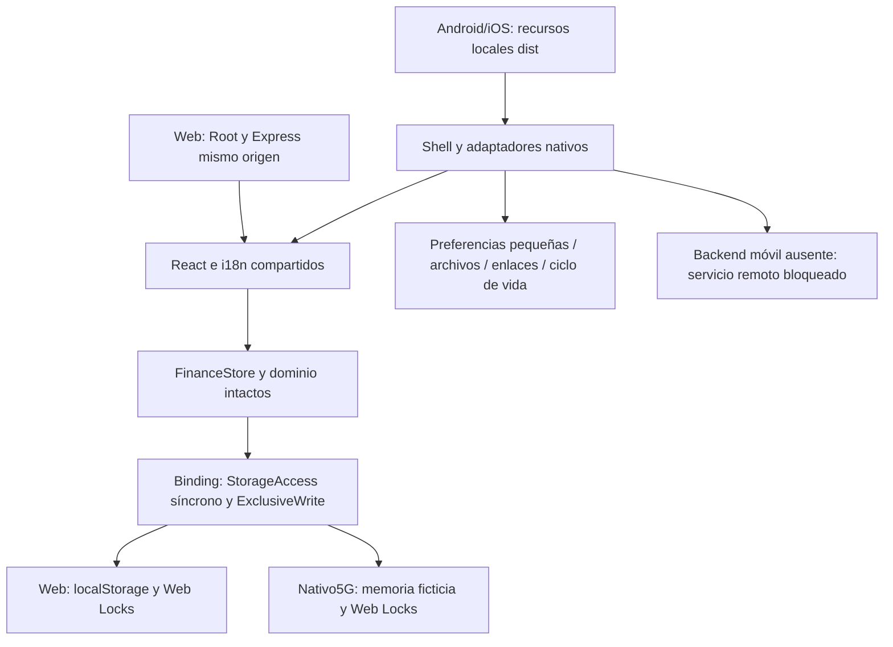

# Fase 5G — Base multiplataforma web, Android e iOS

## Checkpoint 1: base y auditoría

Base `871e6304a5dccf7ceab601755cd08bcdda81e7df`, merge de PR #30 confirmado en GitHub y origin/main, sin commits posteriores al comenzar. Rama nueva `feature/phase-5g-multiplatform-foundation`, worktree limpio y separado. Se conservan las carpetas y ramas anteriores; main no se modifica. Se revisan arquitectura y evidencias 5A–5F: cinco idiomas, JSON3.5, diccionarios/pantallas diferidos, paginación completa y precarga selectiva.

Node24.22.1/npm11.9.0; Capacitor estable consultado en npm: core/CLI/Android/iOS8.6.2. Plugins oficiales compatibles con core≥8.0.0. Se fijarán versiones exactas. React19 y Vite8 producen recursos web normales; Capacitor empaqueta dist y no requiere sustituir React, Express o el producto web. Referencias oficiales: [entorno](https://capacitorjs.com/docs/getting-started/environment-setup), [cambios8](https://capacitorjs.com/docs/updating/8-0), [escenas iOS8.5](https://capacitorjs.com/docs/updating/8-5), [almacenamiento](https://capacitorjs.com/docs/guides/storage), [SystemBars](https://capacitorjs.com/docs/apis/system-bars).

Validación inicial en checkout871 inmutable: npm ci188paquetes,633/633unitarias y22/22infraestructura; lint/build correctos. Chromium completo en curso, no se presupone845por la referencia anterior. El primer npm ci falló por caché /home/agent/.npm no escribible; se repite con npm_config_cache=/workspace/work/.npm-cache, sin cambiar el lockfile de base. Se conserva la advertencia node-domexception obsoleta. No se reducen pruebas, aserciones, axe ni límites.

## Frontera financiera y bloqueo de producción móvil

FinanceStore usa StorageAccess síncrono y ExclusiveWrite asíncrono. Lee la revisión original, rechaza cambios concurrentes bajo Web Locks, construye borradores separados, ejecuta los validadores y publica estado React solo tras confirmar la escritura. Restauraciones/esquemas/borrados preservan copia recuperable verificada antes de sustituir los datos. La clave financiera y JSON2.5–3.5 no cambian. No se modifica la semántica ni el código de FinanceStore, sus validadores o cálculos.

localStorage/IndexedDB de WebView no demuestran permanencia frente a eliminación de datos, presión de almacenamiento, reinstalación o actualización. Preferences solo es adecuado aquí para dos preferencias visuales pequeñas, nunca para el documento financiero, su revisión o sus copias.

**Decisión de5G:** proyectos nativos de prototipo con datos ficticios y almacenamiento financiero solo en memoria de la sesión. Aviso explícito antes de entrar y durante el uso; importar archivos financieros externos bloqueado. No se lee ni migra el perfil financiero de WebView. Se mantienen los mismos contratos síncronos y Web Locks para las operaciones ficticias; si no hay contexto seguro/Web Locks, se rechazan las escrituras. No se emula un almacén nativo asíncrono mediante escrituras pendientes sobre una caché síncrona.

La persistencia financiera nativa permanente queda **bloqueada para datos reales**. Alternativa futura: repositorio asíncrono transaccional SQLite con revisión CAS, serialización de escritores, confirmación durable, recuperación, cifrado y claves en Keystore/Keychain, con adaptación explícita de todos los consumidores y pruebas de cierre forzado/espacio/corrupción/actualización. No basta con instalar un plugin: selección, clave, backups del sistema y garantías de commit deben revisarse antes de habilitarlo. No se instala SQLite ni se afirma haber validado esas garantías en esta PR.

## Inventario inicial

| Dependencia | Web actual | Adaptación/prototipo nativo |
| --- | --- | --- |
|FinanceStore/StorageAccess |localStorage síncrono,Web Locks,revisión y recuperación |Mismo core,almacén de sesión separado;sin persistencia real |
|useFinanceData |Construye store,escucha storage/focus |Inyección de binding de plataforma;reanudar solo comprueba revisión |
|Idioma/tema |Claves independientes en localStorage y storage event |Preferencias visuales pequeñas,adaptador asíncrono;sin datos financieros |
|Root/rutas |Landing y /app bajo APP_BASE_PATH |Shell local que entra al App compartido,base nativa / |
|Express |SPA y POST assistant-chat/parse-movement |No se empaqueta ni ejecuta un servidor Express en el dispositivo |
|Asistente |Un consumidor fetch de paths.assistant;contexto calculado/local primero |Backend móvil ausente:sin fetch relativo/URL inventada;aviso y funciones locales |
|parse-movement |Endpoint Express conservado;registro actual usa parser local |Sin consumidor cliente que requiera migrar;parser y prompts intactos |
|JSON/CSV |Blob/enlace download,JSON con preview y restauración explícita |Exportación de sesión ficticia mediante caché privada/Share;importación real bloqueada |
|Recuperación |Copias verificadas en el mismo contrato de almacenamiento |Copias ficticias de sesión;no se certifica recuperación tras muerte del proceso |
|Overlay y navegación |Jerarquía/foco/Escape,guardas de planificación |Atrás nunca descarta formularios/restauraciones;reutiliza guardas/consume evento |
|Pantalla/teclado |CSSresponsive,44px,safe-area parcial |CSS nativo específico,SystemBars/teclado/ciclo de vida oficiales |
|Enlaces |Rutas locales/anchors |Enlaces externos HTTPS por navegador del sistema;sin deep links/restauración automática |
|Precarga |APIs opcionales/red/idle de5F |Mismo comportamiento,cae a carga bajo demanda si faltan capacidades |

## Plataformas y herramientas disponibles

Linux x86_64. Hay JRE21.0.13, pero no javac, Android SDK, adb, emulador, Android Studio, Xcode ni Swift disponibles al iniciar. No existe /dev/kvm. Se intentará preparar una toolchain Android local dentro del workspace para compilar, sin instalar un IDE completo ni generar claves de distribución. La ejecución Android en emulador/dispositivo está pendiente; iOS requiere macOS/Xcode26+ y queda bloqueado en este host. Generar un proyecto iOS desde Linux no se presentará como compilación o validación WKWebView.

Identificador provisional elegido: `invalid.finanzas.prototype` (espacio .invalid reservado), nombre de prototipo claramente indicado. No se registra ningún producto. Debe aprobarse el identificador definitivo antes de instalaciones que conserven datos reales, firma o beta externa. No se generan/suben certificados,keystores reales,credenciales ni distribuciones. El objetivo de compilación local será una variante de desarrollo sin firma.

## Diseño compartido

## Validación y entrega pendientes

Faltan checkpoints2–5: proyectos/sincronización,adaptadores/pruebas,experiencia móvil,batería web final,mediciones,matriz y una única PR Draft con CI del SHA final. Los947grupos axe incompletos en53conjuntos de5F siguen pendientes de revisión contextual;no son947violaciones ni se declaran resueltos. No hay lector de pantalla/dispositivos físicos probados.

No fusionar,desplegar,publicar en tiendas/TestFlight,sincronizar Google AI Studio ni cambiar main/protecciones. No añadir nube,autenticación bancaria,actualizaciones remotas de JavaScript ni semántica financiera nueva.

## Checkpoint 2 — Proyectos y compilación real

Core/CLI/Android/iOS8.6.2 y plugins oficiales app8.1.2,browser8.0.5,filesystem8.1.5,keyboard8.0.6,preferences8.0.1,share8.0.3 fijados. Las188entradas previas del lockfile conservan versión e integridad. webDir=dist;build:native independiente,base local /,sin server.url remoto,CSP nativo y metadato verificado antes de cap sync. Los comandos web y vite.config.ts siguen intactos. Un build web cargado por error en un contenedor falla cerrado sin montar App.

[Resultados del checkpoint](phase-5g-checkpoint2-validation.json):637/637unitarias,lint y builds web/nativo correctos;cap add y sync de ambas plataformas correctos. Android ha ejecutado assembleDebug de verdad:273tareas,4m35s,APK con recursos locales y SIN firma. No se genera un keystore ni se publica el binario;sin firma no es una instalación ejecutada. Java/JDK21.0.13+9 verificado por checksum,SDK/target36,min24,AGP8.13.0,Gradle8.14.3 con checksum del wrapper. La descarga del SDK se resolvió confiando en la CA del sistema del entorno,con TLS activado;ningún ajuste de confianza entra en la aplicación.

Android:INTERNET es el único permiso;backup del sistema y transferencia de datos excluidos,cleartext desactivado,FileProvider solo cache/finanzas-prototype-exports y signingConfig debug nulo. iOS:SPM y UIScene generados,ATS sin excepciones de HTTP,intercambio público de Documents desactivado,manifiesto de privacidad para timestamps de archivos propios y preferencias propias incluido en recursos. No se afirma compilación iOS,WKWebView o almacenamiento persistente por generar estos archivos en Linux.

El contenedor permanece deliberadamente bloqueado antes del checkpoint3;no abre el store web ni habilita datos reales. Los SDK nativos quedan detrás de la entrada nativa;la web no necesita sus APIs. El script nativo reconstruye y comprueba los recursos antes de sincronizar para evitar empaquetar accidentalmente otro dist.

## Checkpoint 3 — Adaptadores y sesión ficticia

[Validación del checkpoint](phase-5g-checkpoint3-validation.json):653/653unitarias y lint correctos. Se añade una frontera de StorageAccess estrictamente síncrona (setItem devuelve undefined,las promesas se rechazan por tipos);web conserva localStorage,DATA_KEY,Web Locks y eventos storage/focus. El prototipo usa un Map nuevo por sesión y el mismo FinanceStore,validadores,revisiones y recuperación;si faltan Web Locks/contexto seguro se bloquea la escritura. Los44archivos financieros/configuración web protegidos siguen idénticos.

La importación externa se rechaza tanto al pulsar el botón como al recibir un File programático. Las copias de recuperación y la descarga forense usan el binding correcto,por lo que un perfil WebView previo no se mezcla con el prototipo. Exportaciones JSON/CSV conservan bytes/formato vigentes;se esperan sus promesas,se bloquea duplicación y los errores conservan datos/formularios. En nativo el exportador escribe solo Cache privado,verifica lectura exacta antes de Share y limpia únicamente sus temporales caducados en la siguiente exportación explícita. No limpia ni guarda finanzas al reanudar.

Preferences se limita a las claves visuales existentes:hidratación asíncrona antes del proveedor y cola serializada para cambios rápidos,sin almacenar documentos financieros. El asistente nativo muestra indisponibilidad del servicio remoto y conserva consultas/registro locales;no envía fetch relativo al servidor de recursos local ni incorpora backend/secretos. Web conserva el endpoint del mismo origen y los payloads originales.

Prueba inicial real del build nativo en Chromium:consentimiento antes de entrar,App compartido iniciado,0errores y0lecturas/escrituras financieras de WebView con un perfil centinela preexistente. Es una prueba de adaptadores en navegador,no Android/WKWebView. La matriz,las guardas completas y los hashes de capturas finales se completan en checkpoint4. El análisis intermedio web mide138.072bytes gzip iniciales frente a137.397de5F,sin módulos Capacitor iniciales. La comparación temporal definitiva se ejecutará secuencialmente,sin compilaciones o pruebas concurrentes;la primera sonda compartió CPU con unitarias y queda excluida de la comparación de tiempos.

## Checkpoint 4 — Regresión de adaptadores y experiencia móvil emulada

40/40 resultados nuevos de Chromium,0fallos/omisiones/cancelaciones,59,19s. Incluye consentimiento,JSON3.5 de sesión,exportación,cinco idiomas sin cambios financieros,reinicio desechable,importación bloqueada incluso por File programático,backend remoto ausente,fallo de exportación,Atrás/reanudar con borradores y confirmación de Planificación,build web erróneamente empaquetado y foco al entrar. La matriz cubre cinco idiomas ×390/768/1280×dos temas:tanto consentimiento como inicio,60superficies axe,sin violaciones. Los incompletos quedan registrados para revisión contextual, no como aprobados manualmente. Evidencia en [checkpoint4-browser.json](phase-5g-evidence/checkpoint4-browser.json).

La nueva prueba detectó un desbordamiento real de9px en francés/tablet/texto125%:la línea del estado de amortización no se envolvía. Se permite flex-wrap únicamente en esa línea,sin tocar cálculos ni traducciones. [Antes](phase-5g-evidence/fr-tablet-text125-before.png) y [después](phase-5g-evidence/fr-tablet-text125-after.png),recursos de producción y datos ficticios. El foco pasa al botón Volver al dejar el consentimiento. CDP emula insets24/16px para verificar CSS y se comprueba la ocultación de la navegación con el estado del teclado;no son pruebas de notch ni teclado de un sistema operativo real.

654/654unitarias y lint correctos;la nueva aserción verifica los44hashes protegidos en CI. Se conserva cada una de las43suites anteriores y se añade una al final. La primera ejecución del nuevo test falló por tres supuestos del propio harness (mayúsculas de cartera,botón de envío vacío,foco inicial);se corrigieron esos supuestos sin cambiar comportamientos financieros. La primera corrección de reflow tuvo un intento de parche abortado antes de modificar el archivo;las ejecuciones anteriores quedan conservadas y la validación40/40 corresponde al código corregido.
