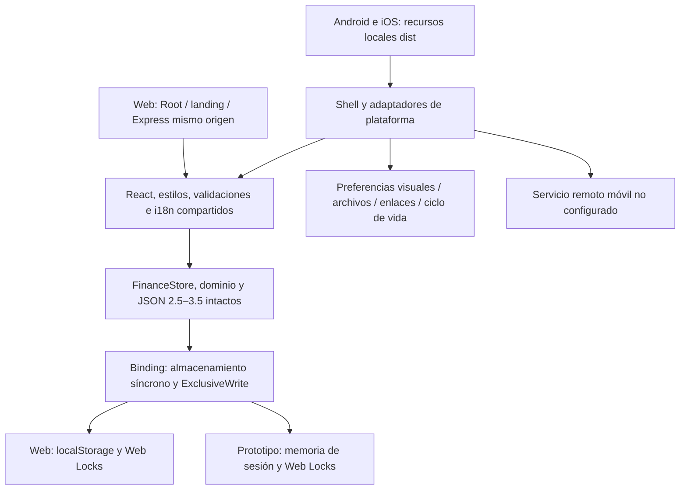

# Fase 5G — Base multiplataforma

## Estado y límites de la entrega

Rama `feature/phase-5g-multiplatform-foundation`, nacida con árbol limpio de `origin/main` en `871e6304a5dccf7ceab601755cd08bcdda81e7df`. La fusión de PR #30 se confirmó en GitHub; no había commits posteriores al empezar. Se conservan todos los worktrees anteriores y un checkout base inmutable. Se revisaron arquitectura, contratos y documentación 5A–5F. No se modifica main, su protección, Express, Google AI Studio ni los modelos contables.

La web continúa siendo el producto existente. Android e iOS son **prototipos para datos ficticios** que empaquetan los recursos locales de React. La persistencia financiera nativa permanente, la importación de archivos financieros reales y el backend móvil están **bloqueados**. No hay publicación, distribución, actualización remota de JavaScript, firma ni credenciales de producción.

Fuente de las mediciones y compilaciones: `c6f663f00781611ecca2e3575ba6102bdcfddf91`. Los archivos documentales posteriores no alteran esa fuente; se verifica el inventario de assets y los hashes del frontend. El SHA final y los checks de ese SHA se enlazan en la única PR Draft, evitando un ciclo de commits documentales que cambie el SHA que se está describiendo.

## Arquitectura compartida



`src/platform/environment.ts` centraliza los tipos web/android/ios/test/blocked; no utiliza user-agent. El modo test representa exclusivamente el build nativo abierto en un navegador de pruebas. Un contenedor que empaquete por error el build web muestra un bloqueo antes de montar App o leer finanzas. La entrada nativa carga sus SDK mediante importación dinámica; el grafo web no contiene módulos Capacitor, ni siquiera en chunks diferidos.

`PlatformServices` aporta binding financiero, capacidad de importar, exportación asíncrona, endpoint del asistente, notificaciones y registro de Atrás. Su valor web conserva los contratos previos. No se duplican proveedores i18n ni instancias de almacenamiento. El contexto del prototipo y su Map permanecen estables al cambiar idioma o tema.

Los [44 archivos protegidos](phase-5g-protected-files.json) conservan sus hashes: FinanceStore, cálculos, validadores, modelos, identificadores, parsers, esquemas, reglas de catálogo/préstamos/transferencias/gastos compartidos, prompts/API, servidor, configuración de rutas, Vite web y workflow. Una nueva prueba verifica esos bytes en CI. `useFinanceData` es la frontera de inyección del adaptador, no una sustitución de FinanceStore.

## Capacitor y compatibilidad

Se consultaron npm y las fuentes oficiales antes de instalar: [entorno](https://capacitorjs.com/docs/getting-started/environment-setup), [actualización 8](https://capacitorjs.com/docs/updating/8-0), [UIScene en 8.5](https://capacitorjs.com/docs/updating/8-5), [almacenamiento](https://capacitorjs.com/docs/guides/storage), [SystemBars](https://capacitorjs.com/docs/apis/system-bars).

| Componente | Versión / decisión |
| --- | --- |
| Node / npm validados | 24.22.1 / 11.9.0; Capacitor requiere Node ≥22 |
| React / React DOM | 19.3.1, conservados del lockfile |
| Vite / TypeScript / Playwright | 8.3.7 / 7.0.2 / playwright-core 1.64.1, conservados |
| Capacitor core / CLI / Android / iOS | 8.6.2 exactas |
| Plugins oficiales | app 8.1.2, browser 8.0.5, filesystem 8.1.5, keyboard 8.0.6, preferences 8.0.1, share 8.0.3 |
| Android | min SDK 24, compile/target SDK 36, AGP 8.13.0, Gradle 8.14.3 con checksum |
| Herramientas Android locales | JDK Temurin 21.0.13+9, command-line tools 15859902, build-tools 36.0.0 |
| IDE Android requerido | Android Studio 2025.2.1+; no instalado en este host |
| iOS | deployment target 15.0, Swift Package Manager y UIScene; Xcode 26+ sobre macOS |

Las 188 entradas previas del lockfile conservan versión e integridad. `npm ci` instala ahora 305 paquetes; no se actualizan dependencias previas. No se introduce otro framework, SQLite ni SDK de analítica. La licencia y los requisitos de plugins deben revisarse de nuevo antes de distribución.

## Configuración y comandos reproducibles

Identificador **provisional**: `invalid.finanzas.prototype`, espacio `.invalid` reservado; nombre visible «FinanZas Pro Prototipo». No es un identificador aprobado ni un producto registrado. El identificador final debe aprobarse antes de instalaciones que conserven datos reales, firma o beta externa. Los iconos nativos son los de la plantilla de desarrollo y deben sustituirse antes de una beta.

`capacitor.config.ts` define `webDir: dist`, hostname local, Android HTTPS local e iOS `capacitor://localhost`; no configura `server.url`, dominios de producción ni API móvil. `vite.native.config.ts` extiende el Vite web sin modificarlo: base `/`, `viewport-fit=cover`, CSP nativa y metadato de prototipo. El script comprueba ese metadato antes de sincronizar, para no empaquetar un dist web por accidente.

```bash
npm ci
npm run dev                  # Express y Vite web, comportamiento existente
npm run build                # build web; conserva APP_BASE_PATH
npm run build:native         # dist de recursos locales de prototipo
npm run native:sync:android  # reconstruye, verifica y sincroniza Android
npm run native:open:android  # abre Android Studio después de sincronizar
npm run native:android:assemble # reconstruye/sincroniza y :app:assembleDebug sin firma
npm run native:sync:ios      # reconstruye, verifica y sincroniza iOS
npm run native:open:ios      # macOS: abre Xcode después de sincronizar
```

Los comandos nativos normales comparten `dist`; no ejecutar una sincronización mientras un servidor/prueba está leyendo ese directorio. Al volver a web, ejecutar `npm run build`. La suite nueva genera su propio directorio aislado de preview y no reemplaza el dist de las 43 suites anteriores. No usar `npm run clean` ni eliminar worktrees para preparar herramientas.

Android necesita `JAVA_HOME`, `ANDROID_HOME`/`ANDROID_SDK_ROOT`, SDK 36 y build-tools 36.0.0. Puede abrirse también el directorio `android/` en Android Studio. iOS se abre con `ios/App/App.xcodeproj`; resolver `CapApp-SPM` con acceso a sus fuentes oficiales y elegir simulador sin firma de distribución. No se han resuelto ni compilado esos paquetes con Xcode en Linux. En un Mac preparado puede verificarse el simulador sin firma con:

```bash
xcodebuild -project ios/App/App.xcodeproj -scheme App \
  -sdk iphonesimulator -destination 'generic/platform=iOS Simulator' \
  CODE_SIGNING_ALLOWED=NO build
```

Ese comando **no se ha ejecutado** aquí. Android produce deliberadamente un APK sin firma: abrir el proyecto no implica que Android Studio pueda instalarlo directamente. La instalación necesita una decisión posterior sobre firma local de desarrollo; esta PR no genera claves ni modifica ese bloqueo para distribuir un binario.

## Inventario de dependencias del navegador

| Capacidad actual | Web | Contenedor nativo y límites |
| --- | --- | --- |
| DOM, foco, eventos de teclado/puntero, scroll, ResizeObserver/MutationObserver | Componentes React existentes | Mismos componentes; teclado/barras/ciclo de vida solo por adaptadores; ejecución SO pendiente |
| localStorage | Finanzas y preferencias separadas | Finanzas solo Map; preferencias visuales con Preferences y caché UI existente; no IndexedDB financiero nuevo |
| Web Locks / contexto seguro | Escrituras protegidas, probado en Chromium | Misma protección; se rechaza escribir si no está disponible, no se presume compatibilidad WKWebView |
| crypto.randomUUID/getRandomValues | Identidades/revisiones y nonce | No se introduce fallback inseguro; capacidad real del WebView pendiente |
| Intl, EUR, Europe/Madrid | Cinco idiomas existentes | Presentación compartida, sin retorno del formato al parser; locales de SO pendientes |
| Blob, File, lectura de JSON y enlaces download | Exportación/importación y preview existentes | JSON/CSV mediante caché privada/Share; importación externa bloqueada; no hay otro formato |
| beforeprint/afterprint | useCompletePrint mantiene todas las filas y restaura scroll | No hay adaptador de impresión móvil ni certificación de impresión; la exportación completa JSON/CSV es independiente |
| matchMedia, tamaños y visibilidad | Tema y responsive existentes | CSS específico con env de áreas seguras; no se confunde emulación con SO real |
| requestIdleCallback y señales opcionales de red/ahorro | Precarga selectiva de 5F | Se mantienen sus fallbacks y guardas; no se descargan todos los módulos ni se depende de hover |
| location, rutas APP_BASE_PATH y fetch | Landing/App y Express mismo origen | Base local /, salida documental protegida, enlaces HTTPS por Browser y servicio remoto no configurado |

No se añade service worker, almacenamiento remoto, un segundo motor financiero ni API de dispositivos dispersa por componentes. El acceso nativo queda concentrado en src/platform/native. Los hooks de impresión existentes son presentación de navegador; ni este inventario ni una compilación certifican impresoras, WebView o dispositivos físicos.

## Persistencia y protección financiera

### Contratos existentes

FinanceStore lee la revisión inicial, serializa mediante Web Locks, vuelve a validar revisión y borrador, y publica el nuevo estado solo tras confirmar una escritura. Restaurar o sustituir datos requiere copia recuperable verificada y confirmación explícita. No cambian claves, JSON 2.5–3.5, redondeos, orden de sumas ni identificadores. La web conserva eventos storage/focus, errores de cuota, rechazo de conflictos y formularios pendientes.

`SyncFinanceStorage.setItem` devuelve **undefined**, no void: una función que devuelva Promise no satisface el contrato. El binding web conserva el acceso síncrono real y diferido a localStorage; nunca se presenta una promesa de persistencia como un guardado síncrono completado.

### Prototipo nativo

Cada arranque crea un almacén **en memoria**, separado del perfil localStorage de WebView. No lee, importa ni migra un perfil previo. Antes de entrar exige aceptar el aviso de datos ficticios; mantiene una advertencia durante el uso. Reiniciar pierde la sesión. Las copias y las revisiones ficticias usan el mismo core y ese Map, sin afirmar durabilidad tras muerte del proceso.

Se conserva el mismo `browserExclusiveWrite`: si faltan contexto seguro o Web Locks, las escrituras se rechazan. No hay sustitución por un mutex más débil. La disponibilidad real de Web Locks en Android System WebView/WKWebView no se ha comprobado; no se promete escritura nativa en un entorno sin esa capacidad.

La sonda de Chromium mantiene un perfil centinela previo y registra **0 lecturas y 0 escrituras financieras en WebView** al usar idioma, tema, exportación, navegación y reanudación. Prueba operaciones reales en el FinanceStore de sesión y conservación exacta del backup al cambiar idioma. Esto demuestra aislamiento del adaptador, no permanencia nativa.

### Bloqueo de datos reales y propuesta posterior

localStorage o IndexedDB de WebView no certifican supervivencia frente a presión de almacenamiento, borrado del sistema, reinstalación, cambio de origen o actualización. Preferences se utiliza solo para `finanzas.ui.language` y `finanzas.ui.theme`, nunca para finanzas, revisiones ni recuperaciones. Es asíncrono, se hidrata antes de i18n y serializa cambios rápidos; su fallo mantiene la selección de sesión y muestra un aviso.

Antes de habilitar datos reales se requiere seleccionar y probar un repositorio nativo transaccional, por ejemplo SQLite con revisión CAS y escritores serializados; confirmar commit durable, recuperación y verificación tras escritura; decidir cifrado, custodia/rotación de claves en Keystore/Keychain, archivos temporales y recuperación ante pérdida de clave. Todos los consumidores deben adaptarse explícitamente a contratos asíncronos. Instalar un plugin o mantener una caché con escrituras pendientes no es suficiente.

Se necesitan pruebas de cierre forzado en cada punto crítico, disco lleno, archivo truncado, corrupción, migración/actualización instalada, copia y restauración cancelada/confirmada. También política de backups del sistema, borrado/reinstalación y privacidad. Nada de esto se declara aprobado por la compilación de un APK.

## Archivos, restauración y recuperación

La web conserva JSON 3.5, validación/preview/confirmación/restauración atómica y CSV completo sobre todos los resultados filtrados, no solo la página montada. Las descargas utilizan el adaptador asíncrono; una exportación repetida no abre operaciones simultáneas y el fallo no borra datos ni formularios. El contenido CSV, BOM, cabeceras y formato bancario existente no cambian.

En nativo, una exportación explícita de la sesión ficticia escribe en `Cache/finanzas-prototype-exports`, verifica lectura exacta antes de abrir Share y mantiene el archivo para lectores asíncronos. La siguiente exportación explícita limpia únicamente sus nombres propios de más de 24 horas. No hay limpieza ni escritura de archivos financieros al iniciar o reanudar. Fallos de cuota/truncado cancelan Share y limpian solo el temporal propio fallido. Son contratos verificados con drivers simulados; el diálogo Share y el acceso de otras apps no se han ejecutado en un SO móvil.

FileProvider Android expone solo ese subdirectorio privado, sin rutas públicas; compartir requiere acción y selección explícita del usuario. Una app receptora puede conservar lo compartido: esto debe explicarse de nuevo antes de manejar datos reales. iOS no habilita File Sharing ni Documents In Place. No se solicita acceso general al almacenamiento.

La importación externa nativa se bloquea tanto en el botón como ante un File programático. No hay selector de documentos habilitado para datos reales, restauración automática por URL ni handlers de archivos del sistema. Se conserva la restauración explícita de los propios datos ficticios y la implementación web completa. El selector nativo y la restauración persistente quedan bloqueados hasta resolver el repositorio durable; no se inventa un formato alternativo.

## Express y asistente

El servidor mantiene `/api/assistant-chat` y `/api/parse-movement`, bajo las rutas existentes de mismo origen y APP_BASE_PATH. El consumidor actual de chat usa la ruta existente; no hay consumidor cliente activo de parse-movement que necesite cambiarse. Express, prompts, reconocimiento de intención y payloads permanecen idénticos.

No hay backend móvil HTTPS autorizado. El adaptador nativo entrega endpoint null: muestra indisponibilidad remota, conserva consultas y registro locales, y no intenta fetch relativo al servidor de recursos de Capacitor. No se inventa una URL, se amplía CORS ni se incluye Gemini/API keys en el cliente. Un futuro servicio requiere autorización, HTTPS y autenticación/privacidad apropiadas: el origen localhost de Capacitor no es una credencial.

Las cinco traducciones usan el proveedor existente. La entrada natural mantiene las limitaciones previas de reconocimiento en español; no se amplían capacidades, parser, prompts ni API por cambiar plataforma.

## Experiencia y seguridad nativas

- Atrás Android se registra antes de habilitar App; si falla ese listener crítico, el arranque falla cerrado. Primero oculta teclado; después preserva diálogos, restauraciones y formularios con borradores. Planificación reutiliza su confirmación existente. En inicio minimiza Android, sin exitApp. El botón Volver de iOS usa las mismas guardas; no se habilita navegación gestual de historial que pueda saltarlas.
- Al reanudar solo se emite la comprobación de revisión de focus. No hay autosave, recarga, migración ni restauración financiera. Cambiar de app o recibir llamadas sigue pendiente de ejecución nativa real.
- SystemBars/Keyboard y CSS específico gestionan tema, insets y espacio de teclado. El modo nativo de insets permite padding nativo en WebView antiguo y env en el moderno, evitando aplicar ambos dos veces. CDP prueba insets 24/16 px y CSS de teclado; no equivale a notch, barras o teclado Android/iOS reales.
- Los enlaces externos HTTPS se abren con el navegador del sistema tras un click confiable. Se rechazan HTTP, scripts, archivos, credenciales en URL y navegación documental interna que pueda descartar el formulario. No hay deep links registrados; los eventos de apertura recibidos no restauran nada automáticamente.
- La CSP nativa permite recursos locales, bloquea frames/objetos/form submission y conexiones externas; conserva estilos inline necesarios de React. No hay allowNavigation remota, contenido mixto, cleartext, puente HTTP nativo automático ni cookies nativas habilitadas.
- Android desactiva backups y transferencia de todos los dominios de datos. El APK fusionado declara INTERNET y el permiso propio de firma DYNAMIC_RECEIVER_NOT_EXPORTED_PERMISSION generado por AndroidX; no hay permisos peligrosos de archivos/cámara/contactos. iOS conserva ATS sin excepciones y un manifiesto de privacidad para timestamps propios C617.1 y preferencias CA92.1, sin tracking. Estas declaraciones requieren revisión de distribución posterior.
- Logging nativo desactivado y WebContents debugging de Android desactivado. No se introducen logs financieros, analítica, trackers, SDK publicitarios, cloud/banca ni actualizaciones remotas. El APK se inspecciona para confirmar recursos locales y ausencia de archivos de servidor, claves de firma o patrones de clave Gemini.

## Incidencias y correcciones acotadas

| ID | Caso reproducible | Corrección / estado |
| --- | --- | --- |
| 5G-01 | Un build web podría abrir el perfil WebView en un contenedor mal empaquetado | Detección explícita y bloqueo antes de App; prueba Chromium |
| 5G-02 | Las rutas relativas de IA no sirven como backend móvil | Endpoint nulo, aviso y funciones locales; cero peticiones API en preview |
| 5G-03 | Exportación nativa asíncrona requiere esperar fallo/confirmación | Adaptador awaited, single-flight, lectura verificada y conservación de sesión |
| 5G-04 | Atrás podría descartar un formulario | Listener previo al App y guardas originales; borradores y foco comprobados en preview |
| 5G-05 | Francés, 768 px, texto 125%: estado de amortización rebasa 9 px | flex-wrap solo en esa línea; matriz y capturas antes/después |
| 5G-06 | Al retirar el consentimiento, el foco quedaba en body | Foco explícito en Volver; Tab y Shift+Tab comprobados |
| 5G-B1 | Persistencia financiera nativa durable no demostrada | Bloqueado: solo sesión ficticia, importación real deshabilitada |
| 5G-B2 | No existe backend móvil autorizado | Servicio remoto bloqueado; no se despliega ninguno |
| 5G-B3 | Host Linux sin emulador/KVM/dispositivo ni macOS/Xcode | Android compilado sin ejecutar; iOS preparado sin compilar |

[Comparativa francés antes](phase-5g-evidence/fr-tablet-text125-before.png) / [después](phase-5g-evidence/fr-tablet-text125-after.png). Las diez capturas `native-preview-{idioma}-{tema}.png` muestran el App real con fixtures, build de producción y 390×900. Son screenshots de Chromium, no emuladores móviles. Los hashes de fuente de [checkpoint4-browser.json](phase-5g-evidence/checkpoint4-browser.json) fijan su procedencia.

## Pruebas y evidencia

La base se volvió a ejecutar, sin asumir la referencia: npm ci 188 paquetes, **633 unitarias, 22 infraestructura y 845 Chromium en 43 suites**, sin fallos, omisiones, cancelaciones ni todo; lint/build correctos. La batería de navegador base duró 3.199,754 s en este host.

La nueva cobertura añade 21 unitarias y 40 resultados Chromium: plataforma/configuración, hashes protegidos, sincronía estricta, aislamiento/revisiones/errores/cuota/recuperación del mismo store, falta de Web Locks, preferencias asíncronas, exportaciones verificadas/fallidas/concurrentes, enlaces y registro de Atrás. El preview utiliza recursos de producción y comprueba sesión JSON 3.5, bloqueo de importación, exportación, cambio de idiomas, reinicio desechable, guardas, backend ausente, CSS seguro y teclado/foco.

La matriz nueva cubre cinco idiomas × tres anchos (390/768/1280) × dos temas, tanto consentimiento como inicio: **60 superficies, cero violaciones automatizadas y cero grupos incompletos en esa ejecución focalizada**. Ninguna regla axe se deshabilita. No se usan lectores de pantalla, Safari/iPhone real ni dispositivos físicos. Los **947 grupos incompletos / 53 conjuntos equivalentes de 5F** siguen pendientes; no son infracciones ni se declaran resueltos. Se conserva su [revisión contextual](phase-5f-reference-axe-review.json) y se separan de los nuevos resultados.

Validación local final completa de la fuente c6f663f: **654/654 unitarias, 22/22 infraestructura, 885/885 resultados Chromium en 44 suites**, 0 fallos, omisiones, cancelaciones o todo. npm ci (305 paquetes), lint, build y análisis de bundles aprobados. La batería de navegador final dura 3195.596 s en este host. [Resumen completo](phase-5g-evidence/final-local-validation.json).

La agrupación final local contiene 1571 observaciones, cero violaciones, 906 grupos incompletos / 49 conjuntos equivalentes / 5520 ocurrencias de nodos; [procedencia y ejemplos](phase-5g-evidence/final-local-axe-review.json). La base local nueva tenía 906 grupos/49 conjuntos, separados de los 947/53 de CI 5F. No se convierten pendientes contextuales en aprobaciones manuales ni se afirma revisión con lector de pantalla.

Se conservan 210 hashes de fuente y 39 assets web byte a byte después del cierre documental. Las 43 suites originales y el prefijo íntegro del comando test:ui están verificados; solo se añade la suite de prototipo. Los 44 archivos financieros/configuración protegidos siguen intactos.

## Compilaciones y matriz por plataforma

Android `:app:assembleDebug` **compilado**, build incremental 20 s, 185 tareas (21 ejecutadas/164 actualizadas). APK **sin firma**, 5.543.039 bytes, SHA256 `6f8421e4176ce0b7add4e4a7aac28aa2706fec9401f2511199c7371fc2fd1da3`; 46 recursos web locales, 2.450.652 bytes sin comprimir. El primer build limpio del checkpoint2 ejecutó 273 tareas/4m35; ambos registros se distinguen. El binario no se sube al repositorio ni se distribuye. Verificar con apksigner rechaza intencionadamente el APK sin firma; ZIP/recursos/ausencia de firma se comprobaron por separado.

`cap sync android` y `cap sync ios` pasan. Generar/sincronizar iOS desde Linux solo prepara fuentes y recursos; resolver SPM, compilar y ejecutar WKWebView requieren macOS/Xcode. Android no se instala: faltan emulador/imagen/dispositivo y /dev/kvm; quedan aproximadamente 1,4 GB de disco y no se eliminan entornos previos para forzar una imagen. No se mide una versión de WebView inexistente en este host.

| Funcionalidad | Web | Preview Chromium del build nativo | Android | iOS |
| --- | --- | --- | --- | --- |
| Fuentes/configuración | Aprobado | Aprobado | Aprobado | Aprobado, solo fuentes |
| Compilación | Aprobado | Aprobado | Aprobado, APK sin firma | Bloqueado: macOS/Xcode |
| Arranque/navegación | Aprobado, batería web | Aprobado | Bloqueado: sin runtime | Bloqueado: sin runtime |
| Movimientos/cálculos | Aprobado, batería web | Core/carteras probados; alta de movimiento no ejecutada en preview | Bloqueado | Bloqueado |
| Persistencia/reapertura | Aprobado, batería web | Aprobado solo aislamiento y reinicio desechable | Bloqueado para datos reales | Bloqueado para datos reales |
| Exportación | Aprobado, batería web | Aprobado descarga web/driver simulado | No ejecutado Share/SO | No ejecutado Share/SO |
| Restauración | Aprobado, batería web | Aprobado bloqueo externo; contratos de sesión unitarios | Bloqueado durable | Bloqueado durable |
| Cinco idiomas y tema | Aprobado, batería web | Aprobado | No ejecutado en SO | No ejecutado en SO |
| Accesibilidad automatizada | Aprobado, batería web | Aprobado axe, 60 superficies | No ejecutado en SO | No ejecutado en SO |
| Recuperación de errores | Aprobado, batería web | Aprobado contratos simulados/sesión | Bloqueado cierre/cuota/actualización | Bloqueado cierre/cuota/actualización |
| Teclado/barras/interrupciones | No aplicable SO móvil | Aprobado CSS/CDP/guardas; no SO | No ejecutado | No ejecutado |

No debe leerse «bloqueado» como aprobado. La matriz separa pruebas web, adaptadores simulados, compilación real y ejecución nativa pendiente.

## Rendimiento y tamaño

[Tabla completa de medianas y rangos](phase-5g-evidence/performance.md), [carga/navegación](phase-5g-evidence/core-comparison.json) y [recorridos](phase-5g-evidence/journeys-comparison.json). Cada versión aporta 144 filas de carga y 72 recorridos, tres muestras por escenario/perfil. Se ejecutan antes y después de forma secuencial sobre recursos de producción, sin navegadores/builds/pruebas locales competidores. Se verifican hashes financieros, perfiles, Chromium y muestras; cero errores ni peticiones externas. Solo restaurar con confirmación explícita permite escritura y exige conservar una copia recuperable.

| Métrica web móvil emulada | Base 871e630 | Fuente c6f663f |
| --- | --- | --- |
| Landing, JS estático gzip | 137.397 B | 138.072 B (+675; 0,49%) |
| App inicial, JS recibido gzip | 248.196 B | 249.065 B (+869; 0,35%) |
| Entrada App, ms mediana [mín–máx] | 2.766,8 [2.744,6–2.768,1] | 2.750,8 [2.591,9–2.913,0] |
| Abrir 5.000, ms mediana [mín–máx] | 945,0 [879,8–1.102,9] | 1.079,1 [1.002,0–1.358,7] |
| Filtrar 5.000, mediana ms | 512,7 | 512,3 |
| Catálogo, primera apertura, mediana ms | 1.013,5 | 819,5 |
| Planificación, primera apertura, mediana ms | 672,6 | 710,0 |
| Asistente, primera apertura, mediana ms | 1.262,3 | 1.212,5 |
| Abrir formulario / escribir importe, medianas ms | 248,8 / 92,3 | 255,7 / 89,6 |
| Importar preview / restaurar confirmado, medianas ms | 259,9 / 195,5 | 249,0 / 205,2 |
| Heap App, mediana aproximada CDP | 5.027.900 B | 5.056.732 B |
| Heap abrir 5.000, mediana aproximada CDP | 11.267.604 B | 11.450.188 B |

Los tiempos son mixtos y los rangos se solapan: **no se afirma una mejora general ni una regresión causal demostrada**. En particular se conserva la mediana mayor al abrir 5.000 (+14,2%) y la de 1.000 (547,3→672,5 ms), sin ocultarlas ni aumentar timeouts. La lista sigue contabilizando el conjunto completo con 50 filas montadas, sin modificar paginación, cálculos, ordenación ni precarga de 5F. Tampoco se usa la primera pantalla como evidencia de completar trabajo diferido.

El coste JavaScript corresponde a la comprobación de empaquetado/adaptadores y a los avisos en el diccionario canónico; **ningún módulo Capacitor se incorpora al grafo web**. Los otros cuatro diccionarios y módulos siguen diferidos, sin precarga indiscriminada. Las dependencias instaladas pasan de 188 a 305 paquetes; node_modules ocupa 259.796→284.120 KiB en este host, coste de herramientas/plugins, no descarga web inicial. El CSS global pasa de 95.783 a 96.305 B minificados y de 17.264 a 17.331 B gzip (+67 B), medido con el mismo gzipSync del servidor. Se conserva el presupuesto de bundles sin elevarlo y no reaparece un chunk superior a 500 kB.

No hay medición de arranque, memoria o navegación de Android/WKWebView: están bloqueadas por falta de runtime. No se confunden los 2.450.652 B de recursos locales/5.543.039 B del APK con memoria ni velocidad de un teléfono. Los perfiles CPU, JSON comprimidos, capturas, hashes de fuentes y assets quedan en [evidencias](phase-5g-evidence/source-and-assets.json).

## CI y reproducibilidad

Se conserva `.github/workflows/ci.yml` byte a byte: tres checks Unitarias / Lint, build y diff / Chromium y axe, Ubuntu 24.04, Node 24.22.1, permisos contents:read, acciones fijadas por SHA y presupuesto de navegador 50 min. No se elevan límites individuales, se quitan aserciones ni se relaja axe. La suite nativa se añade **después** de las 43 anteriores; también compila sus recursos de producción en CI. El propio npm test verifica configuración/proyectos y los hashes de la frontera protegida; CI no se presenta como compilador Android ni iOS.

CI real de la fuente medida: [43778346659](https://github.com/dlopezteruel-rgb/Finanzas-pro/actions/runs/43778346659), workflow_dispatch sobre c6f663f. **Los tres trabajos terminan en success**; los ZIP se descargan y sus SHA256 se contrastan con los digests de GitHub y el head SHA, no solo con la apariencia del check. [Metadatos, versiones, resúmenes y digests](phase-5g-evidence/reference-ci.json).

| Trabajo | Resultado real | Duración del trabajo |
| --- | --- | --- |
| Unitarias | 654/654 y 22/22 infraestructura | 24 s |
| Lint, build y diff | Aprobado, comparación real con base | 25 s |
| Chromium y axe | 885/885, 44 suites, cero violaciones | 45 min 45 s |

La revisión agrupada de CI reúne 27 informes / 1.571 observaciones, 947 grupos incompletos / 53 conjuntos / 5.762 ocurrencias de nodos. Las 60 superficies nuevas no añaden incompletos. [Ejemplos y procedencia](phase-5g-evidence/reference-ci-axe-review.json); los 53 conjuntos permanecen pendientes de revisión contextual. La diferencia frente al conteo local se conserva separada; no se declara una revisión manual ni una resolución por cambios de conteo.

El cierre documental conserva la fuente y los assets medidos. La PR Draft incluye además los enlaces, estados y duraciones de los **tres checks de su SHA final exacto**; esa comprobación se realiza tras publicar el cierre, sin crear otro commit que invalide el SHA descrito.

Reproducción web completa:

```bash
npm ci
npm test
node scripts/ci/run-check.mjs tools
npm run lint
npm run build
CHROMIUM_PATH=/ruta/real/a/chromium npm run test:ui
git diff origin/main...HEAD --check
git diff --check
PERF_REQUIRE_LAZY=1 node scripts/performance/bundles.mjs /tmp/5g-bundles.json
```

CI resuelve el ejecutable de la versión instalada de playwright-core; no presupone /usr/bin/chromium. Los fixtures y servidores de pruebas son locales y no usan datos personales, API keys ni Google AI Studio. La ruta `/usr/bin/chromium` sí existe en este host y se utilizó para las mediciones.

## Intentos y limitaciones conservados

- El primer npm ci encontró la caché home no escribible; se repitió con caché del workspace, sin actualizar el lockfile de base.
- Errores iniciales de coma y del generador de inventario se corrigieron antes de las validaciones exitosas. El generador correcto es `node scripts/i18n/report.mjs docs/phase-5b-inventory.json`; inventory.mjs produce otro formato.
- Java no confiaba inicialmente en la CA del entorno: se usó la CA verificada del sistema para descargar SDK/Gradle, manteniendo TLS. La configuración de red/herramientas permanece fuera del repositorio y no entra en la app.
- Plantillas Gradle contenían CRLF/espacios finales: el diff-check falló y se corrigió mediante commit separado, sin ocultar el fallo. La prueba de firma sin firma produjo «Missing META-INF/MANIFEST.MF», resultado esperado, no fallo de compilación.
- El nuevo harness supuso incorrectamente nombres de cuenta sin normalizar, un botón de envío vacío habilitado y foco en un elemento ya retirado. Se corrigió el test; no la semántica financiera. La matriz sí encontró el reflow francés, corregido y capturado. Un intento de parche ambiguo se abortó antes de modificar el archivo.
- Una primera sonda temporal compartió CPU con unitarias/lint y se excluyó expresamente. La comparación aceptada se repite de manera secuencial y aislada; no se usa la sonda exploratoria para afirmar rendimiento.
- Permanecen node-domexception obsoleto, aviso de actualización disponible de npm, advertencia de sdkmanager obsoleto y flatDir de las plantillas Gradle. No se actualizan dependencias ni se suprimen advertencias para obtener verde.
- No se certifican persistencia móvil, cifrado, restauración tras cierre, actualizaciones instaladas, permisos interactivos, Share real, orientación/llamadas, lectores de pantalla ni dispositivos físicos.

## Preparación obligatoria antes de beta

1. Aprobar identidad final, marca/iconos y política de privacidad; revisar permisos/manifiestos y compatibilidad real de SDK/WebView/WKWebView.
2. Implementar y validar persistencia durable, cifrado/gestión de claves, revisión CAS, recuperación y política de backups; conservar rechazo de escritura donde falten garantías.
3. Probar Android e iOS en simuladores y dispositivos físicos: cierre forzado, falta de espacio, actualización, corrupción, teclado, notch, navegación, Share y restauración explícita. No retirar el aviso ni habilitar datos reales antes de cumplirlo.
4. Autorizar, desplegar y proteger un backend HTTPS móvil si se desean funciones remotas del asistente; no incluir secretos en cliente ni usar CORS como autenticación.
5. Validar documentos/importación persistente y su preview/confirmaciones; compartir solo con consentimiento explícito. Revisar accesibilidad contextual pendiente y lectores de pantalla.
6. Definir firma y distribución en una fase posterior con credenciales custodiadas; esta PR no crea keystores, certificados, APK firmado, IPA, TestFlight ni publicación.

## Checkpoints publicados e inventario

1. `75ac94d`: auditoría, base y frontera de seguridad.
2. `0b07a4b`, seguido de `181ebcb`: proyectos locales y compilación Android; normalización de plantillas y tarea sin firma.
3. `72856fe`: adaptadores, sesión ficticia y operaciones asíncronas seguras.
4. `c6f663f`: matriz de prototipo, guardas, foco y corrección de reflow; fuente congelada de las mediciones.
5. `d53294a`: perfiles, capturas, hashes y evidencia de compilación recuperables; cierre posterior con batería local completa y CI de referencia verificada.

[Inventario completo de archivos cambiados](phase-5g-changed-files.json). Los cambios se concentran en proyectos/configuración nativos, adaptadores de plataforma, integración mínima de presentación, diccionarios, pruebas y evidencia documental. No se incluye APK, credencial, keystore, certificado privado ni datos personales. El cierre se publica como una única PR Draft hacia main; no se fusiona, despliega, publica en tiendas/TestFlight ni sincroniza Google AI Studio.
