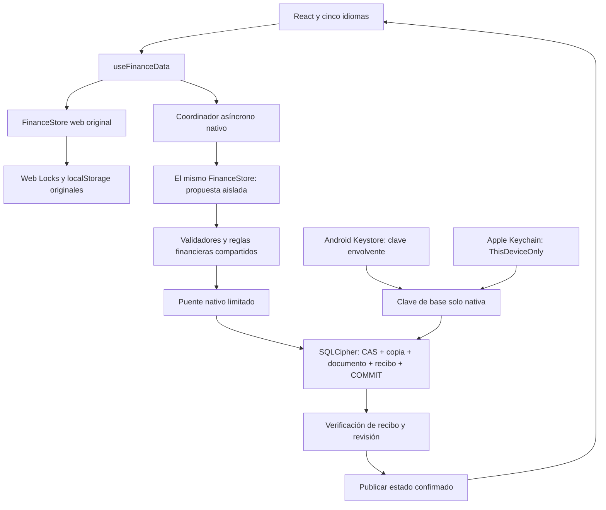

# Fase 5H — Persistencia financiera nativa segura

> El informe de entrega original y sus checkpoints describen la PR32 anterior. La actualización sobre main31a8e8d se documenta al final en «Integración de PR #33 — Persistencia web duradera», con evidencias separadas; no se atribuyen las pruebas históricas al código integrado.

## Estado de entrega y límites

**Infraestructura de prototipo revisable; aceptación completa bloqueada.** Android/iOS continúan sin autorización para datos reales. Además se ha reproducido una incidencia **P0 preexistente en la web**: un SIGKILL inmediato después de confirmar una cuenta puede perder esa escritura de localStorage. El cierre normal y la interrupción antes de escribir sí pasan. El resultado es 2/3 tanto en ce1ec83 como en esta rama; no se presenta como aprobado ni se oculta detrás de la CI habitual.

PR Draft única: [#32](https://github.com/dlopezteruel-rgb/Finanzas-pro/pull/32). El [registro de entrega de la PR](https://github.com/dlopezteruel-rgb/Finanzas-pro/pull/32) incluye el SHA final exacto, la URL de la ejecución final y los tres checks comprobados después de publicar. Los [checks asociados a la revisión actual](https://github.com/dlopezteruel-rgb/Finanzas-pro/pull/32/checks) son la fuente de estado remoto; las cifras siguientes son las ejecuciones **locales** reales. No se deduce aprobación de un check todavía en curso.

| Verificación local | Resultado real |
| --- | --- |
| npm ci | Correcto, 306 paquetes; lockfile conservado salvo plugin local |
| npm test | **699/699**: 654 anteriores +45 nuevas; 0 fallos, canceladas, omitidas o todo |
| Infraestructura CI | **28/28**: 22 anteriores +6 del planificador; sin omisiones |
| Lint / build / diff | Aprobados; comparación real contra ce1ec83 |
| npm run test:ui | **920/920 en 45 suites**: 885 anteriores +35 nuevas; 0 fallos/cancelaciones/omisiones/todo; 3.579,24s |
| Axe combinado | **0 violaciones**, 1.662 observaciones; 937 grupos incompletos /51 conjuntos, pendientes contextuales |
| Axe nuevo | 91 observaciones, 0 violaciones, 31 grupos incompletos /2 conjuntos; revisión contextual pendiente |
| SQLCipher4.20 real, Linux | **11/11**; SQLite3.54.1/OpenSSL3.5.8; no equivale a protección de claves móvil |
| Sonda de reinicio Web, fuera de batería habitual | Base **2/3** y rama **2/3**; SIGKILL tras confirmar **fallido**, con salida1 y estado anterior íntegro |
| Android | APK debug unsigned compilado; runtime **bloqueado**, sin instalar/distribuir |
| iOS | Fuentes y recursos SPM sincronizados; compilación/runtime **bloqueados** por falta de macOS/Xcode |
| npm audit | 0 vulnerabilidades npm; no certifica bibliotecas/cripto nativas |

[Informes de pruebas](phase-5h-evidence/local-browser-summary.json), [unitarias](phase-5h-evidence/local-unit-summary.json), [infraestructura](phase-5h-evidence/local-tools-summary.json), [código/diff](phase-5h-evidence/local-code-summary.json), [agrupación axe](phase-5h-evidence/local-axe-review.json), [motor y APK](phase-5h-evidence/native-build-and-engine.json), [fuentes de runtime](phase-5h-evidence/runtime-source-fingerprints.json). Los apartados de checkpoints que siguen conservan sus resultados históricos; sus cifras intermedias no sustituyen esta tabla.

## Checkpoint 1: base y decisión arquitectónica previa

Base verificada: `ce1ec8398fed0eb6a39f0c362567b8a6613eaf81`, merge de PR #31 confirmado en GitHub. No hay commits posteriores en origin/main al empezar. Rama nueva `feature/phase-5h-secure-native-storage`, árbol inicialmente limpio, worktree independiente. Se conservan todos los entornos anteriores. La referencia 5G se vuelve a ejecutar: su árbol 4796e3f es idéntico al merge ce1ec83; no se heredan aprobaciones por sus cifras anteriores. Los resultados nuevos se documentarán al terminar.

5G permite únicamente una sesión financiera en memoria, importación externa bloqueada y exportación ficticia. No hay persistencia móvil certificada ni backend autorizado. Android compiló sin ejecutar; iOS requiere macOS/Xcode. Este host Linux conserva JDK21/SDK36, pero no /dev/kvm, emulador, dispositivo ni macOS/Xcode. Quedan aproximadamente 1,2 GB libres; no se eliminarán worktrees ni snapshots para instalar una imagen. Las ejecuciones Android/iOS y el uso de datos reales siguen **bloqueados** hasta obtener evidencia suficiente.

## Comparativa y selección

| Opción | Evidencia / ventajas | Límites y decisión |
| --- | --- | --- |
| SQLite del sistema sin cifrado | Motor transaccional, APIs oficiales | No protege el documento en reposo: descartado como almacén móvil financiero |
| @capacitor-community/sqlite 8.1.1 | npm confirma MIT y peer Capacitor ≥8; mantenimiento reciente; SQLCipher Android/iOS | API genérica SQL y secretos accesibles desde JS; para CAS, recuperación y claves exclusivamente nativas se necesita una frontera nativa adicional. No se instala para evitar duplicación y superficie innecesaria |
| Plugins comerciales / Secure Preferences | Pueden aportar soporte y almacenamiento de valores pequeños | Contratos, costes y protección deben verificarse por producto; no equivalen a base transaccional. Preferences no será almacén financiero ni depósito de claves |
| Puente local Capacitor limitado + SQLCipher Community oficial | Permite una única operación nativa CAS transaccional; no expone SQL arbitrario ni claves a JS; reutiliza motor criptográfico mantenido | Mayor responsabilidad de mantenimiento del puente. Se entrega como infraestructura de prototipo, sin habilitar datos reales y con pruebas de motor diferenciadas |

**Elección:** puente local `@finanzas/native-vault`, SQLCipher Community **4.20.0** exacto para Android e iOS. Maven Central marca 4.20.0 como latest/release; SQLCipher.swift 4.20.0 publica un xcframework con checksum `1505174fe7f8a0fe81d6ebf87a64b17701b500c12a445ef6b68b9159f012d747`. Se evita 5.0 beta. No se implementa criptografía propia ni se presenta Community Edition como FIPS. Licencia BSD con atribución y avisos de componentes; no se adquiere una licencia comercial ni se presupone soporte de pago.

Referencias verificadas: [Android Community](https://www.zetetic.net/sqlcipher/sqlcipher-for-android-community/), [documentación](https://www.zetetic.net/sqlcipher/documentation/), [licencia](https://www.zetetic.net/sqlcipher/license/), [SQLCipher.swift](https://github.com/sqlcipher/SQLCipher.swift), [community sqlite](https://github.com/capacitor-community/sqlite). Las bibliotecas criptográficas/plataforma se usan directamente; ningún algoritmo de cifrado casero. Las dependencias y licencias se inventariarán con sus versiones efectivas al compilar.

## Contrato asíncrono y único motor financiero

FinanceStore, cálculos, modelos, validadores, parsers y esquemas permanecen intactos. La web conserva su StorageAccess síncrono, Web Locks, revisión original y copias. SyncFinanceStorage.setItem sigue devolviendo **undefined**, nunca una Promise.

Se añade un controlador nativo asíncrono que emplea el mismo FinanceStore para **preparar una propuesta** sobre almacenamiento temporal realmente síncrono y separado del estado confirmado. Ese staging no se presenta como persistencia, no publica estado React y no devuelve éxito al usuario. La propuesta resultante ya ha pasado los mismos validadores, reconciliaciones y protecciones de históricos que la web. No se duplica lógica financiera en Kotlin o Swift.

Después se envía un payload inmutable con operationId único, revisión esperada, snapshot propuesto y necesidad de copia recuperable. El puente calcula SHA256 sobre los bytes UTF-8 exactos del payload; no se reconstruye un JSON canónico ambiguo entre lenguajes. El SHA es identidad de petición, no sustituto del cifrado/autenticación de SQLCipher.

Una operación nativa BEGIN IMMEDIATE / transacción de escritura lee revisión y recibo, verifica CAS, guarda y comprueba la copia anterior cuando corresponde, sustituye el documento y registra el recibo **en la misma transacción**. COMMIT usa synchronous=EXTRA. Solo tras commit y lectura de comprobación se publica el nuevo estado. El bloqueo JS serializa la UI, pero la seguridad de concurrencia está en SQLite y funciona entre conexiones/procesos.

No se cambia el significado económico ni el formato JSON financiero: snapshot versionado y JSON 2.5–3.5 continúan bajo los validadores originales. La versión SQL del contenedor es independiente (v1). No se normalizan movimientos, cuotas, relaciones o aprobaciones en tablas separadas.

## Resultado incierto y recuperación

La tabla de recibos conserva operationId, fingerprint y revisión confirmada, sin duplicar un documento entero por cada recibo. Repetir el mismo id/payload devuelve el resultado confirmado; reutilizar un id con otro payload se rechaza. Un fallo de transporte después del commit nunca provoca repetir ciegamente la transformación financiera.

Ante respuesta perdida se bloquean nuevas escrituras y se reconcilia mediante una transacción nativa. Si existe recibo y el head coincide se confirma el resultado. Si una revisión posterior lo ha sustituido se informa de conflicto y se exige recarga. Si no existe recibo, la reconciliación registra un tombstone de cancelación: una petición antigua que llegue más tarde no podrá ejecutarse. Si no se puede resolver el resultado, el bloqueo permanece y los formularios se conservan.

Tras reinicio solo se carga y valida el head confirmado. No se reenvían formularios ni propuestas pendientes automáticamente. El estado válido será el anterior o el nuevo completo, nunca una mezcla. Se probarán cierre antes/durante/después del commit, respuesta perdida, copia fallida, conflictos, corrupción y falta de espacio. Las pruebas con SQLite/SQLCipher de escritorio se distinguirán de las de Android/WKWebView.

Se mantiene una copia operativa del último estado y copias recuperables inmutables para restauración, borrados masivos y evolución de documento. La copia se toma del head real dentro de la transacción, no de una caché JS. El rollback de una restauración también revierte su copia nueva, conservando intactos el head anterior y sus copias previas. No se podan automáticamente copias destructivas; el crecimiento/espacio insuficiente se trata como error recuperable.

## Claves y cifrado

Android: SQLCipher cifra la base completa. Una clave aleatoria de 256 bits se genera exclusivamente en nativo y se envuelve con AES-GCM mediante una clave no exportable de Android Keystore. El sobre cifrado se escribe atómicamente en almacenamiento privado sin backup, nunca en Preferences ni JS. No se asume StrongBox/TEE: se informa de capacidades y se mantiene bloqueo de producto. Se exige dispositivo desbloqueado; API28+ emplea unlockedDeviceRequired. Clave ausente, invalidada o inaccesible con base existente bloquea la apertura y conserva archivos. Se proporciona un manejador de corrupción que **no borra** la base; no se utilizará el borrado automático por defecto de bibliotecas SQLite.

iOS: clave aleatoria nativa en Keychain con WhenUnlockedThisDeviceOnly, sin sincronización iCloud ni grupo compartido. Archivos propios con NSFileProtectionComplete y excluidos de backup. El acceso bloqueado/denegado/ausente produce estado recuperable, nunca generación de otra clave para una base existente. Una reinstalación puede conservar un item de Keychain mientras elimina el contenedor: se distingue clave huérfana de base existente sin clave.

Las claves no atraviesan el puente JS, no se exportan ni aparecen en logs/configuración. Se minimiza su residencia y se cierra la conexión al pasar a segundo plano o perder protección, respetando la operación ya en curso; no hay guardados por pausa. No se promete borrado perfecto de todas las copias internas de memoria administrada. Rotación no se hará automáticamente: requiere copia independiente verificada, transacción/rekey validada y recuperación, pendiente de habilitación posterior.

SQLCipher protege confidencialidad e integridad de páginas; no impide por sí solo que un atacante con control del dispositivo restaure una copia cifrada antigua completa. Tampoco protege datos que la aplicación ya necesita mostrar tras desbloqueo frente a un sistema comprometido. Se documentan esos límites, sin afirmar seguridad absoluta.

## Activación y producto

Instalar el plugin no habilita datos reales. Ambas plataformas siguen sin aprobación de runtime ni decisión de producto. El camino persistente será **sandbox de desarrollo con consentimiento explícito y datos ficticios**, separado del modo temporal 5G; los builds de distribución rechazan su uso. El identificador sigue siendo `invalid.finanzas.prototype`. No se convierte automáticamente la sesión 5G ni un perfil encontrado en localStorage.

La apertura inicial persistente requiere una acción explícita y parte de un perfil financiero vacío con catálogo de sistema; no copia movimientos/carteras/préstamos de demostración. Las preferencias de idioma/tema siguen independientes. La importación externa real y el backend móvil permanecen bloqueados. Se implementan fronteras de archivo y restauración que solo podrán activarse tras verificación suficiente; no se fuerza su activación para que una prueba web parezca una prueba nativa.

## Copias y archivos

Se distinguen copia interna cifrada (misma clave/dispositivo), exportación portable, restauración explícita y backup del SO. Las copias internas no recuperan una clave perdida. La recuperación en otro teléfono requiere una copia independiente verificada. Se evaluará un contenedor cifrado por contraseña, pero no se enviará uno sin KDF/cifrado autenticado/pruebas suficientes ni se etiquetará como JSON 3.5.

La alternativa existente es JSON financiero completo, compatible y sensible en claro, solo tras consentimiento informado de exportación. Los temporales privados se verifican antes de Share y se limpian controladamente; compartir permite a la app receptora conservar una copia, límite que no puede garantizarse desde Finanzas Pro. Ninguna exportación cambia datos/revisión ni depende de la página de movimientos visible.

Selección nativa: ACTION_OPEN_DOCUMENT / UIDocumentPicker, sin permisos generales, tamaño/UTF-8 acotados y sin restauración automática por URLs. La secuencia compartida conserva validación histórica, preview, consecuencias, confirmación, copia, CAS/commit y verificación. Cancelar antes del commit conserva el estado. Se mantienen bloqueados los caminos de producto no verificados.

## Plan de validación y bloqueos

Se conservan las 654 unitarias, 22 de infraestructura y 885 resultados/44 suites anteriores. Se añaden pruebas de controlador, motor SQL real, inyección de fallos, equivalencia económica, cifrado, recibos/reconciliación, archivos y estados multidioma. Se medirán los bundles y se verificará ausencia de SQLCipher/SDK nativos en la web. CI conservará sus tres checks y sus límites; ninguna ejecución cancelada se presenta como aprobada.

Android: intentar compilación y runtime si aparecen herramientas/capacidad; compilación no equivale a ejecución. iOS: fuentes/preparación posibles, compilación/Keychain/WKWebView bloqueados sin macOS/Xcode. Se documentarán por separado simulación del adaptador, SQLite/SQLCipher real de escritorio, compilación nativa y ejecución en SO/dispositivo. Los 947 grupos axe incompletos/53 conjuntos continúan pendientes de revisión contextual.

Esta decisión precede a la implementación. Los checkpoints siguientes registrarán código, pruebas, resultados reales, matriz por plataforma, fallos y límites. No se fusiona, despliega, distribuye beta, publica en tiendas ni sincroniza Google AI Studio. Main y sus protecciones permanecen intactos.

## Checkpoint 2 — Controlador y transacciones reproducibles

668/668 unitarias y lint aprobados (654 anteriores +14 nuevas), sin omisiones. Las nuevas pruebas usan SQLite real de node:sqlite y las mismas sentencias/esquema que consumirá el puente: apertura sin guardado implícito, inicialización explícita, equivalencia con FinanceStore web, estado no publicado durante commit pendiente, cuatro puntos de rollback, respuesta perdida, bloqueo/reconciliación tardía, CAS entre conexiones, recibos idempotentes, tombstones, copia completa y rechazo de integridad/esquema desconocido. Este motor de escritorio no certifica cifrado ni Keystore/Keychain y no se presenta como ejecución Android/iOS.

La primera versión de dos pruebas suponía que un turno de event loop bastaba para alcanzar el commit y sustituía incorrectamente una cadena dentro de JSON escapado. Se corrige el arnés con una señal explícita del driver y serialización del payload modificado; no se reduce ninguna aserción anterior. FinanceStore y sus validadores siguen byte a byte intactos. Las pruebas criptográficas y de caída de procesos se añaden en el checkpoint 3.

## Checkpoint 3 — Puente, cifrado y claves

Se incorpora el plugin local con versiones nativas fijadas, claves exclusivamente nativas y las mismas sentencias del checkpoint 2. Android `assembleDebug` ha terminado correctamente (APK de desarrollo **sin firma**, no distribuido); no se ha instalado ni ejecutado. La primera compilación detectó la dependencia explícita de ActivityResult y la firma de dos parámetros del manejador de corrupción de SQLCipher 4.20; ambas se corrigen. iOS se sincroniza como fuentes SPM, pero compilación, Keychain y ejecución siguen bloqueadas sin macOS/Xcode.

Se compila también SQLCipher Community 4.20.0 de fuentes oficiales, commit `355d4db92d3404e71faa8088d071a71d767807f4`, archivo descargado SHA256 `fc5394c916beeabb1f43e2ac97d0827f36e8917f6675a00cca54537c32cb36a2`. Las **10/10 pruebas del motor real en Linux** pasan: cabecera cifrada/ausencia del marcador ficticio en claro, clave equivocada sin borrado, integridad, manipulación detectada, copia y rollback, proceso terminado antes y después del commit, recibo tras respuesta perdida, CAS entre dos procesos, SQLite FULL y conservación de esquema futuro. El uso de SQLite en escritorio no demuestra Keystore/Keychain ni durabilidad ante corte eléctrico de un teléfono.

La compilación desde fuentes requiere generar primero la amalgama (`make sqlite3.c`) y definir `SQLITE_EXTRA_INIT=sqlcipher_extra_init` y `SQLITE_EXTRA_SHUTDOWN=sqlcipher_extra_shutdown`, además de SQLITE_HAS_CODEC y el proveedor OpenSSL. Los primeros intentos de compilación detectaron estos requisitos; no se ocultan ni se sustituyen por pruebas simuladas. El comando reproducible y el script están separados de la batería web: si falta SQLCIPHER_LIBRARY, la prueba termina con error y declara que no se ejecutó.

La revisión de la implementación Android comprobó que SQLCipher conserva el byte[] de contraseña para su pool de conexiones. El puente mantiene esa referencia únicamente mientras la base está abierta y la borra después de cerrar; borrarla inmediatamente después de open rompería futuras conexiones internas. No se promete borrado perfecto de copias internas de memoria. Un bloqueo de inicialización a nivel de archivo evita que dos procesos creen sobres/claves diferentes; después SQLite protege CAS y commit.

El bloqueo de producto se aplica también en nativo: builds release rechazan almacenamiento e importación; debug exige consentimiento ficticio explícito. No hay API de SQL arbitrario, extracción de clave, reset o borrado de base. Las clases de fallo conservan los archivos. Las herramientas de inyección de fallos solo existen detrás de ese permiso debug. No se habilitan datos reales.

## Checkpoints 4 y 5 — Archivos, recuperación e integración

La frontera asíncrona se conecta explícitamente a useFinanceData. El modo web conserva FinanceStore y su Storage síncrono; el modo nativo preparado recibe un controlador duradero, sin caché síncrona fingida ni publicación antes del commit. El selector inicial conserva la sesión desechable 5G y añade un sandbox persistente **debug, ficticio y opt-in**. Ambas opciones siguen prohibiendo datos reales. La apertura prepara y valida almacenamiento antes de montar App; un error conserva base/clave y muestra el motivo, sin reset automático.

Las copias recuperables se leen asíncronamente. La exportación toma el documento completo confirmado, comprueba la revisión y pide consentimiento antes de crear/compartir el archivo en claro. Cancelar con Escape o Atrás no crea ni comparte archivos. Se conserva la verificación por relectura del temporal privado. La app destinataria puede conservar una copia; el prototipo mantiene el temporal verificado para receptores asíncronos y caduca únicamente sus propios temporales de más de 24h en la siguiente exportación explícita. No se hace limpieza ni guardado financiero al reanudar.

El selector nativo ACTION_OPEN_DOCUMENT/UIDocumentPicker está conectado a una frontera tipada que limita tamaño y formato y devuelve una propuesta para la **misma** preview, confirmación y restauración originales. No restaura al seleccionar ni recibir una URL. Sin embargo, `externalImport=false` impide llamar al selector desde la interfaz en ambas plataformas hasta su validación nativa y autorización de producto. El modo temporal tampoco importa perfiles. No hay contenedor cifrado portable implementado: permanece bloqueado; JSON sin cifrar requiere consentimiento y un medio de custodia adecuado. Una copia interna ligada a la clave del teléfono no recupera una clave perdida.

693/693 unitarias pasan (654 originales +39 nuevas), sin omisiones/cancelaciones. Incluyen SQLite real, publicación tardía, fallos de commit, recibos, tombstones, competencia de revisiones, restauración completa, propuestas financieras inválidas, acciones rápidas y recuperación de lecturas bloqueadas. Once casos abren snapshots 2.5–3.5 conservando bytes/revisión exactos sin migración ni escritura. El corpus complejo conserva transferencias, repartos, reintegros, presupuestos aprobados, subítems y catálogo a través del motor compartido. La selección de archivos se prueba como validación/preview separada de restauración y con cancelación/archivos vacíos, truncados, incompatibles y excesivos.

La nueva suite añade 35 resultados Chromium (34 casos + contenedor), aprobados en la ejecución específica disponible: interfaz de producción de diagnóstico + SQLite real de escritorio, **no Android/iOS**. Cubre guardado pendiente sin éxito anticipado, fallo/retención de formulario/reintento, respuesta perdida/reconciliación sin duplicación, exportación consentida/cancelada, los cinco idiomas, 390/768/1280 px, ambos temas, teclado, zoom y ausencia de lecturas/escrituras financieras en WebView localStorage. Axe estricto mantiene sus reglas; los registros incompletos se conservan. La validación completa del estado final sigue pendiente en este checkpoint.

La primera prueba de recuperación mostró que los controles de la barra quedaban inaccesibles detrás de un formulario modal: se añade un diálogo de recuperación dentro de la jerarquía común de overlays. El formulario sigue montado, sus campos se conservan y nuevas escrituras permanecen bloqueadas. Si la confirmación llega después de que el formulario haya recibido error, se exige recarga para evitar reenviar una operación ya confirmada. Un selector de prueba que excluía el formulario por aria-hidden se corrige para comprobar explícitamente su conservación bajo el diálogo; no se rebaja la aserción. Se separan y amplían las áreas táctiles de las acciones del nuevo diálogo tras revisar su captura real.

Los 29 mensajes nuevos de almacenamiento y el aviso de prototipo se traducen mediante el sistema i18n existente. Se revisa la coincidencia léxica pt-PT «Cancelar», sin traducir datos personales ni guardar etiquetas traducidas. Ningún cambio en cálculos, FinanceStore, Web Locks, esquemas financieros, API/prompts, backend móvil o los 44 archivos protegidos de 5G.

## Compatibilidad y activación por plataforma

| Capacidad | Web | Android | iOS |
| --- | --- | --- | --- |
| Lectura persistente | **Aprobado**: recarga y reinicio normal comprobados | **Bloqueado**: sin runtime | **Bloqueado**: sin Xcode/runtime |
| Escritura atómica lógica | **Aprobado**: contrato original bajo Web Locks; no equivale a fsync | **Bloqueado** en runtime; protocolo SQLite/SQLCipher de escritorio aprobado | **Bloqueado** en runtime; protocolo de escritorio aprobado |
| Control de revisiones | **Aprobado** en pruebas originales y multiventana | **Bloqueado** en runtime; CAS de conexiones/procesos de escritorio aprobado | **Bloqueado** en runtime |
| Cifrado en reposo | **No ejecutado**: no se añade cifrado al contrato web | **Bloqueado** en Android; SQLCipher implementado/compilado | **Bloqueado** en iOS; fuentes SQLCipher preparadas |
| Protección de claves | No aplicable al contrato original | **Bloqueado**: Keystore sin ejecutar | **Bloqueado**: Keychain sin ejecutar |
| Cierre normal y reapertura | **Aprobado** en Chromium real con perfil ficticio persistente | **Bloqueado** | **Bloqueado** |
| Cierre forzado tras confirmar | **Fallido, P0 preexistente**: se recupera el documento anterior, falta la cuenta nueva | **Bloqueado**: no se extrapola Linux a Android | **Bloqueado** |
| Interrupción antes de escribir | **Aprobado** en la sonda Chromium; estado anterior íntegro | **Bloqueado** en runtime; fallos SQL probados en escritorio | **Bloqueado** en runtime |
| Copia recuperable | **Aprobado** en batería original | **Bloqueado** en runtime; coordinador/escritorio aprobado | **Bloqueado** en runtime |
| Exportación | **Aprobado** en batería original y nueva | **Bloqueado** Share real; adaptador/consentimiento probado en Chromium | **Bloqueado** Share real |
| Restauración | **Aprobado** en batería original | **Bloqueado** externo; restauración del coordinador probada en escritorio | **Bloqueado** externo/runtime |
| Corrupción / esquema desconocido | **Aprobado** en validadores/regresiones originales | **Bloqueado** en runtime; rechazo sin borrado probado en escritorio | **Bloqueado** en runtime |
| Versiones y migraciones | **Aprobado**: compatibilidad original; sin cambios nuevos de esquema financiero | **Bloqueado** en runtime; v1/2.5–3.5 comprobados en driver real de escritorio | **Bloqueado** en runtime |
| Datos financieros equivalentes | **Aprobado** en motor compartido | **Bloqueado** en runtime; documentos y saldos comparados con web en SQLite real | **Bloqueado** en runtime |
| Datos reales habilitados | Contrato web original conservado, con P0 documentado | **NO** | **NO** |

Las columnas distinguen implementación, compilación y ejecución. Ninguna prueba nativa se marca como aprobada porque una simulación o CI web pase. No hay teléfono físico, emulador Android, macOS ni Xcode en este host. El APK unsigned no se distribuye. Capacitor8.6.2, Android SDK36/JDK21/Gradle8.14.3/AGP8.13.0 permanecen como en 5G; iOS requiere Xcode26+ con SwiftPM y el SDK oficial. Identificador provisional `invalid.finanzas.prototype` sin firma real.

## Política de instalación, actualización y recuperación

Instalación nueva: solo consentimiento explícito crea el sandbox; la detección de plataforma nunca importa localStorage. Actualización desde 5G: sus datos en memoria no se convierten automáticamente. Reapertura de 5H: se valida el documento y esquema1 sin migrar. Un SQL user_version desconocido bloquea; v0 únicamente inicializa tablas cuando está vacío y existe consentimiento. No se ofrece borrado/recreación ante apertura fallida. Toda evolución posterior de SQL deberá aportar copia previa, migración transaccional idempotente y revalidación; no se ha inventado una migración financiera nueva.

Android conserva allowBackup=false y las exclusiones anteriores; base, sobre y copias internas viven bajo noBackupFilesDir, temporales bajo cache privada. iOS excluye su directorio protegido de backup y usa Keychain ThisDeviceOnly. Preferencias de idioma/tema permanecen separadas; exports elegidos por el usuario quedan bajo su custodia. La política no promete recuperar otro teléfono ni una reinstalación: sin copia independiente portable se pueden perder los datos. Un restore de SO sin clave compatible bloquea y conserva la base; no la borra.

Antes de datos reales quedan pendientes ejecución por plataforma, rotación/rekey y fallos de Keystore/Keychain en dispositivo, cierre forzado/actualizaciones, verificación de backups/traslado, espacio y permisos reales, Share/picker, revisión de dependencias/licencias/privacidad y aprobación de identidad/producto. Una beta externa o distribución exigiría además identificador definitivo, firma, política de privacidad y decisión de cifrado/exportaciones. Nada de ello se activa en esta PR.

## Evidencia y validación final en curso

La batería inicial de ce1ec83 produjo 654 unitarias, 22 de infraestructura, lint y build correctos. Chromium inicial **NO aprobado**: 735/741 resultados en 36/44 suites, cinco fallos derivados del cierre del navegador por timeout global de multilingualCatalog, una cancelación; ocho suites no ejecutadas. Se conserva el informe fallido, sin ampliar su límite de 300s. Se repite esa suite aislada para separar contención del entorno de una regresión; el resultado se registrará al terminar. La batería final completa se ejecutará sin otro navegador local en paralelo.

Bundles de producción medidos frente a ce1ec83: landing 138.072→138.880 bytes gzip (+808; +0,59%); grafo estático de App 249.065→250.262 (+1.197; +0,48%). El incremento corresponde a mensajes y frontera de presentación, no al motor nativo. El análisis completo identifica **cero módulos Capacitor/SQLCipher/vault/driver de pruebas en todos los chunks web**, no solo en el inicial. Las cifras finales se volverán a recoger si cambia ese grafo. No hay medición de arranque/memoria Android/iOS sin runtime, ni se extrapola Chromium a dispositivos físicos.

Se conservan los 947 grupos axe incompletos de 5G, agrupados en 53 conjuntos equivalentes, pendientes de revisión contextual. Las observaciones nuevas se documentarán separadas; no se convierten en infracciones ni aprobaciones manuales. No se ha utilizado lector de pantalla ni dispositivo físico. Los screenshots son de la aplicación real con datos ficticios y se renovarán con el código final.

CI: se mantienen los tres checks y el presupuesto global de 50 minutos, sin cambiar workflows/protecciones ni reglas de fallo. Se publicará una única PR Draft y se registrarán resultados/URLs del SHA final; este checkpoint no afirma CI final verde.

## Comandos reproducibles

```bash
npm ci
npm test
node scripts/ci/run-check.mjs tools
npm run lint
npm run build
CHROMIUM_PATH=/usr/bin/chromium npm run test:ui
PERF_REQUIRE_LAZY=1 node scripts/performance/bundles.mjs /tmp/5h-bundles.json
git diff origin/main...HEAD --check

# Prueba criptográfica real de escritorio, separada de Android/iOS:
bash scripts/native/build-sqlcipher-test.sh
# Usar la ruta SQLCIPHER_LIBRARY impresa por el comando anterior:
SQLCIPHER_LIBRARY=/ruta/impresa/libsqlcipher.so npm run test:native:engine

npm run native:sync:android
npm run native:sync:ios
npm run native:android:assemble
npm run native:open:android
npm run native:open:ios # macOS con Xcode26+, no ejecutar como si Linux compilara iOS
```

El build de diagnóstico `vite.vault-test.config.ts` tiene marcador native-prototype-test y el validador de empaquetado lo rechaza. Su endpoint loopback __vault_test existe únicamente en el script de prueba; no se añade al servidor Express de la aplicación ni se crea un servicio financiero remoto. El navegador bloquea recursos externos y usa almacenamiento ficticio aislado. No hay claves de Gemini, telemetría ni servicios nuevos.

## Checkpoint 6 — Revisión de integridad y validación

La revisión añade una comprobación de integridad lógica: el documento activo debe referenciar un recibo **committed con su misma revisión**. Un head cuyo recibo falta, está abortado o pertenece a otra revisión se rechaza sin borrar el documento. Se aplica a Android, iOS y driver SQLite de pruebas. La nueva prueba reproduce la pérdida del recibo y verifica conservación de bytes. No cambia el modelo financiero ni el esquema SQL.

695/695 unitarias pasan tras esta revisión. La segunda prueba nueva ejecuta las mismas altas de préstamo/cuota, transferencia vinculada y reintegro en FinanceStore web y coordinador asíncrono; compara documentos, relaciones, saldos exactos, aprobación, catálogo, subítems, exportación y restauración con copia anterior. Su primera ejecución utilizó por error el parámetro de edición de una liquidación para una creación; se corrige el arnés para utilizar operationId, conservando todas las aserciones. SQLCipher real pasa ahora **11/11**: se añade inspección de base y journal durante una transacción sin commit, sin encontrar los marcadores financieros en claro. Son pruebas Linux, no de Keystore/Keychain.

La compilación Android se repite correctamente con la comprobación de recibos. El APK sin firma incorpora las cuatro ABI de desarrollo; el aumento respecto al APK conservado de 5G (5.543.039 bytes) hasta aproximadamente13,38MB corresponde principalmente a libsqlcipher.so nativa, no a JavaScript web. El hash y tamaño exactos finales se registrarán con el manifiesto de evidencias. No se distribuye ni instala.

La suite de catálogo de la base repetida aislada pasa **43/43 en 284,6s**, con el límite original de300s. Esto no convierte en aprobada la ejecución inicial incompleta. La batería web final está en curso, sin otro navegador local en paralelo.

PR Draft única: https://github.com/dlopezteruel-rgb/Finanzas-pro/pull/32. Primera ejecución CI de checkpoint273684e: https://github.com/dlopezteruel-rgb/Finanzas-pro/actions/runs/43922926002, con Unitarias y Lint/build/diff aprobados; Chromium pendiente al publicar esta revisión. La nueva publicación la sustituirá mediante la concurrencia normal del workflow. Una ejecución sustituida o cancelada no se presentará como aprobación final.

### Aislamiento del build de diagnóstico

Se detecta y corrige un caso reproducible de configuración: una variable de entorno heredada `VITE_VAULT_TEST=true` podía incluir el puente loopback de pruebas en un build nativo ordinario sin cambiar su marcador. El build nativo fija ahora ese valor a false; solo la configuración explícita de diagnóstico puede sobreescribirlo y siempre usa un marcador rechazado por el empaquetador. Además, el validador examina todos los assets JavaScript y rechaza el endpoint __vault_test.

La nueva prueba genera **ambos builds reales en memoria con la variable heredada activada** y comprueba módulos, endpoint y marcadores. 696/696 unitarias y lint pasan después de actualizar el inventario AST por la importación de esta prueba. No se cambia la configuración web ni ningún workflow. loggingBehavior:none y webContentsDebuggingEnabled:false siguen vigentes; el puente no registra documentos ni claves.

### Commit confirmado con una revisión posterior

Se reproduce otra carrera: nuestra transacción se confirma y una segunda conexión avanza el documento antes de recibir el primer resultado. Ese caso no puede usar el mensaje de conflicto previo al commit («no se ha guardado»). El coordinador conserva el formulario, bloquea nuevas escrituras y comunica **operación confirmada, recarga y no la reenvíes**, sin publicar una vista obsoleta como guardado actual. Se comprueba tanto con respuesta directa como con respuesta perdida seguida de reconciliación; ambas operaciones permanecen una sola vez en la base. 698/698 unitarias y lint pasan. FinanceStore web sigue intacto.

## Inventario de consumidores y frontera de sincronía

Auditoría de producción (excluyendo tests): App es el único consumidor de useFinanceData. Las únicas instancias de FinanceStore están en ese hook (web/sesión temporal) y en AsyncFinanceStore (propuesta aislada). Los componentes financieros reciben los callbacks comunes update/mutate/restore; no se crean motores distintos para cuentas, préstamos, planificación, catálogo o asistente.

| Superficie | Acceso financiero | Contrato conservado |
| --- | --- | --- |
| App → useFinanceData | Lectura de estado confirmado, callbacks de guardado/restauración | Promise de guardado resuelta solo al confirmar persistencia |
| utils/financeStore.ts | Validación, revisión y transiciones del dominio | Archivo original protegido, sin modificaciones |
| utils/backup.ts | Serialización/validación, versiones, copias y restauración | Archivo original protegido, JSON2.5–3.5 sin cambios |
| platform/financeBinding.ts | Acceso web lazy a localStorage; sesión temporal en Map | Setter síncrono devuelve undefined; Web Locks originales |
| platform/vault/asyncFinanceStore.ts | Propuesta sobre Map separado y confirmación mediante driver | No publica staging; CAS/recibo y verificación antes de actualizar UI |
| platform/vault/nativeDriver.ts | Puente Capacitor tipado y selector de documento | Asíncrono explícito; no SQL o claves desde JS |
| native/secure-vault | Android/iOS: cifrado, claves, exclusión, transacción y recibos | Cierre por ciclo de vida sin guardar formularios; release bloqueado |
| app/themePreference, i18n/preference y native/preferences | Preferencias visuales independientes | Sin acceso a claves financieras ni migración de perfiles |
| App, recuperación | Descarga forense web original y copias de dominio asíncronas | Native no sustituye acceso síncrono por una caché aparente |
| scripts/native y nativeVault.browser.ts | Fixtures aislados y drivers reales de escritorio | Instrumentación fuera del servidor y de los recursos de producción |



El driver SQLite de escritorio y el puente HTTP loopback del navegador son implementaciones **de prueba**, no un backend del producto. Todas las tablas financieras se conservan como documento TEXT; no se añaden columnas monetarias, SQL SUM, normalizaciones ni redondeos. Se distingue esquema de contenedorSQL1 de documento financiero3.5.

## Fallos y alcance de las pruebas

| Punto / riesgo | Evidencia ejecutada | Alcance pendiente |
| --- | --- | --- |
| Antes de validar / propuesta inválida | Unitarias: ningún commit; documento anterior idéntico | Interacción con dispositivos reales |
| Antes/dentro de transacción y copia | SQLite real: cuatro puntos de inyección y rollback de head/copia | Puentes Android/iOS en runtime |
| Antes de COMMIT | SQLite real e interrupción de proceso SQLCipher | Corte eléctrico/almacenamiento del teléfono |
| Después de COMMIT / respuesta perdida | Recibo, reconciliación, bloqueo y no duplicación | Puente suspendido/reanudado en ambos SO |
| Otro escritor / revisión posterior | CAS entre conexiones/procesos; respuesta directa y perdida | Varias vistas/procesos en Android/iOS |
| Documento, checksum, recibo o esquema corrupto | Rechazo y conservación de registros/archivos de prueba | Runtimes y recuperación supervisada móvil |
| Archivo vacío/truncado/incompatible/excesivo/cancelado | Validación separada de preview/restauración, sin escritura | Picker/Share y permisos reales; importación de producto bloqueada |
| Base y journal en claro / clave incorrecta / manipulación | 11 pruebas SQLCipher Linux; conservación ante fallo | Inspección de sandbox Android/iOS y claves del SO |
| Falta de espacio | SQLite FULL real y rollback comprobado | Cuotas y fallos de sistema de archivos de cada móvil |
| Rotación, clave invalidada, restore de SO, reinstalación | Diseño fail-closed y política documentados | Pruebas Keystore/Keychain, rekey y copia independiente antes de activar |

No se presentan llamadas simuladas a un plugin como prueba de cifrado nativo. Las pruebas del coordinador emplean SQLite real y las criptográficas SQLCipher real; la protección de claves del dispositivo y la durabilidad móvil siguen bloqueadas.

## Límites que deben resolverse antes de datos reales

- Instalar el plugin no autoriza el uso. Hace falta evidencia nativa suficiente **y** aprobación explícita del producto; los builds release siguen rechazando operaciones de almacenamiento.
- Android/iOS no se han ejecutado en este host. iOS tampoco se ha compilado ni ha resuelto el xcframework con Xcode. La versiónSQLite3.54.1/OpenSSL3.5.8 medida corresponde al motor Linux, no se atribuye a los binarios móviles sin ejecutarlos.
- No hay copia portable cifrada. Un JSON en claro solo se exporta tras consentimiento; no se promete recuperación de otro teléfono mientras Share/picker/restauración no estén verificados por plataforma.
- Los temporales verificados pueden permanecer más de24h si no hay otra exportación: la limpieza es en la siguiente acción explícita, no un temporizador garantizado. Antes de datos reales se debe validar retención, protección de archivos y permisos temporales por plataforma. No se controla la copia conservada por una app receptora.
- Las copias recuperables crecen sin poda automática. En bases grandes aumentan espacio, memoria y coste de las comprobaciones de integridad al abrir. Debe medirse con perfiles reales ficticios de volumen en cada runtime; no se reduce la verificación para simular rendimiento.
- No se garantiza seguridad frente a dispositivo comprometido, rollback malicioso de una base cifrada completa, borrado perfecto de memoria administrada ni corte eléctrico mediante pruebas de procesos Linux.
- npm audit cubre dependencias npm; cero avisos no equivale a auditoría criptográfica, SCA completa de binarios Maven/SPM ni certificación de plataforma. Deben conservarse licencias/avisos de los distribuidores oficiales y revisar las políticas antes de distribuir.
- El asistente móvil conserva backend no configurado; no se añaden dominios, CORS permisivo, claves de Gemini ni servicios remotos.
- Los pendientes axe contextuales anteriores permanecen abiertos. No se han probado lectores de pantalla, Safari/iPhone, Android físico o tecnologías de asistencia nativas.


### Durabilidad del journal y ejecución de PRAGMA

Se refuerza la decisión inicial de sincronización: el modo final es **synchronous=EXTRA (3) + journal_mode=DELETE** en Android, iOS y los motores de prueba. [SQLite explica](https://www.sqlite.org/pragma.html#pragma_synchronous) que EXTRA añade fsync del directorio tras retirar el journal; FULL con DELETE puede revertir el último commit tras una pérdida de energía según el sistema de archivos. Los adaptadores comprueban el valor3 y el journal elegido; un ajuste inesperado bloquea la apertura. Esto no sustituye las pruebas de fallo físico pendientes en dispositivos.

La API Android execSQL no debe usarse para PRAGMA que devuelven filas. El motor4.20 real confirma resultados en cipher_log_level, journal_mode y busy_timeout; se consumen mediante consultas. En iOS se drenan las filas hasta SQLITE_DONE antes de finalizar el statement. La configuración se establece antes de la transacción inicial de esquema. 699/699 unitarias, lint, 11/11 SQLCipher Linux y nueva compilación Android pasan. No hay ejecución Android/iOS ni habilitación de datos reales.


## Incidencia crítica preexistente de la web — 5H-WEB-001

| Campo | Evidencia |
| --- | --- |
| Gravedad / estado | **P0, abierto**, pérdida de una escritura que la interfaz ya había confirmado, bajo cierre abrupto de todos los procesos del navegador |
| Alcance | Reproducido con Chromium de este host y datos ficticios; afecta también a ce1ec83, no es una regresión introducida por 5H |
| Reproducción | Establecer un perfil ficticio en disco mediante cierre normal y verificarlo; abrir la app web, crear una cuenta, esperar cierre del formulario y leer el snapshot confirmado; SIGKILL del grupo de procesos **propio**; reabrir el mismo perfil/origen |
| Actual | Falta la cuenta nueva y el hash del documento coincide exactamente con el snapshot anterior íntegro |
| Esperado para durabilidad fuerte | El snapshot que se confirmó debe sobrevivir al cierre probado |
| Controles | Cierre normal tras guardar aprobado; SIGKILL antes de ejecutar el callback del Web Lock aprobado, sin operación nueva |
| Resultados | **2/3 base y 2/3 rama**, 1 fallo en cada ejecución; el script devuelve1, no reintenta para ocultarlo ni lo convierte en un éxito esperado |
| Prueba / informes | [webCrashRecovery.ts](../scripts/native/webCrashRecovery.ts), [base](phase-5h-evidence/baseline-web-crash.json), [rama](phase-5h-evidence/local-web-crash.json) |
| Acción necesaria | Decidir una persistencia web con confirmación duradera y recuperación compatibles, conservando datos/identidades/JSON y Web Locks; requiere una revisión específica del contrato web original |

La sonda establece primero un checkpoint **realmente recuperable** cerrando normalmente el navegador, y comprueba sus bytes antes del fallo. Así se distingue pérdida del cambio nuevo de una preparación que nunca llegó a disco. Los perfiles son privados, temporales y ficticios; se eliminan únicamente sus propios archivos al terminar. No se mata ningún navegador ajeno. Se guardan hashes y conteos, no documentos personales.

Este experimento adicional se mantiene separado de npm run test:ui y de los tres checks habituales; su fallo está publicado aquí y la aceptación completa sigue bloqueada. **Una CI verde de la batería habitual no resuelve ni aprueba 5H-WEB-001.** No se altera el contrato ni el almacenamiento web solicitado en3.1/17 para hacer desaparecer el resultado. Cambiarlo con seguridad exige diseñar compatibilidad, confirmación de durabilidad, concurrencia, copias y recuperación; no basta con retrasar artificialmente el mensaje de éxito.

```bash
# Builds web de producción, datos ficticios y perfiles nuevos; devuelve1 si hay un fallo.
CHROMIUM_PATH=/usr/bin/chromium node --import tsx scripts/native/webCrashRecovery.ts /ruta/base-ce1ec83/dist /tmp/base-crash.json
CHROMIUM_PATH=/usr/bin/chromium node --import tsx scripts/native/webCrashRecovery.ts dist /tmp/5h-crash.json
```

No se ha validado Safari, Firefox, teléfonos físicos ni cortes eléctricos. La prueba no atribuye su resultado a todas las versiones de todos los navegadores. La persistencia nativa se valida de forma independiente y permanece bloqueada para datos reales.

## Rendimiento, permisos y evidencia final

| Métrica reproducible | Base ce1ec83 | Rama |
| --- | --- | --- |
| JavaScript inicial landing gzip | 138.072 bytes | 138.880 bytes (+808;0,59%) |
| Grafo estático App gzip | 249.065 bytes | 250.262 bytes (+1.197;0,48%) |
| Módulos nativos/SQLite en todos los chunks web | 0 | 0 |
| APK debug unsigned, cuatro ABI | 5.543.039 bytes | 13.407.342 bytes |
| Inicio/memoria Android/iOS | Sin runtime medido | **Bloqueado**, no se inventa una cifra |

El APK final local tiene SHA256 `e0de9d12990b7f8168b013051df89181f0ae5d971b597cea35d36d5dd6b97940`. Sus fuentes de runtime corresponden al checkpoint4ba2329, con los mismos bytes de aplicación que el cierre de evidencias; el [manifiesto](phase-5h-evidence/runtime-source-fingerprints.json) permite compararlos. El binario no se sube ni distribuye. apksigner confirma ausencia de firma: esto es esperado para el prototipo, no una firma de distribución validada.

La diferencia de APK se debe sobre todo a las cuatro bibliotecas ABI de SQLCipher. Los [informes de bundles](phase-5h-evidence/final-bundles.json) confirman que no entra ese motor en la web. El manifiesto Android **fusionado**, además del de fuentes, conserva exactamente INTERNET y el permiso interno signature DYNAMIC_RECEIVER_NOT_EXPORTED_PERMISSION que ya existía en5G; no se añaden permisos generales de almacenamiento. iOS conserva sus declaraciones previas de privacidad y no añade iCloud/analítica. La revisión bajo Xcode/runtime sigue pendiente.

Advertencias observadas: npm mantiene la deprecación transitiva node-domexception1.0.0; Gradle informa de repositorios flatDir y APIs que no serán compatibles con Gradle9. Se conservan las versiones comprobadas de5G y no se realizan actualizaciones automáticas. Cero vulnerabilidades npm no es aprobación de seguridad de Maven/SPM, del firmware o del dispositivo.

### Capturas reales con datos ficticios

Son capturas de la aplicación de diagnóstico en **Chromium**, no Android ni iOS. [Hashes y alcance](phase-5h-evidence/captures.json).

- [Resultado incierto: formulario conservado y acciones separadas](phase-5h-evidence/vault-uncertain-commit.png).
- [Francés, móvil y tema claro](phase-5h-evidence/vault-adapter-fr-light.png).
- [Inglés, móvil y tema oscuro](phase-5h-evidence/vault-adapter-en-dark.png).

### Accesibilidad y pendientes

El informe combinado local registra 28 informes/1.662 observaciones, **cero violaciones**, 937 grupos incompletos/51 conjuntos equivalentes. Las91 observaciones nuevas añaden31 grupos/2 conjuntos, todos color-contrast:elmPartiallyObscuring en diálogos superpuestos. No son31 defectos independientes ni revisiones manuales aprobadas. Se conservan [ejemplos y referencias](phase-5h-evidence/native-adapter-axe-review.json).

Los **947 grupos/53 conjuntos de referencia de5G** siguen identificados y abiertos en [su informe de CI](phase-5g-evidence/reference-ci-axe-review.json). Las diferencias por navegador/entorno no se presentan como resoluciones. No se han utilizado lectores de pantalla ni dispositivos físicos.

### CI y criterio de revisión

El workflow mantiene sus tres trabajos y el límite global de50min, sin cambiar reglas, aserciones ni permisos. Los checkpoints publicados durante el trabajo generan ejecuciones separadas: 43922926002,43924760454,43926972745 y43928495946 quedaron sustituidas por correcciones; no son aprobaciones completas. La ejecución[43933525220](https://github.com/dlopezteruel-rgb/Finanzas-pro/actions/runs/43933525220), código4ba2329, **se canceló por alcanzar el límite de50min**, no por falta de créditos: unitarias y código aprobados, Chromium con42/45 suites completas y828/828 resultados, suite43 interrumpida y dos sin ejecutar. No se declara aprobada.

Se conserva npm run test:ui secuencial y cada una de sus45 órdenes. Solo el ejecutor de CI incorpora [browser-battery.mjs](../scripts/ci/browser-battery.mjs): extrae el manifiesto original, construye producción una vez y permite hasta dos suites **previamente revisadas como aisladas** en paralelo. La compilación, routes (que reconstruye dist), matrices largas, volumen y cualquier suite nueva desconocida son barreras exclusivas. No hay reintentos ni cambios en timeouts, axe, assertions o datos. Cada suite conserva su log y salida; los resúmenes se emiten en orden de manifiesto. Una salida no cero, señal, omisión o cancelación falla el trabajo; no se lanzan etapas posteriores y se espera el cierre de las que ya estaban en marcha. schedule.json registra identidades y estados, incluso si el job es interrumpido. run-check exige coincidencia con el manifiesto completo antes de aprobar.

Se añaden seis pruebas de infraestructura: conservación exacta de comandos/barreras, rechazo de comandos ocultos/duplicados/rutas inválidas, concurrencia máxima y orden de resultados, y fallos reales por código7, omisión y señal. Las22 originales permanecen. Una [microcomparación de160 capturas](phase-5h-evidence/capture-benchmark.json) midió medianas de17–35ms con Playwright y16–32ms con CDP directo (diferencias de1–3,3ms), insuficientes para explicar el límite; no se modifica la captura de diagnósticos. La [primera ejecución real focalizada](phase-5h-evidence/scheduling-focused.json) del planificador aprueba357/357 resultados en22 suites,649,45s. La [segunda ejecución focalizada](phase-5h-evidence/scheduling-additional.json) aprueba45/45 resultados en5 suites,72,48s. En conjunto402/402 en27 suites, sin omisiones. Estas ejecuciones focalizadas no sustituyen la batería completa local ni la CI final.

El estado, SHA, URL, duraciones y recuentos **definitivos** se comprueban y registran en el [registro de entrega de PR32](https://github.com/dlopezteruel-rgb/Finanzas-pro/pull/32) después de publicar ese cierre; no se inventa anticipadamente el resultado de un commit cuyo CI aún no existe. Una aprobación de esos tres checks no resuelve la sonda5H-WEB-001 ni habilita datos reales móviles.

La infraestructura puede revisarse, pero **no se declara aceptación completa ni autorización de datos reales**: faltan ejecución y seguridad Android/iOS, copias portables verificadas, validaciones de ciclo de vida/actualización y una decisión sobre el P0 web. No se fusiona, despliega, distribuye beta ni sincroniza Google AI Studio. Main y sus protecciones permanecen intactos.

## Integración de PR #33 — Persistencia web duradera

### Checkpoints 1–3: auditoría, merge y contrato compartido

Main verificado31a8e8d5fb5c51f1befe08d464620b55c854bc63, PR33 fusionada. PR32 originalceb08c7fa3d05ea8c448855bf46fdec03e8af947. Se conservan los diez worktrees, incluidos sus archivos pendientes ajenos. Respaldo local recovery/phase-5h-before-web-integration-20261117 y bundle verificado con prerrequisitoce1ec839; no hay reset, force-push ni PR alternativa. Se integra main mediante merge auditable en la rama existente.

Antes de resolver se registraron14conflictos por archivo y las incompatibilidades semánticas: [inventario](phase-5h-integration/initial-audit.json), [decisión previa](phase-5h-integration/decisions.md). Las resoluciones unen ambos contratos; no eligen globalmente un padre.

| Superficie | Rama web/main | PR32 original | Integración |
| --- | --- | --- | --- |
| Persistencia | IndexedDB strict, Web Locks, CAS, recibos | SQLCipher4.20, CAS, recibos | Ambos drivers conservados byte a byte |
| Propuestas económicas | FinanceStore original | FinanceStore original | Mismo motor; sin cambios en cálculos ni JSON |
| Inicio | FinanceBinding.open asíncrono | Bootstrap abre vault tras consentimiento | Selección tipada web/native/prototype, sin fallback financiero localStorage |
| Recursos | Hook posee conexión web | Bootstrap posee vault | Cierre por propietario; transacciones concedidas no se simulan canceladas |
| Publicación | Tras complete estricto/verificación | Tras commit EXTRA/verificación | UI solo recibe datos confirmados; no éxito por staging |
| Recuperación | Forense IndexedDB+origen antiguo | Copias/recibos del vault | Capacidades discriminadas; forense web no existe en nativo |
| UI | Carga/migración, errores, recarga | Preparación/clave, sandbox, consentimiento de exportación | Estados separados sin diálogos web duplicados en nativo |
| Traducciones | webStore en5idiomas | vault en5idiomas | Unión de claves, sin duplicados de significado |
| Regresión navegador |45suites/957resultados anteriores |45suites/920anteriores |46suites únicas,995resultados mínimos previstos; no suma ciega |

FinanceSession decide usando servicios del entry real, no user-agent. Un shell nativo no puede seleccionar FinanceBinding.open ni el navegador recibir un controlador vault. Web se abre en effect, con loading/migration antes de la UI financiera. Nativo se entrega ya abierto y verificado por bootstrap después de consentimiento; no lee ni migra WebView localStorage. Memoria se admite solo en el prototipo explícito. Idioma/tema/render no crean sesiones nuevas. Los callbacks del hook dejan de publicar al desmontarse; el controlador nativo se cierra serialmente por bootstrap y el web cierra su propia conexión sin fingir rollback.

Se conservan Web Locks, CAS, estricta comprobación de durabilidad, complete/recibo/hash, copias atómicas, migración archivada, señal de autoridad y detección de divergencia. Se conservan SQLCipher4.20, DELETE/EXTRA, Keystore, WhenUnlockedThisDeviceOnly, no iCloud y las políticas de no borrar claves/bases. [Huellas de código protegido](phase-5h-integration/protected-files.json). No cambian FinanceStore, backup, identificadores, redondeos ni lectura JSON2.5–3.5; el documento sigue3.5.

Resultados previos al commit de merge: instalación npm ci306paquetes correcta;733/733unitarias y50/50infraestructura; lint/build correctos.38/38casos de UI de vault con SQLite real de escritorio:35anteriores+3nuevos (idioma/tema sin reinicialización, copia vía vault con consentimiento y fallo de clave sin IndexedDB/defaults). Las91superficies axe nativas simuladas conservan cero violaciones. Estos resultados no certifican Android/iOS. SQLCipher realLinux11/11,4.20.0community,SQLite3.54.1,OpenSSL3.5.7,DELETE yEXTRA. Los logs y versiones de este checkpoint se guardan separadamente en phase-5h-integration/checkpoint-merge-*. Todavía faltan SIGKILL integrado, batería completa, mediciones, compilaciones y CI del SHA final.

El primer ensayo del planificador detectó el cambio de barrera de nativeFoundation; se corrigió manteniendo ambas compilaciones nativas exclusivas, sin cambiar aserciones financieras ni límites. Los12casos de planificación de ambos padres están registrados en archivos separados y usan un único ejecutor. El manifiesto conserva44suites comunes, nativeVault y webDurability. Solo fixtures independientes ya identificadas pueden solaparse con máximo2; rutas, auditoría general, volumen y SIGKILL son barreras. La UI se compila una sola vez antes de la batería. Se mantiene el workflow de50min y los tres checks; resultados faltantes/omitidos/cancelados o informes P0 ausentes rechazan la CI.

Los bloqueos de datos reales, importación externa, copia portable cifrada, backend remoto, beta y tiendas continúan activos. Compilación no autoriza runtime ni distribución. Los apartados siguientes añadirán solo evidencias realmente ejecutadas sobre el código integrado.
