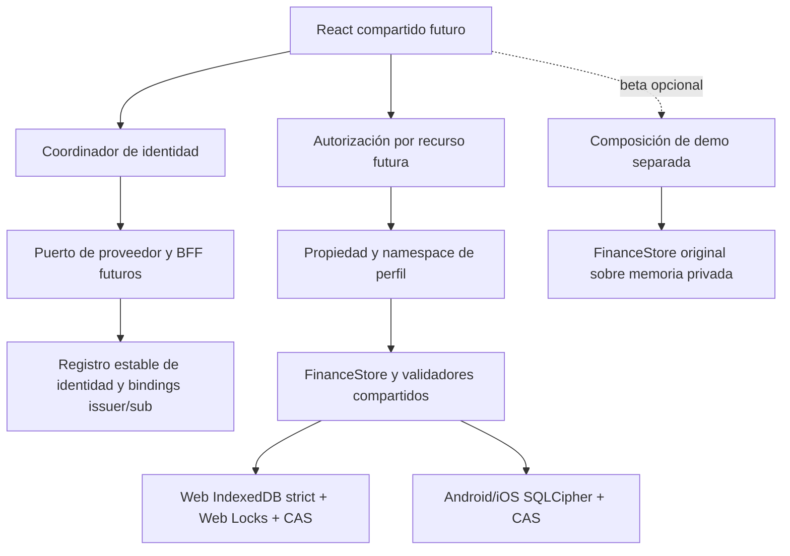

# Arquitectura de identidad y sesiones

## Separación de responsabilidades

Las líneas hacia proveedor/BFF/registro/autorización/propiedad son **diseño**, no infraestructura creada. `index.ts` crea sólo un coordinador sin proveedor; sus APIs de login responden PROVIDER_UNCONFIGURED. `testing/simulation.ts` inyecta un driver simulado, no se exporta por el entry de producto. El único estado `authenticated` ejecutable está marcado `simulation-only`. Ningún objeto JS, ID manual, correo o token decodificado puede autorizar finanzas: `realFinancialAccess` siempre deniega el acceso real, incluso con propietario coincidente (SERVER_AUTHORIZATION_REQUIRED).

| Concepto | Responsabilidad |
| --- | --- |
| Identidad | UUID de aplicación asignado por futuro servidor, con bindings únicos `(issuer,sub)`; estable ante cambios de correo/método |
| Sesión | Referencia opaca, tiempos, método y proyección; no propietario ni credenciales |
| Autorización | Comprobación en servidor de actor, recurso, acción, vigencia y necesidad de reauth |
| Propiedad | Envelope de perfil y revisión de binding, independiente del JSON financiero3.5 |
| Local/Remoto | Adaptadores y espacios separados; un login no crea ni migra un perfil |
| Sync | Protocolo7C de revisiones, idempotencia y recuperación, no un efecto de sesión |
| Demo | Datos ficticios en memoria, sin identidad, servidor financiero ni ID persistente de invitado |

## Modelo ejecutable

Estados: signed-out, initializing, authenticated(simulation-only), expired, revoked, error y isolated-demo(composición opcional). Cada lectura de sesión revisa expiración; no depende sólo de un temporizador o evento foreground. Revisión generacional y AbortSignal descartan respuestas antiguas después de logout local, revocación, cambio de identidad o cierre. Los consumidores reciben copias, no una proyección mutable interna. Cierre idempotente; callbacks tardíos no reabren un coordinador cerrado.

El driver simulado entrega sólo proyecciones de una lista de campos exacta. Se rechazan campos adicionales de password/accessToken/refreshToken/email y fechas/IDs inválidos. Los errores se convierten a códigos fijos, sin exponer mensajes del proveedor. Esto es higiene del contrato, **no validación criptográfica de identidad**. El adapter real necesitará SDK/servidor aprobado; un cliente malicioso controla su JS y DOM.

`clearLocalSession` elimina sólo la proyección local. No afirma revocar cookies o refresh tokens de un IdP inexistente. `markRevoked` modela un evento simulado;7A.2 deberá comprobar estado real con el proveedor/BFF. El driver real deberá tener peticiones acotadas, recuperación ante fallo y política de offline; no se implementan llamadas ni retry automático aquí.

## Correo y contraseña — diseño de7A.2

Registro mediante UI alojada o transporte de credenciales aprobado; verificación de correo antes de habilitar cuenta. Recuperación de contraseña con respuestas genéricas, límites de abuso, enlaces de un uso con caducidad y callbacks exactos. Cambios de correo/contraseña requieren reautenticación y política explícita de revocación. No guardar contraseñas en estado de sesión, logs, preferencias ni backups; su captura transitoria pertenece al proveedor/flujo, no al dominio financiero. No crear hashing o cifrado propio. Definir MFA, passkeys, recovery codes y soporte antes de prometer recuperación.

No elegir cuenta por correo coincidente, casing, alias o contacto encontrado en un backup. El correo es dato de contacto verificado por flujo, no clave de propiedad.

## Google y Apple — diseño de7A.2

Google: Authorization Code + PKCE S256 cuando corresponda, state/nonce, issuer/audience/firma/expiración y redirects exactos. Usar `sub` con issuer como binding; email/hd son atributos, no identidad ni prueba suficiente de linking. [OIDC oficial](https://developers.google.com/identity/openid-connect/openid-connect).

Apple: binding por issuer/sub, validación de código/nonce/audience/firma y reglas del IdP. Correo privado/relay no se equipara a un correo de otra conexión. Nombre/correo pueden no venir en logins posteriores; no deben ser obligatorios para recuperar el binding. Configurar remitentes del relay y separación de claves secretas de servidor, sujetos a autorización. Una transferencia de app/equipo puede requerir mapeos de identidad; no cambiar UUID de aplicación ni datos históricos por ello. [Apple/Firebase y relay](https://firebase.google.com/docs/auth/ios/apple), [Apple](https://developer.apple.com/sign-in-with-apple/).

Vinculación futura: sesión actual reautenticada + control de la segunda credencial + consentimiento explícito + desafío de un uso ligado a ambas identidades, caducidad y operationId. Transacción CAS sobre revisión de bindings y recibo auditado. Si la segunda identidad pertenece a otro UUID de aplicación, detener y revisar: enlazar métodos no fusiona automáticamente perfiles financieros. Nunca buscar/combinar cuentas sólo por email, aunque aparezca verificado.

## Web — propuesta, sin endpoints implementados

BFF de mismo origen sobre Express como candidato. El servidor valida IdP y mantiene credenciales; el navegador recibe cookie de sesión opaca HttpOnly+Secure, preferentemente `__Host-`, Path=/ y SameSite adecuado. CSRF en acciones con efectos, comprobación Origin/Referer conforme a SDK y tokens antifalsificación ligados a sesión. PKCE y state no sustituyen autorización por registro. No aceptar un header userId de cliente como autoridad.

Definir expiración absoluta/inactividad, rotación, revocación, reautenticación para operaciones sensibles y pérdida de respuesta. Un JWT todavía válido puede sobrevivir a revocar refresh: los servicios deben comprobar la política real de revocación y su ventana. No usar el reloj/estado UI como verificador de servidor. [Sesiones Supabase](https://supabase.com/docs/guides/auth/sessions), [cookies Firebase](https://firebase.google.com/docs/auth/admin/manage-cookies).

Apple puede devolver un callback POST entre sitios: una cookie Lax no se envía igual en ese flujo. Resolver con el SDK aprobado y estado de transacción de un uso; no relajar globalmente cookies financieras. Los secretos de cliente confidencial quedan exclusivamente en servidor. No añadir CORS indiscriminado ni confiar en que localhost/Capacitor autentica a una persona.

## Android/iOS — propuesta bloqueada hasta runtime

Navegador seguro del sistema/SDK mantenido; nunca OAuth dentro de un WebView arbitrario. Código + PKCE, state/nonce y callbacks con allowlist exacta. Preferir app links/universal links con dominio y appId aprobados y asociación verificable; no registrar todavía dominios ni el identificador provisional como producto real. Evitar secretos embebidos. La guía Capacitor es referencia, no prueba de que su versión concreta/SSO cumpla todos los requisitos actuales de Google/Apple. [RFC8252](https://www.rfc-editor.org/rfc/rfc8252.html), [Auth0 React+Capacitor](https://auth0.com/docs/quickstart/native/ionic-react).

Credenciales en almacenes OS apropiados, con alias y lifecycle separados de la clave SQLCipher. No usar localStorage, sessionStorage, IndexedDB financiero ni Preferences para contraseñas/bearers/refresh. Cerrar sesión no borra la base ni reemplaza una clave perdida. Al reanudar, revisar expiración/revocación antes de abrir un namespace real. No repetir ciegamente una operación cuya respuesta se perdió. Compilar o superar Chromium no valida sesiones, deep links, Keychain o Keystore reales; los bloqueos móviles continúan.
