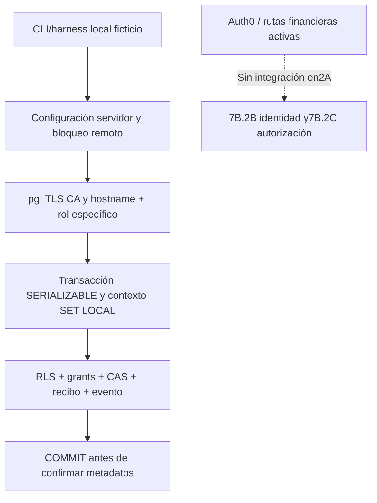

# Fronteras de seguridad y conexión

La sesión Auth0 y la autorización financiera no se conectan en esta fase. Los UUID de A/B los establece el harness confiable, no un navegador. withActor sólo debe recibir un actor resuelto por un servicio confiable futuro. Los IDs de petición no prueban identidad ni propiedad. La demo sigue deshabilitada y aislada; los bloqueos móviles/datos reales permanecen.

## Driver y TLS

Se elige pg8.23.1 oficial ([node-postgres](https://node-postgres.com/), [SSL](https://node-postgres.com/features/ssl), [pool](https://node-postgres.com/features/pooling), [transacciones](https://node-postgres.com/features/transactions)): TCP estándar compatible con PG18 y Node>=16; validado con Node24. No se introduce driver HTTP/WebSocket serverless ni un segundo sistema de autenticación. @types/pg es sólo de desarrollo. Se conserva el árbol anterior y se ejecuta npm audit completo, sin fix--force, overrides o exclusiones para esconder alertas; el resultado actual se publica en la PR.

Se exige rejectUnauthorized=true y checkServerIdentity contra el hostname configurado. Local requiere CA válida; remoto futuro usaría raíces públicas o CA administrada autorizada. Se aceptan sslmode=require/verify-full en URI pero se convierten a la política estricta propia, nunca a no-verify. Se rechazan parámetros arbitrarios, opciones SQL, sslrootcert inyectado, fragmentos, otras bases, usuarios de rol incorrectos, contraseñas reutilizadas entre roles o endpoints no admitidos.

pg.enableChannelBinding=true habilita SCRAM-PLUS cuando se ofrece, pero no equivale a libpq channel_binding=require. Por ello require y disable se rechazan, sin degradación silenciosa; sólo se admite prefer o ausencia de parámetro. Si se exige CB obligatorio, falta una solución oficial verificada antes de habilitar remoto; no se debe retirar un requisito de seguridad sin revisión. TLS verify-full permanece obligatorio en todos los casos. No usar rejectUnauthorized=false, sslmode=no-verify o NODE_TLS_REJECT_UNAUTHORIZED=0 para resolver errores.

[config/postgres.env.example](../../config/postgres.env.example) no contiene secretos ni valores operativos. Las URLs con contraseñas sólo viven en el proceso servidor/almacén secreto autorizado. No usar VITE_, frontend, logs, exportaciones o chat. DatabaseFailure elimina diagnósticos/DSN y sólo devuelve códigos cerrados; el pool no registra errores con credenciales. Las dependencias PG no se importan por entradas web/nativas. No hay apertura de conexión automática al cargar un módulo o cambiar idioma/tema.

## RLS y su límite real

El contexto se establece con set_config(...,true) después de BEGIN y se pierde al COMMIT/ROLLBACK. El pool no guarda actor en estado de sesión. Se prueban reutilización del mismo backend, rollback y contaminación A/B. Ausencia o UUID malformado produce actor NULL y denegación. Las políticas de escritura usan WITH CHECK; las de lectura se definen por separado.

**Un GUC no autentica a su emisor.** Quien controla el servidor o las credenciales runtime puede ejecutar SET LOCAL con otro UUID y acceder a ese ámbito. Hay una prueba real que demuestra este límite; no se presenta como resistencia a ese ataque. No exponer SQL/credenciales a clientes ni aceptar actor desde sus IDs. En2B se resolverán issuer/sub verificados y revocación persistente; en2C se integrarán los gates en las rutas. Una etiqueta de development tampoco prueba la rama Neon real.

RLS no impide acceso a un superusuario/BYPASSRLS o a un migrador que puede cambiar políticas. El administrador y migrador son confianza operativa separada, no credenciales de peticiones. En el clúster local neondb_owner es superusuario; **eso no equivale al administrador limitado de Neon**. Los privilegios Neon reales siguen sin verificar.

El runtime se valida por atributos, membresías (incluido SET ROLE aunque NOINHERIT), ownership de DB/esquemas/tablas/funciones, CREATE/TEMP y CREATE público. El wrapper verifica su identidad DB y privilegios al iniciar la transacción; ante drift falla cerrado. El bootstrap rechaza roles inseguros existentes y revierte su transacción, sin fingir que NOINHERIT basta. No resiste a un administrador comprometido que cambie reglas concurrentemente.

## Operaciones y límites

commitProfileMetadata sólo cambia una etiqueta/revisión de perfil ficticio, no documentos financieros. Valida campos exactos, deriva fingerprint SHA256 con actor/perfil/revisión/contenido y guarda recibo+evento en la misma transacción. Un replay coherente retorna el recibo confirmado; otra huella o CAS incompatible falla. SERIALIZABLE puede abortar con40001; no se reintenta automáticamente. Tras respuesta perdida se consulta recibo en transacción nueva, sin repetir ciegamente una operación. Esto no sustituye los recibos de IndexedDB o SQLCipher.

No se implementan transferencias de propietario, provisión vinculada a Auth0 ni revocación en vivo. No ejecutar mantenimiento que cambie titularidad durante operaciones activas: el protocolo completo de provisión/cambio/revocación y bloqueo de filas se revisará en2B/2C antes de habilitar datos reales. El motor financiero, sus importaciones y relaciones no cambian.
